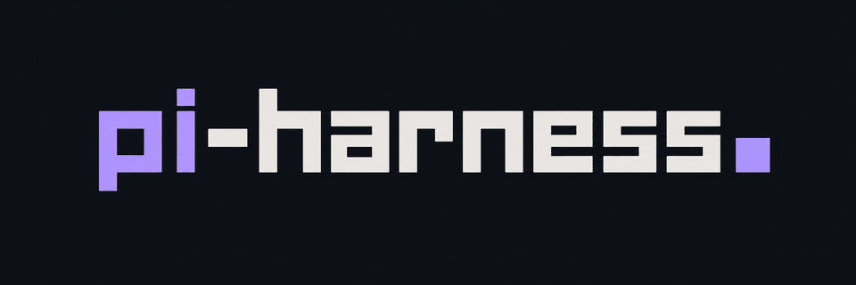
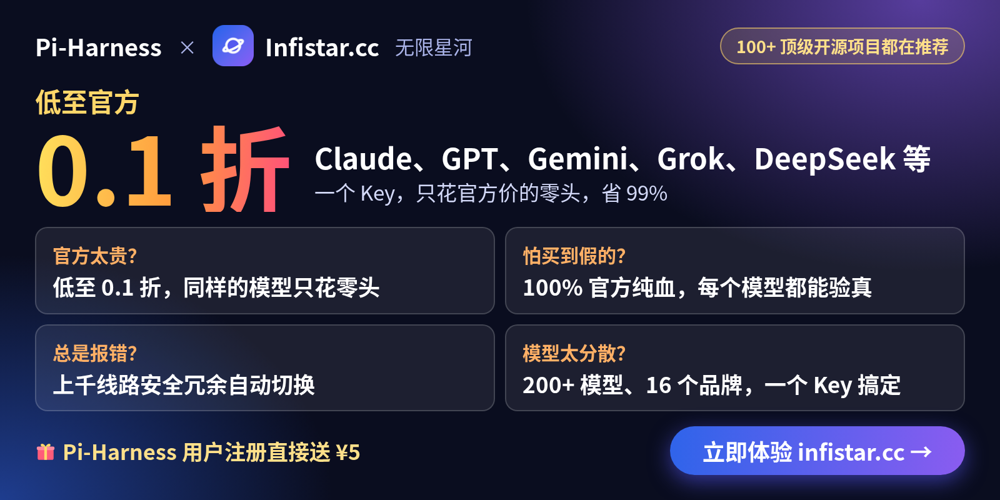
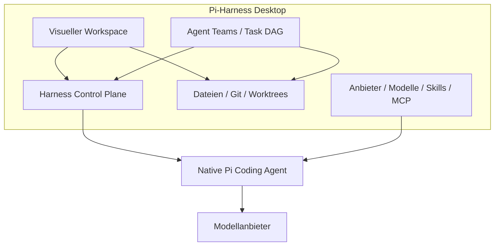
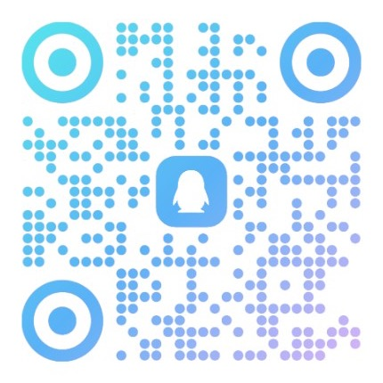

<div align="center">



### Das Operational Superset von Pi Coding Agent

**Native Pi-Agenten in einem Desktop-Workspace beobachten, steuern und koordinieren.**<br>
Pi führt weiterhin jeden Agenten aus. Pi-Harness ergänzt Workspace, Ausführungsverlauf, Wiederherstellung und Agenten-Teams,<br>
und deine Pi-Sitzungen, Konfiguration, Skills und Erweiterungen funktionieren in der App wie außerhalb weiter.

`Pi Coding Agent ⊂ Pi-Harness`

[](https://github.com/wangmiaozero/pi-harness/releases) [](https://github.com/wangmiaozero/pi-harness/stargazers) [](https://github.com/wangmiaozero/pi-harness/actions/workflows/ci.yml) [](LICENSE)<br>
  

**[Download](https://github.com/wangmiaozero/pi-harness/releases)** &nbsp;·&nbsp; **[Video](#watch)** &nbsp;·&nbsp; **[Funktionen](#features)** &nbsp;·&nbsp; **[Harness Plugins](#harness-plugins)** &nbsp;·&nbsp; **[Dokumentation](#documentation)** &nbsp;·&nbsp; **[Änderungsprotokoll](CHANGELOG.md)**

[English](README.md) · [简体中文](README.zh-CN.md) · [繁體中文](README.zh-TW.md) · [日本語](README.ja-JP.md) · [한국어](README.ko-KR.md) · [Русский](README.ru-RU.md) · [Français](README.fr-FR.md) · **Deutsch**

<br>


</div>

<br>

## 赞助商

<table>
  <tr>
    <td width="580" align="center" valign="middle">
        <a href="https://infistar.cc/register?aff=S26RFM4B&ref_source=link" style="color:transparent;background-color:transparent;text-decoration:none;border:none;"></a>
    </td>
    <td valign="middle">
      Pi-Harness × Infistar.cc 无限星河｜Claude、GPT、Gemini、Grok、DeepSeek 等，一个 Key，只花官方价的零头，省 99%；低至官方 0.1 折，100% 官方纯血，每个模型都能验真；上千线路安全冗余自动切换，200+ 模型、16 个品牌，一个 Key 搞定。<br>
      Pi-Harness 用户通过<a href="https://infistar.cc/register?aff=S26RFM4B&ref_source=link">专属链接</a>注册直接送人民币 5 元：<a href="https://infistar.cc/register?aff=S26RFM4B&ref_source=link">https://infistar.cc/register?aff=S26RFM4B&ref_source=link</a>
    </td>
  </tr>
  <tr>
    <td width="580" align="center" valign="middle">
        <a href="https://cloud.tencent.com/act/cps/redirect?redirect=6871&amp;cps_key=ece2099a1da90c2f7a4a4c437ad623f8&amp;from=console" style="color:transparent;background-color:transparent;text-decoration:none;border:none;"></a>
    </td>
    <td valign="middle">
      【腾讯云】WorkBuddy 全场景 AI 办公工作台，团队旗舰版低至198元/月<br>
      <a href="https://cloud.tencent.com/act/cps/redirect?redirect=6871&amp;cps_key=ece2099a1da90c2f7a4a4c437ad623f8&amp;from=console">https://cloud.tencent.com/act/cps/redirect?redirect=6871&amp;cps_key=ece2099a1da90c2f7a4a4c437ad623f8&amp;from=console</a>
    </td>
  </tr>
</table>

## Ist Pi-Harness das Richtige für dich?

[Pi Coding Agent](https://github.com/earendil-works/pi) funktioniert gut im Terminal. In echten Projekten willst du bald mehr: sehen, was jede Ausführung tatsächlich getan hat, zu einem guten Stand zurückkehren, wenn eine Ausführung schiefgeht, und größere Aufgaben auf mehrere Agenten verteilen. Pi-Harness bündelt das in einer Desktop-App, aufbauend auf demselben Pi:

- **Jede Ausführung sehen**: Runs, Trace, Replay und Evaluation zeigen Werkzeugaktivitäten, vergleichen Ergebnisse und helfen, Fehler anhand aufgezeichneter Daten zu untersuchen.
- **Arbeit wiederherstellbar halten**: Policy, Budget, Checkpoints und Recovery legen Werkzeugberechtigungen und Ausgabengrenzen fest, halten Wiederherstellungspunkte vor und ermöglichen Fortsetzen, Verzweigen oder Wiederholen.
- **Ein Team koordinieren**: Agent Teams, Task DAG und Worktrees verteilen abhängige Aufgaben, geben Ergebnisse zwischen Pi-Agenten weiter und halten die Änderungen jedes Agenten getrennt.
- **Bei Native Pi bleiben**: Pi übernimmt Agent Loop, Sitzungen, Kontext, Werkzeuge, Modelle und Denkprozesse. Pi-Harness verwaltet sie visuell, und du kannst Pi weiterhin außerhalb der App nutzen.

Pi-Harness passt zu dir, wenn du Pi in echten Projekten einsetzt und seine Arbeit aus einem Fenster heraus sehen, steuern und koordinieren willst. Wenn dir ein einzelner Chat im Terminal genügt, reicht Pi allein.

Läuft unter macOS, Windows und Linux. Die Community-Installer enthalten Pi und Node.js, du musst also vorher nichts weiter installieren.

<a id="watch"></a>

## Video

**Arbeitsmodus.** DeepSeek öffnet den Coding-Workspace. 13 Sekunden.

https://github.com/user-attachments/assets/942b73c9-ece9-485e-ad82-0e51225a73c1

**Willkommen zurück.** Die Begleiterin erscheint, die Workspace-Übersicht öffnet sich. 11 Sekunden.

https://github.com/user-attachments/assets/98708766-f490-4506-a33f-f1376d41770f

<a id="download"></a>
<a id="get-started"></a>

## Schnellstart

**1 · Installieren.** Lade den Installer für dein System von **[GitHub Releases](https://github.com/wangmiaozero/pi-harness/releases)** herunter:

| | |
| :-- | :-- |
| **macOS** | Die `.dmg` für Apple Silicon (`arm64`) oder Intel (`x64`). Öffnen und Pi-Harness in den Ordner „Programme“ ziehen |
| **Windows** | Der x64-Installer `.exe`. Ausführen und ein Installationsverzeichnis wählen |
| **Linux** | Das x64-`.AppImage`. Ausführbar machen und dann öffnen |

```sh
chmod +x "./Pi-Harness-VERSION.AppImage"   # VERSION durch die heruntergeladene Version ersetzen
./Pi-Harness-VERSION.AppImage
```

<sub>Die Installer enthalten Pi, Node.js, npm und npx: Du musst weder Pi noch Node.js installieren, dieses Repository klonen oder pnpm installieren. Die Release-Validierung umfasst macOS Apple Silicon, macOS Intel, Windows x64 und Linux x64; die geprüften Ergebnisse jedes Releases entscheiden, für welche Plattformen es erscheint. Die Linux-Validierung zielt auf Ubuntu 24.04; andere Distributionen sowie FUSE und Desktop-Integration erfordern eigene Prüfungen. Windows und Linux ARM64 sind Vorschauziele. Ältere Pakete können andere Anforderungen haben, beachte daher die Hinweise zur heruntergeladenen Version. macOS-Builds sind ad hoc signiert, Windows-Installer sind unsigniert: siehe <a href="#verify-your-download">Download prüfen</a>.</sub>

**2 · Umgebung prüfen.** Starte Pi-Harness und prüfe die Umgebung in der Übersicht.

**3 · Anbieter hinzufügen.** Richte einen Anbieter ein, teste die Verbindung und wähle ein Modell. Der Modellzugriff kann Zugangsdaten erfordern und Kosten beim Anbieter verursachen.

**4 · Loslegen.** Starte einen eigenständigen Chat oder öffne ein Projekt, starte oder setze dann eine Pi-Sitzung fort und arbeite mit Chats, Dateien und Git in einem Fenster. Öffne **Arbeitsbereich → Werkzeuge → Harness / Agenten**, um Ausführungen zu prüfen oder ein Team zu koordinieren.

<a id="verify-your-download"></a>

### Download prüfen

Community-Releases sind kostenlos. macOS-Pakete verwenden eine **Ad-hoc-Signatur ohne Apple Developer ID und ohne Notarisierung**. Windows-Installer sind **unsigniert** und können SmartScreen-Warnungen anzeigen. Prüfe die offizielle Downloadquelle und die Prüfsumme, bevor du das Öffnen der App erlaubst. Falls macOS den ersten Start blockiert, nutze für diese App **Systemeinstellungen → Datenschutz & Sicherheit → Dennoch öffnen**. Lass die Sicherheitsschutzfunktionen des Systems aktiviert.

Lade `SHA256SUMS` zusammen mit dem Installer herunter, berechne den Hash deiner Datei und vergleiche ihn mit demselben Dateinamen in der Liste (ersetze `VERSION` und die Architektur durch die Werte deines Downloads):

```sh
shasum -a 256 "Pi-Harness-VERSION-arm64.dmg"   # macOS
sha256sum "Pi-Harness-VERSION.AppImage"        # Linux
```

```powershell
Get-FileHash ".\Pi-Harness-Setup-VERSION.exe" -Algorithm SHA256   # Windows
```

<sub>SHA256 prüft die Übereinstimmung mit der Prüfsummenliste; die Identität des Herausgebers belegt es nicht für sich allein. Nutze die offizielle Seite <a href="https://github.com/wangmiaozero/pi-harness/releases">GitHub Releases</a> und melde vermutete Sicherheitslücken vertraulich an <a href="mailto:tuziling84@gmail.com">tuziling84@gmail.com</a>. Community-Builds suchen in der App nach neuen Versionen und öffnen auf allen Plattformen die Releases-Seite zum manuellen Herunterladen und Installieren. Die automatische Installation bleibt deaktiviert, bis die versionsübergreifende Installation geprüft ist; bestehende Installationen behalten ihr bisheriges Update-Verhalten. Siehe <a href="docs/release/community-release.md">Community Release</a> und <a href="docs/release/update-strategy.md">Details zu Updates</a>.</sub>

<a id="architecture"></a>

## Wie alles zusammenspielt

Pi verantwortet die Ausführung und die nativen Sitzungen. Harness beobachtet jede Ausführung und legt Richtlinien, Budgets, Checkpoints, Wiederherstellung und Evaluation darum. Agenten-Teams nutzen dieselbe Pi-Ausführungsumgebung. Gesprächsverlauf und Projektarchitektur sind Workspace-Werkzeuge, Themes passen das Aussehen an. Das Diagramm zeigt Modulbeziehungen, keine Klassenvererbung.



<a id="pi-vs-pi-harness"></a>

<details>
<summary><b>Native Pi und Pi-Harness</b>, Funktion für Funktion</summary>

<br>

| Funktion                 | Native Pi | Pi-Harness                   |
| ------------------------ | --------- | ---------------------------- |
| Agent Runtime            | Ja        | Native Pi                    |
| Agent Loop               | Ja        | Native Pi                    |
| Sessions                 | Ja        | Ja + visuelle Verwaltung     |
| Context                  | Ja        | Ja + Prüfung                 |
| Compaction               | Ja        | Ja + visuelle Steuerung      |
| Steering                 | Ja        | Ja                           |
| Follow-up                | Ja        | Ja                           |
| Models                   | Ja        | Ja + Verwaltung              |
| Thinking                 | Ja        | Ja + visuelle Steuerung      |
| Tools                    | Ja        | Ja + Auswahl und Richtlinien |
| Skills                   | Ja        | Ja + Verwaltung              |
| Extensions               | Ja        | Ja + Verwaltung              |
| Packages                 | Ja        | Ja + Verwaltung              |
| MCP / Codemode           | Ja        | Ja + Auswahl und Richtlinien |
| Runs                     | —         | Ja                           |
| Trace                    | —         | Ja                           |
| Replay                   | —         | Ja                           |
| Run Compare              | —         | Ja                           |
| Evaluation               | —         | Ja                           |
| Policy                   | —         | Ja                           |
| Budget                   | —         | Ja                           |
| Checkpoints              | —         | Ja                           |
| Recovery                 | —         | Ja                           |
| Diagnostics              | —         | Ja                           |
| Regression               | —         | Ja                           |
| Artifacts                | —         | Ja                           |
| Multi-Agent              | —         | Ja                           |
| Task DAG                 | —         | Ja                           |
| Handoff                  | —         | Ja                           |
| Review Gates             | —         | Ja                           |
| Worktree isolation       | —         | Ja                           |
| Project architecture map | —         | Ja                           |

</details>

<a id="features"></a>

## Funktionen

### Workspace, Dateien und Git

Starte einen eigenständigen Chat oder öffne ein Projekt und setze eine Pi-Sitzung fort. Verfolge Streaming-Antworten, Denkprozesse, Werkzeugaufrufe, Bilder und Dateiänderungen; wähle Modell, Denkstufe und Werkzeuge oder komprimiere den Gesprächskontext. Wenn du Harness oder Agenten über die Workspace-Werkzeuge öffnest, bleiben Chat und Entwurf erhalten.

Durchsuche Dateien, zeige Medien und Dokumente in der Vorschau an und bearbeite lesbaren Text mit Syntaxhervorhebung, Zeilennummern, Suche, Rückgängig/Wiederholen, ausdrücklichem Speichern und Schutz vor Konflikten durch externe Änderungen. Git bietet Diffs, Verlauf, Aktivitätsgrafiken, Commits, optionale KI-Commit-Nachrichten und Worktrees.

<table>
<tr>
<td width="50%"><br><sub>Einfache Dateibearbeitung</sub></td>
<td width="50%"><br><sub>Git</sub></td>
</tr>
</table>

<a id="harness"></a>

### Harness Control Plane

Jede Pi-Ausführung hinterlässt einen Datensatz, den du prüfen, vergleichen und zur Wiederherstellung nutzen kannst.

| | |
| :-- | :-- |
| **Beobachten** | Runs, Trace, Replay, Zeitleisten und Werkzeugaktivitäten. Vergleiche Ausführungen und verfolge Verzweigungen und Wiederholungen im Run Tree |
| **Messen** | Tokens, Kosten und Dauer jeder Ausführung sowie Artefakte und Projektstatistiken |
| **Steuern** | Werkzeugrichtlinien und Budgets pro Ausführung. Erstelle Checkpoints und setze Arbeit fort, verzweige sie oder wiederhole sie |
| **Prüfen** | Evaluation, Diagnostics und Regressionsbaselines prüfen Ergebnisse und helfen, Fehler anhand aufgezeichneter Ausführungsdaten zu untersuchen |

<table>
<tr>
<td width="50%"><br><sub>Sitzungsstatus und eingereihte Anweisungen</sub></td>
<td width="50%"><br><sub>Harness-Konsole</sub></td>
</tr>
</table>

<a id="multi-agent"></a>

### Multi-Agent-Orchestrierung

Öffne **Arbeitsbereich → Werkzeuge → Agenten**, um Pi-Agenten mit wiederverwendbaren Teams und Vorlagen zu koordinieren. Weise Aufgaben mit Abhängigkeiten und Prioritäten zu, plane sie manuell, nacheinander oder parallel, übergib Ergebnisse und Artefakte an die nächste Aufgabe und füge Prüfschritte hinzu. Worktrees halten die Änderungen jedes Agenten getrennt. Budgets, Konflikthinweise sowie Pause, Fortsetzen, Abbrechen, Wiederholen, Überspringen und Neuzuweisen helfen dir bei der Steuerung.

<table>
<tr>
<td width="50%"><br><sub>Beispielteam vor dem Start: drei inaktive Agenten, alle Aufgaben ausstehend</sub></td>
<td width="50%"><br><sub>Aufgabenabhängigkeiten und Prüfpflicht</sub></td>
</tr>
</table>

<a id="conversation-history"></a>

### Universeller Gesprächsverlauf

Durchsuche gemeinsam die Verläufe von Claude Code, Codex (einschließlich Desktop und archivierter Gespräche), Cursor, Cursor Agent, Gemini CLI, OpenCode und Pi. Suche, filtere nach Quelle, Projekt oder Zeitraum und füge eigene Verlaufsordner hinzu.

Öffne das ursprüngliche Gespräch schreibgeschützt, sieh dir die Übergabevorschau an und bearbeite die nächste Anweisung, bevor du in einem neuen Pi-Chat desselben Projekts fortfährst. Ansehen, lokale Vorschauen und erneute Scans verbrauchen keine Modell-Tokens; optionale KI-Zusammenfassungen verwenden dein konfiguriertes Modell nur auf Wunsch.

<table>
<tr>
<td width="50%"><br><sub>Gesprächsverlauf</sub></td>
<td width="50%"><br><sub>Sitzungsbereinigung</sub></td>
</tr>
</table>

<a id="project-architecture"></a>

### Projektarchitektur-Karte

Öffne Architecture im Workspace, um Module, Abhängigkeiten, Einstiegspunkte und Quellcode-Verweise zu erkunden. Filtere nach Paket, fokussiere ein Modul, blättere durch die Karte, zoome oder nutze den Vollbildmodus. Speichere Analyse-Snapshots, erkenne, wann Quellcodeänderungen sie veralten lassen, und exportiere JSON, Offline-HTML oder die aktuelle Ansicht als PNG.

| | |
| :-- | :-- |
| **Lokal zuerst** | Die Analyse läuft lokal und verbraucht keine Modell-Tokens; KI-Beschreibungen sind optional |
| **Abdeckung** | Importbeziehungen von JavaScript, TypeScript und Vue werden lokal analysiert; andere unterstützte Sprachen erhalten einen Dateiindex. Jede Analyse zeigt ihre Abdeckung und Grenzen |
| **Umfang** | Die Karten beschreiben unterstützte statische Abhängigkeiten; sie sind kein vollständiger Funktionsaufrufgraph |


<a id="providers-and-models"></a>
<a id="skills-extensions-packages-and-mcp"></a>

### Anbieter, Modelle und Skills

| | |
| :-- | :-- |
| **Anbieter** | Richte Pi-kompatible Anbieter mit Vorlagen oder eigenen Endpunkten ein, verwalte Zugangsdaten, lade Modelllisten, wo unterstützt, teste Verbindungen und wähle dein Chatmodell |
| **Bilder** | Nutze unterstützte Bildmodelle, um Bilder aus Text zu erzeugen oder zu bearbeiten, und lade die Ergebnisse herunter |
| **OpenCode Zen / Go** | Speichere im OpenCode-Tab unter Modelle deinen API-Schlüssel und aktiviere die gewünschten Modelle. Modelle werden automatisch geladen und lassen sich einzeln oder gemeinsam prüfen. Zugriff und Kosten hängen von deinem offiziellen Konto und dem Modell ab; eine kostenpflichtige Prüfung fragt vorher nach deiner Zustimmung. Preise und Datenrichtlinien findest du in den [Modellinformationen von OpenCode](https://opencode.ai/v2/docs/console/models/) |
| **Skills** | Durchsuche und bearbeite integrierte und lokale Skills. Gib `@` im Eingabefeld ein, um einen installierten Skill zu suchen und aufzurufen |
| **Pakete und Erweiterungen** | Verwalte Pi-Pakete und Erweiterungen unter Fähigkeiten. Optionale Ergänzungen wie [Superpowers](https://github.com/obra/superpowers) werden nur auf deinen Wunsch installiert, aktualisiert oder deinstalliert |

<table>
<tr>
<td width="50%"><br><sub>Anbieter und Modelle</sub></td>
<td width="50%"><br><sub>Fähigkeiten</sub></td>
</tr>
</table>

<a id="mcp-marketplace"></a>

### MCP-Server und Marktplatz

Öffne **Einstellungen → MCP**, um Server mit lokalem Startbefehl oder HTTP-Adresse hinzuzufügen, nach **Alle / Global / Projekt** zu filtern, ein Projekt zu wählen und jeden Server in seinem eigenen Bereich zu bearbeiten oder zu aktivieren. Durchsuche Konfigurationen anderer Werkzeuge und prüfe sie vor dem Import.

Der Marktplatz enthält **15 integrierte Servervorlagen**, darunter Memory, Context7, Playwright, Filesystem und GitHub, sowie Suche und Seitennavigation für die offizielle MCP-Registry. Prüfe Konfiguration und Zielbereich vor dem Speichern. Die Vorlagen stehen zur Installation bereit und sind nicht alle standardmäßig aktiviert. Importierte Einträge und Registry-Einträge werden deaktiviert gespeichert, damit du sie zuerst fertig einrichten kannst.


<a id="agent-settings"></a>

### Agenten-Einstellungen

**Ab v2.2.10 verfügbar.** Ob ein heruntergeladener Installer diese Einstellungen enthält, steht in den Versionshinweisen.

| Seite | Was du einstellst | |
| :-- | :-- | :-- |
| **AI** | Standard-Denkstufe, automatische Kontextkomprimierung, Wiederholungsverhalten und Workspace-Vorgaben | [Screenshot](docs/%E5%8A%9F%E8%83%BD%E7%95%8C%E9%9D%A2/%E7%BB%8F%E5%85%B8%E4%B8%BB%E9%A2%98/AI.png) |
| **Echtzeit-Sprache** | Sprachdienst und Konto für Anrufe im Workspace | [Screenshot](docs/%E5%8A%9F%E8%83%BD%E7%95%8C%E9%9D%A2/%E7%BB%8F%E5%85%B8%E4%B8%BB%E9%A2%98/%E5%AE%9E%E6%97%B6%E8%AF%AD%E9%9F%B3.png) |
| **Tastenkürzel** | Eigene Tastenkürzel für Befehlspalette, Einstellungen, neue Sitzungen und das Schließen von Tabs, oder die Standardwerte | [Screenshot](docs/%E5%8A%9F%E8%83%BD%E7%95%8C%E9%9D%A2/%E7%BB%8F%E5%85%B8%E4%B8%BB%E9%A2%98/%E5%BF%AB%E6%8D%B7%E9%94%AE.png) |
| **Anweisungen** | Globale oder projektbezogene Anweisungen | [Screenshot](docs/%E5%8A%9F%E8%83%BD%E7%95%8C%E9%9D%A2/%E7%BB%8F%E5%85%B8%E4%B8%BB%E9%A2%98/%E6%8C%87%E4%BB%A4.png) |
| **MCP** | MCP-Server in jedem Bereich | [Screenshot](docs/%E5%8A%9F%E8%83%BD%E7%95%8C%E9%9D%A2/%E7%BB%8F%E5%85%B8%E4%B8%BB%E9%A2%98/MCP%E6%9C%8D%E5%8A%A1%E5%99%A8.png) |
| **Unteragenten** | Wiederverwendbare Unteragenten mit Rolle, Anweisungen, Modell, Denkstufe und Werkzeugen. Wähle einen gemeinsamen Workspace oder einen isolierten Worktree und starte eine Aufgabe oder nutze die Vorlage in einem Team | [Screenshot](docs/%E5%8A%9F%E8%83%BD%E7%95%8C%E9%9D%A2/%E7%BB%8F%E5%85%B8%E4%B8%BB%E9%A2%98/%E5%AD%90%E6%99%BA%E8%83%BD%E4%BD%93.png) |
| **Remote-Hosts** | Hosts mit laufendem pi-host, gekoppelt über Adresse und Kopplungstoken | [Screenshot](docs/%E5%8A%9F%E8%83%BD%E7%95%8C%E9%9D%A2/%E7%BB%8F%E5%85%B8%E4%B8%BB%E9%A2%98/%E8%BF%9C%E7%A8%8B%E4%B8%BB%E6%9C%BA.png) |

<a id="realtime-voice"></a>

### Echtzeit-Sprache

Sprich mit deinem Workspace über **OpenAI Realtime, Gemini Live oder Codex Live**. Verwende ein unterstütztes Anbieterkonto oder einen eigenen API-Schlüssel; Codex Live nutzt deine bestehende Codex-Anmeldung in Pi. Verfügbarkeit und Kosten des Dienstes hängen von deinem Konto ab.

1. Öffne **Einstellungen → Echtzeit-Sprache**, aktiviere Sprache, wähle Dienst und Konto und speichere.
2. Klicke in einer Workspace-Unterhaltung auf die Wellenform-Schaltfläche neben dem Eingabefeld.
3. Prüfe die Zielunterhaltung und die optionale Kontextfreigabe, wähle **Echtzeit-Sprache starten** und erlaube den Mikrofonzugriff.
4. Schalte das Mikrofon stumm, sieh Transkripte an oder beende den Anruf über die schwebenden Bedienelemente, auch nach einem Seitenwechsel.

Das Teilen des letzten Gesprächskontexts ist standardmäßig aus. Wenn du es aktivierst, werden nur die letzten sechs reinen Textnachrichten ohne Anhänge und Werkzeugergebnisse geteilt. Arbeitsaufträge aus einem Anruf werden erst nach deiner Prüfung an die Arbeitsunterhaltung gesendet.


<a id="remote-hosts"></a>

### Remote-Hosts

Kopple unter **Einstellungen → Remote-Hosts** einen Host mit laufendem **pi-host** über seine Adresse und sein Kopplungstoken. Verbinde oder trenne Hosts, durchsuche ihre Projekte und Sitzungen, lies Unterhaltungen, sende Prompts und beantworte Genehmigungsanfragen. Der Remote-Host muss bereits laufen und erreichbar sein.

<a id="desktop-companion"></a>

### Desktop-Begleiter

Aktiviere ein installiertes Desktop-Tier unter **Einstellungen → Desktop-Haustier**, um Denkphasen, Werkzeugaktivität, Wartezustände und abgeschlossene Aufgaben auf dem Desktop zu verfolgen. Standardmäßig ist es deaktiviert; es bleibt verfügbar, wenn das Hauptfenster minimiert ist.

Im Leerlauf stehen 193 Aktionen in einem durchsuchbaren Kontextmenü bereit. Während Aufgaben laufen, pausieren manuelle Interaktionen; beim Verschieben bleibt die Arbeitsanimation erhalten. Lokale Haustierpakete lassen sich importieren, Größe, Deckkraft und Sprechblasen per Schieberegler anpassen.

<table>
<tr>
<td width="33%"><br><sub>Einstellungen und Schieberegler</sub></td>
<td width="33%"><br><sub>Kontextmenü</sub></td>
<td width="33%"><br><sub>Durchsuchbare Aktionen</sub></td>
</tr>
</table>

<a id="themes-and-custom-skins"></a>
<a id="screenshots"></a>

### Themes und eigene Skins

Wähle klassische Farbpaletten, Ming-Themes, Starship Cockpit, macOS-27-Hintergründe oder einen importierten eigenen Skin. Neue Installationen starten in **Weiches Hell**. Passe Chatnamen, App-Symbole, lokale Hintergrundbilder, Fenster- und Bildschirmleuchten sowie den Flammeneffekt des Eingabefelds an. Eine Startanimation begleitet die Umgebungsprüfung.

Figurendesigns und Desktop-Tiere sind optionale Pakete. Öffne **Einstellungen → Ressourcenmarkt**, um jeweils ein `@piharness`-Paket aus dem GitHub-Katalog zu installieren. Die App startet ohne Netzwerkverbindung. Ein zuvor gewähltes Design oder Tier bleibt ausgewählt, solange seine Dateien noch nicht installiert sind, und der Workspace nutzt das Grundaussehen, bis du das Paket installierst. Siehe [docs/market/MARKET.md](docs/market/MARKET.md).

**Erstelle deinen eigenen Skin** mit dem [Pi-Harness Skin-Starter](https://github.com/wangmiaozero/pi-harness-skin-starter):

1. Verwende das Starter-Repository als Vorlage oder lade es herunter.
2. Öffne es mit deinem Coding-Agenten und beschreibe den gewünschten Stil mit dem mitgelieferten Prompt.
3. Importiere das fertige Projekt unter **Einstellungen → Thema → Skin importieren**.

Der mehrsprachige Starter enthält Hinweise zu Farben, Vorschauen, Hintergründen und optionalen Charakterbildern. Bewahre deinen Skin in einem eigenen Repository auf, um ihn unabhängig zu aktualisieren und zu teilen.

<table>
<tr>
<td width="50%"><br><sub>Ming · Beamter im Schnee</sub></td>
<td width="50%"><br><sub>Ming · Flötenspielerin im Schnee</sub></td>
</tr>
<tr>
<td width="50%"><br><sub>Ming · Gelehrte im Mondlicht</sub></td>
<td width="50%"><br><sub>Starship Cockpit</sub></td>
</tr>
<tr>
<td width="50%"><br><sub>Ming · Allgemeine Einstellungen</sub></td>
<td width="50%"><br><sub>Ming · Theme- und Skin-Galerie</sub></td>
</tr>
<tr>
<td colspan="2"><br><sub>macOS 27 · Liquid Ether</sub></td>
</tr>
</table>

<a id="harness-plugins"></a>

### Harness Plugins

**Plugin SDK v1.0.0 · Enthalten ab Pi-Harness v2.2.6.** Plugins erweitern die Abläufe rund um den Agenten, ergänzend zu den Wegen, Pi selbst zu erweitern:

| Erweiterung | Zweck |
| :-- | :-- |
| **Pi Extensions** | Den Pi-Agenten selbst erweitern |
| **Skills** | Dem Agenten Anweisungen und Workflow-Wissen geben |
| **MCP** | Den Agenten mit Werkzeugen und externen Diensten verbinden |
| **Harness Plugins** | Die Abläufe von Pi-Harness rund um den Agenten erweitern |

Steuere **Harness Event Subscribers, Custom Evaluators, Trace Exporters und Agent Team Templates** bei. Auswertungen sind ergänzend, Exporte nutzen freigegebene JSON-Daten, und Teamvorlagen erstellen ausstehende Workflows, die du prüfst und selbst startest. Probiere die gepflegten SDK-Beispiele aus: [Run Metrics](examples/harness-plugins/run-metrics/plugin.json), [Quality Evaluator](examples/harness-plugins/quality-evaluator/plugin.json) und [Team Template](examples/harness-plugins/team-template/plugin.json).

Öffne in einem Build aus dem Quellcode **Arbeitsbereich → Werkzeuge → Harness → Harness Plugins → Install local plugin**, wähle den Plugin-Ordner, prüfe die Berechtigungen und aktiviere es. Die Installation führt keinen Code aus. Ausführbare Plugins erfordern eine ausdrückliche native Vertrauensfreigabe: **Der separate Prozess ist keine Sicherheitssandbox; freigegebener Node-Code kann auf deinen Computer zugreifen**. Verwende für nicht vertrauenswürdige Inhalte deklarative Vorlagen.

[Entwicklung und Installation](docs/plugins/getting-started.md) · [Architektur](docs/plugins/architecture.md) · [SDK API](docs/plugins/api-reference.md) · [Sicherheitsgrenzen](docs/plugins/security.md)

### Außerdem

- **Umgebungsprüfung**: Prüfe Node.js, npm, PATH, Pi Coding Agent und die aktive Konfiguration; installiere, aktualisiere oder repariere Pi in unterstützten Umgebungen, nutze Diagnosen und verwalte Konfigurationssicherungen.
- **Laufzeitumgebungen**: Die mitgelieferten Pi- und Node-Laufzeitumgebungen funktionieren sofort; in den Einstellungen stehen außerdem System- und benutzerdefinierte Laufzeitumgebungen zur Wahl.
- **App-Updates**: Suche direkt in der App nach neuen Versionen.
- **Acht Sprachen**: English, 简体中文, 繁體中文, 日本語, 한국어, Русский, Français und Deutsch.

<a id="documentation"></a>

## Dokumentation

| | |
| :-- | :-- |
| **[Leitfaden zu den Agenten-Einstellungen](docs/agent-settings.md)** | AI, Echtzeit-Sprache, Tastenkürzel, Anweisungen, MCP, Unteragenten und Remote-Hosts |
| **[Ressourcenmarkt](docs/market/MARKET.md)** | Theme- und Desktop-Tier-Pakete installieren |
| **[Harness Plugins](docs/plugins/getting-started.md)** | Plugins entwickeln und installieren; siehe auch [Architektur](docs/plugins/architecture.md), [SDK API](docs/plugins/api-reference.md) und [Sicherheitsgrenzen](docs/plugins/security.md) |
| **[Community Release](docs/release/community-release.md)** | Wie Community-Builds signiert, geprüft und [aktualisiert](docs/release/update-strategy.md) werden |
| **[Fehlerbehebung](docs/release/troubleshooting.md)** | Probleme mit Prüfsummen, Sicherheitswarnungen, Start und Updates |
| **[Screenshot-Verzeichnis](docs/README.md)** | Alle Oberflächen und Themes, nach Kategorie |
| **[Änderungsprotokoll](CHANGELOG.md)** | Was sich in jedem Release geändert hat |

## Entwicklung

Installiere **Node.js 24 LTS (≥ 24.22.1)** und **pnpm 9.12.1** und führe dann aus:

```sh
git clone https://github.com/wangmiaozero/pi-harness.git
cd pi-harness
pnpm install --frozen-lockfile
pnpm dev
```

<sub>Um ohne separate Pi-Installation zu entwickeln, nutze die Beispielkonfiguration in <a href="fixtures/README.md">fixtures</a>: Richte in den Einstellungen das manuelle Konfigurationsverzeichnis auf den absoluten Pfad von <code>fixtures/mock-pi</code> aus. Die Beispielkonfiguration bietet keinen echten Modellzugriff; richte bei Bedarf deinen eigenen Anbieter ein.</sub>

Führe vor dem Einreichen einer Änderung die Prüfungen aus. Bei Änderungen an zentralen Desktop-Abläufen führe zusätzlich `pnpm test:e2e` aus.

```sh
pnpm typecheck
pnpm lint
pnpm test
pnpm compile
```

## Community

- **[Issues](https://github.com/wangmiaozero/pi-harness/issues)**: Melde einen Fehler oder schlage eine Verbesserung vor. Gib App-Version, Betriebssystem und Schritte zur Reproduktion an und entferne Zugangsdaten und private Gesprächsinhalte.
- **[Pull Requests](https://github.com/wangmiaozero/pi-harness/pulls)**: Beschreibe das Problem, die für Nutzer sichtbare Änderung und deine Prüfergebnisse. Dokumentation, Übersetzungen, Themes und gezielte Korrekturen sind willkommen.
- **[Eigene Skins](https://github.com/wangmiaozero/pi-harness-skin-starter)**: Erstelle einen Skin und teile ihn.
- **QQ-Gruppe**: pi-harness · **1109717308**. Scanne den Code, um beizutreten.

<p align="center">
  
</p>

Wenn Pi-Harness dir die Arbeit mit Pi erleichtert, **hilft ein ⭐ anderen, es zu finden.**

<picture>
  <source media="(prefers-color-scheme: dark)" srcset="https://api.star-history.com/svg?repos=wangmiaozero/pi-harness&type=Date&theme=dark">
  
</picture>

## Danksagung

Pi-Harness baut auf den offiziellen Projekten [Pi Coding Agent und Pi Agent Harness](https://github.com/earendil-works/pi) auf. Erstellt und gepflegt von [wangmiao](https://github.com/wangmiaozero) · [tuziling84@gmail.com](mailto:tuziling84@gmail.com).

**PR-Mitwirkende**

<table>
  <tr>
    <td align="center">
      <br /><a href="https://github.com/HenryArch"><b>HenryArch</b></a><br />
      <a href="https://github.com/wangmiaozero/pi-harness/pull/8">PR #8</a>
    </td>
  </tr>
</table>

Pull Requests zur Verbesserung von Pi-Harness sind willkommen. Vielen Dank an alle, die das Projekt gemeinsam besser machen!

## Lizenz

[GNU Affero General Public License v3.0 only](LICENSE) (`AGPL-3.0-only`).

Copyright © 2026 [wangmiao](https://github.com/wangmiaozero).
