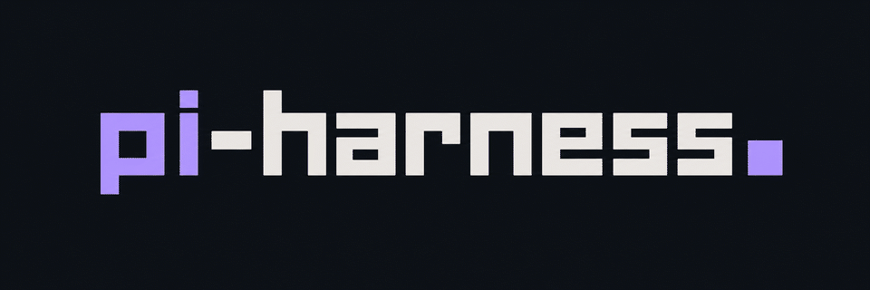
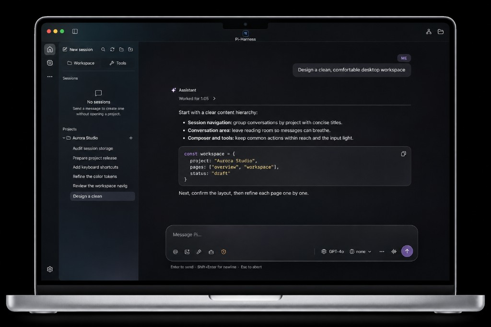
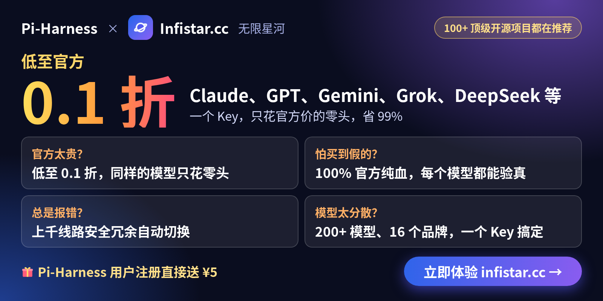
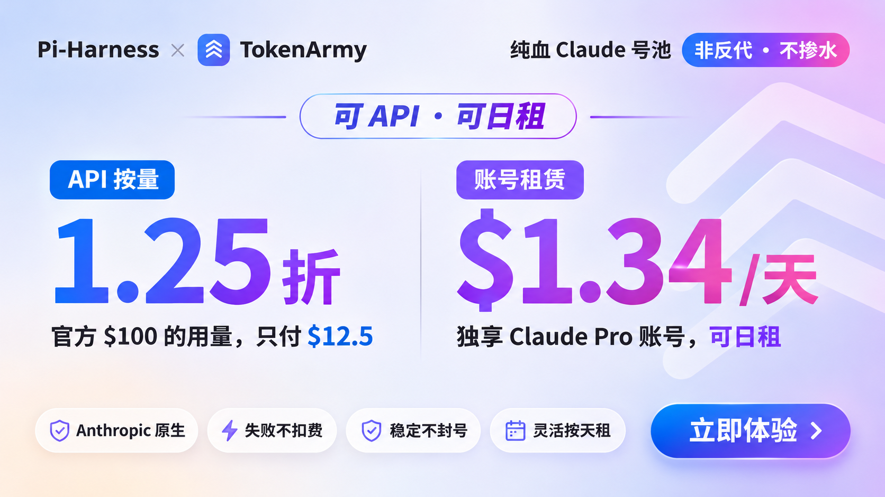
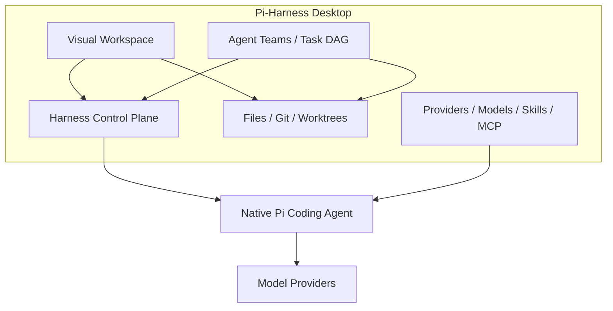

<div align="center">



### El superset operativo de Pi Coding Agent

**Observa, controla y orquesta agentes Pi nativos en un único espacio de trabajo de escritorio.**<br>
Pi sigue ejecutando cada agente. Pi-Harness añade a su alrededor el espacio de trabajo, el historial de ejecuciones, la recuperación y los equipos de agentes,<br>
y tus sesiones, configuración, Skills y extensiones de Pi siguen funcionando dentro y fuera de la aplicación.

`Pi Coding Agent ⊂ Pi-Harness`

[](https://github.com/wangmiaozero/pi-harness/releases) [](https://github.com/wangmiaozero/pi-harness/stargazers) [](https://github.com/wangmiaozero/pi-harness/actions/workflows/ci.yml) [](LICENSE)<br>
  

**[Descargar](https://github.com/wangmiaozero/pi-harness/releases)** &nbsp;·&nbsp; **[Demostración](#watch)** &nbsp;·&nbsp; **[Funciones](#features)** &nbsp;·&nbsp; **[Plugins de Harness](#harness-plugins)** &nbsp;·&nbsp; **[Documentación](#documentation)** &nbsp;·&nbsp; **[Registro de cambios](CHANGELOG.md)**

[English](README.md) · [简体中文](README.zh-CN.md) · [繁體中文](README.zh-TW.md) · [日本語](README.ja-JP.md) · [한국어](README.ko-KR.md) · [Русский](README.ru-RU.md) · [Français](README.fr-FR.md) · [Deutsch](README.de-DE.md) · **Español**

<br>



</div>

<br>

## Patrocinadores

<table>
  <tr>
    <td width="580" align="center" valign="middle">
        <a href="https://infistar.cc/register?aff=S26RFM4B&ref_source=link" style="color:transparent;background-color:transparent;text-decoration:none;border:none;"></a>
    </td>
    <td valign="middle">
      Pi-Harness × Infistar.cc 无限星河｜Claude、GPT、Gemini、Grok、DeepSeek 等，一个 Key，只花官方价的零头，省 99%；低至官方 0.1 折，100% 官方纯血，每个模型都能验真；上千线路安全冗余自动切换，200+ 模型、16 个品牌，一个 Key 搞定。<br>
      Pi-Harness 用户通过<a href="https://infistar.cc/register?aff=S26RFM4B&ref_source=link">专属链接</a>注册直接送人民币 5 元：<a href="https://infistar.cc/register?aff=S26RFM4B&ref_source=link">https://infistar.cc/register?aff=S26RFM4B&ref_source=link</a>
    </td>
  </tr>
  <tr>
    <td width="580" align="center" valign="middle">
        <a href="https://tokenarmy.shop/r/TA-7FBJU-NUSUC" style="color:transparent;background-color:transparent;text-decoration:none;border:none;"></a>
    </td>
    <td valign="middle">
      <strong>Pi-Harness × TokenArmy</strong><br>
      <strong>Claude Pro 日租</strong> · 独享账号，低至 $1.34/天，不封号<br>
      <strong>Claude API 按量计费</strong> · 低至官方价格 1.25 折，失败不扣费<br>
      <a href="https://tokenarmy.shop/r/TA-7FBJU-NUSUC">Pi-Harness 用户专属注册链接</a><br>
      <em>价格与服务以 TokenArmy 平台规则为准。</em>
    </td>
  </tr>
  <tr>
    <td width="580" align="center" valign="middle">
        <a href="https://cloud.tencent.com/act/cps/redirect?redirect=6871&amp;cps_key=ece2099a1da90c2f7a4a4c437ad623f8&amp;from=console" style="color:transparent;background-color:transparent;text-decoration:none;border:none;"></a>
    </td>
    <td valign="middle">
      【腾讯云】WorkBuddy 全场景 AI 办公工作台，团队旗舰版低至198元/月<br>
      <a href="https://cloud.tencent.com/act/cps/redirect?redirect=6871&amp;cps_key=ece2099a1da90c2f7a4a4c437ad623f8&amp;from=console">https://cloud.tencent.com/act/cps/redirect?redirect=6871&amp;cps_key=ece2099a1da90c2f7a4a4c437ad623f8&amp;from=console</a>
    </td>
  </tr>
</table>

## ¿Pi-Harness es para ti?

[Pi Coding Agent](https://github.com/earendil-works/pi) funciona bien en una terminal. En proyectos reales pronto quieres más: ver qué hizo realmente cada ejecución, volver a un estado correcto cuando algo sale mal y repartir un trabajo grande entre varios agentes. Pi-Harness reúne todo eso en una aplicación de escritorio, sobre el mismo Pi:

- **Ver cada ejecución**: Runs, Trace, Replay y Evaluation muestran la actividad de las herramientas, comparan resultados y permiten investigar fallos a partir de la evidencia registrada.
- **Mantener el trabajo recuperable**: Policy, Budget, Checkpoints y Recovery configuran permisos de herramientas y límites de gasto, guardan puntos de recuperación y permiten reanudar, bifurcar o reintentar.
- **Coordinar un equipo**: Agent Teams, Task DAG y Worktrees asignan tareas dependientes, pasan resultados entre agentes Pi y mantienen separados los cambios de cada agente.
- **Seguir en Pi nativo**: Pi ejecuta el bucle del agente, las sesiones, el contexto, las herramientas, los modelos y el razonamiento. Pi-Harness los gestiona visualmente, y puedes seguir usando Pi fuera de la aplicación.

Es para ti si usas Pi en proyectos reales y quieres ver, dirigir y coordinar su trabajo desde una sola ventana. Si un chat en la terminal es todo lo que necesitas, Pi por sí solo es suficiente.

Funciona en macOS, Windows y Linux. Los instaladores de la comunidad incluyen Pi y Node.js, así que no hay nada más que instalar antes.

<a id="watch"></a>

## Demostración

**Modo de trabajo.** DeepSeek abre directamente el espacio de trabajo de programación. 13 segundos.

https://github.com/user-attachments/assets/942b73c9-ece9-485e-ad82-0e51225a73c1

**De vuelta.** Aparece el compañero y se abre la vista general del espacio de trabajo. 11 segundos.

https://github.com/user-attachments/assets/98708766-f490-4506-a33f-f1376d41770f

<a id="download"></a>
<a id="get-started"></a>

## Inicio rápido

**1 · Instalar.** Descarga el instalador para tu sistema desde **[GitHub Releases](https://github.com/wangmiaozero/pi-harness/releases)**:

| | |
| :-- | :-- |
| **macOS** | El `.dmg` para Apple Silicon (`arm64`) o Intel (`x64`). Ábrelo y arrastra Pi-Harness a Aplicaciones |
| **Windows** | El instalador `.exe` para x64. Ejecútalo y elige un directorio de instalación |
| **Linux** | El `.AppImage` para x64. Hazlo ejecutable y ábrelo |

```sh
chmod +x "./Pi-Harness-VERSION.AppImage"   # sustituye VERSION por la versión descargada
./Pi-Harness-VERSION.AppImage
```

<sub>Los instaladores incluyen Pi, Node.js, npm y npx: no necesitas instalar Pi ni Node.js, clonar este repositorio ni instalar pnpm. La validación de la versión cubre macOS Apple Silicon, macOS Intel, Windows x64 y Linux x64, y los resultados verificados de cada versión deciden para qué plataformas se publica. La validación de Linux se dirige a Ubuntu 24.04; otras distribuciones y la integración con FUSE o el escritorio necesitan sus propias comprobaciones. Windows y Linux ARM64 son objetivos de vista previa. Los paquetes antiguos pueden tener requisitos distintos, así que sigue las notas de la versión que descargues. Las compilaciones de macOS están firmadas ad-hoc y los instaladores de Windows no están firmados: consulta <a href="#verify-your-download">Verificar la descarga</a>.</sub>

**2 · Comprobar el entorno.** Abre Pi-Harness y revisa el entorno en Overview (vista general).

**3 · Elegir un modelo.** Abre **Free Models** en el selector de modelos del chat para probar Kilo. Para usar tu suscripción de ChatGPT, abre **Models → New provider → ChatGPT** e inicia sesión desde el navegador. También puedes configurar un proveedor con una clave de API.

**4 · Empezar a trabajar.** Inicia un chat independiente o abre un proyecto, y luego inicia o reanuda una sesión de Pi y trabaja con conversaciones, archivos y Git en una sola ventana. Abre **Workspace → Tools → Harness / Agents** para inspeccionar ejecuciones o coordinar un equipo.

<a id="verify-your-download"></a>

### Verificar la descarga

Las versiones de la comunidad son gratuitas. Los paquetes de macOS usan **firma ad-hoc, sin Apple Developer ID ni notarización**. Los instaladores de Windows **no están firmados** y pueden mostrar avisos de SmartScreen. Verifica el origen oficial de la descarga y el checksum antes de permitir que la aplicación se abra. Si macOS bloquea el primer arranque, usa **Ajustes del Sistema → Privacidad y Seguridad → Abrir de todos modos** para esa aplicación. Mantén activadas las protecciones de seguridad del sistema.

Descarga `SHA256SUMS` junto con el instalador, calcula el hash de tu archivo y compáralo con el mismo nombre de archivo en la lista (sustituye `VERSION` y la arquitectura por los valores de tu descarga):

```sh
shasum -a 256 "Pi-Harness-VERSION-arm64.dmg"   # macOS
sha256sum "Pi-Harness-VERSION.AppImage"        # Linux
```

```powershell
Get-FileHash ".\Pi-Harness-Setup-VERSION.exe" -Algorithm SHA256   # Windows
```

<sub>SHA256 comprueba la coherencia con la lista de checksums; no demuestra por sí mismo la identidad del editor. Usa la página oficial de <a href="https://github.com/wangmiaozero/pi-harness/releases">GitHub Releases</a> y comunica de forma privada cualquier vulnerabilidad sospechada a <a href="mailto:tuziling84@gmail.com">tuziling84@gmail.com</a>. Las compilaciones de la comunidad buscan nuevas versiones dentro de la aplicación y abren la página de Releases para descargar e instalar manualmente en todas las plataformas. La instalación automática permanece desactivada hasta que se verifique la instalación entre versiones, y las instalaciones existentes mantienen su comportamiento de actualización anterior. Consulta <a href="docs/release/community-release.md">Community Release</a> y <a href="docs/release/update-strategy.md">los detalles de actualización</a>.</sub>

<a id="architecture"></a>

## Cómo encaja todo

Pi es dueño de la ejecución y de las sesiones nativas. Harness observa cada ejecución y aplica a su alrededor políticas, presupuestos, checkpoints, recuperación y evaluación. Los equipos de agentes usan el mismo motor de ejecución de Pi. El historial de conversaciones y la arquitectura del proyecto son herramientas del espacio de trabajo, y los temas personalizan el aspecto. El diagrama muestra relaciones entre módulos, no herencia de clases.



<a id="pi-vs-pi-harness"></a>

<details open>
<summary><b>Pi nativo y Pi-Harness</b>, capacidad por capacidad</summary>

<br>

| Capacidad                | Pi nativo | Pi-Harness                 |
| ------------------------ | --------- | -------------------------- |
| Agent Runtime            | Sí        | Pi nativo                  |
| Agent Loop               | Sí        | Pi nativo                  |
| Sessions                 | Sí        | Sí + gestión visual        |
| Context                  | Sí        | Sí + inspección            |
| Compaction               | Sí        | Sí + control visual        |
| Steering                 | Sí        | Sí                         |
| Follow-up                | Sí        | Sí                         |
| Models                   | Sí        | Sí + gestor                |
| Thinking                 | Sí        | Sí + control visual        |
| Tools                    | Sí        | Sí + selección y política  |
| Skills                   | Sí        | Sí + gestor                |
| Extensions               | Sí        | Sí + gestor                |
| Packages                 | Sí        | Sí + gestor                |
| MCP / Codemode           | Sí        | Sí + selección y política  |
| Runs                     | —         | Sí                         |
| Trace                    | —         | Sí                         |
| Replay                   | —         | Sí                         |
| Run Compare              | —         | Sí                         |
| Evaluation               | —         | Sí                         |
| Policy                   | —         | Sí                         |
| Budget                   | —         | Sí                         |
| Checkpoints              | —         | Sí                         |
| Recovery                 | —         | Sí                         |
| Diagnostics              | —         | Sí                         |
| Regression               | —         | Sí                         |
| Artifacts                | —         | Sí                         |
| Multi-Agent              | —         | Sí                         |
| Task DAG                 | —         | Sí                         |
| Handoff                  | —         | Sí                         |
| Review Gates             | —         | Sí                         |
| Worktree isolation       | —         | Sí                         |
| Project architecture map | —         | Sí                         |

</details>

<a id="features"></a>

## Qué hace

### Espacio de trabajo, archivos y Git

Inicia un chat independiente, o abre un proyecto y reanuda una sesión de Pi. Sigue las respuestas en streaming, el razonamiento, las llamadas a herramientas, las imágenes y los archivos modificados; elige el modelo, el nivel de razonamiento y las herramientas, o compacta la conversación. Abrir Harness o Agents desde Workspace Tools conserva tu conversación y tu borrador. Cada conversación recuerda su selección de herramientas.

Explora y busca archivos, previsualiza medios y documentos, y edita texto legible con resaltado de sintaxis, números de línea, búsqueda, deshacer/rehacer, guardado explícito y protección frente a conflictos con cambios externos. Git te ofrece diffs, historial, gráficos de actividad, commits, mensajes de commit con IA opcional y worktrees.

<table>
<tr>
<td width="50%"><br><sub>Edición de archivos ligera</sub></td>
<td width="50%"><br><sub>Git</sub></td>
</tr>
</table>

<a id="harness"></a>

### Plano de control de Harness

Cada ejecución de Pi deja un registro que puedes inspeccionar, comparar y recuperar.

| | |
| :-- | :-- |
| **Observar** | Runs, Trace, Replay, líneas de tiempo y actividad de herramientas. Compara ejecuciones y sigue bifurcaciones y reintentos en el Run Tree |
| **Medir** | Tokens, coste y duración de cada ejecución, además de artefactos y estadísticas del proyecto |
| **Controlar** | Políticas de herramientas y presupuestos por ejecución. Crea checkpoints y luego reanuda, bifurca o reintenta el trabajo |
| **Comprobar** | Evaluation, Diagnostics y líneas base de regresión comprueban resultados e investigan fallos a partir de la evidencia registrada |

<table>
<tr>
<td width="50%"><br><sub>Estado de la sesión e instrucciones en cola</sub></td>
<td width="50%"><br><sub>Consola de Harness</sub></td>
</tr>
</table>

<a id="multi-agent"></a>

### Orquestación multiagente

Abre **Workspace → Tools → Agents** para coordinar agentes Pi con equipos y plantillas reutilizables. Asigna tareas con dependencias y prioridades, prográmalas de forma manual, secuencial o en paralelo, pasa resultados y artefactos a la siguiente tarea y añade puertas de revisión. Los worktrees mantienen separados los cambios de cada agente. Presupuestos, avisos de conflicto y controles de pausar, reanudar, abortar, reintentar, omitir y reasignar te ayudan a gestionar el trabajo.

<table>
<tr>
<td width="50%"><br><sub>Un equipo de ejemplo antes de ejecutar: tres agentes inactivos, todas las tareas pendientes</sub></td>
<td width="50%"><br><sub>Dependencias de tareas y requisito de revisión</sub></td>
</tr>
</table>

<a id="conversation-history"></a>

### Historial universal de conversaciones

Explora juntos los historiales de Claude Code, Codex (incluidas conversaciones de escritorio y archivadas), Cursor, Cursor Agent, Gemini CLI, OpenCode y Pi. Busca, filtra por origen, proyecto o intervalo de fechas y añade carpetas de historial personalizadas.

Abre la conversación original en solo lectura, previsualiza un traspaso y edita la siguiente instrucción antes de continuar en un nuevo chat de Pi bajo el mismo proyecto. La exploración, las vistas previas locales y los reintentos de escaneo no consumen tokens del modelo; los resúmenes con IA opcionales usan tu modelo configurado solo cuando los solicitas.

<table>
<tr>
<td width="50%"><br><sub>Historial de conversaciones</sub></td>
<td width="50%"><br><sub>Limpieza de sesiones</sub></td>
</tr>
</table>

<a id="project-architecture"></a>

### Mapa de arquitectura del proyecto

Abre Architecture en Workspace para explorar módulos, dependencias, puntos de entrada y referencias del código. Filtra por paquete, céntrate en un módulo, pagina el mapa, haz zoom o pasa a pantalla completa. Guarda instantáneas del análisis, comprueba cuándo los cambios del código las dejan obsoletas y exporta JSON, HTML sin conexión o la vista actual como PNG.

| | |
| :-- | :-- |
| **Local primero** | El análisis se ejecuta en local y no consume tokens del modelo; las descripciones con IA son opcionales |
| **Cobertura** | Las importaciones de JavaScript, TypeScript y Vue se analizan en local; otros lenguajes compatibles obtienen un índice por archivo. Cada análisis muestra su cobertura y sus límites |
| **Alcance** | Los mapas describen dependencias estáticas compatibles; no son un grafo completo de llamadas entre funciones |


<a id="providers-and-models"></a>
<a id="skills-extensions-packages-and-mcp"></a>

### Proveedores, modelos y Skills

| | |
| :-- | :-- |
| **Proveedores** | Configura proveedores compatibles con Pi mediante presets o endpoints personalizados, gestiona credenciales, descubre modelos donde esté soportado, prueba conexiones y elige el modelo de chat. La pestaña Providers incluye accesos directos para ChatGPT, Claude, Gemini y la pasarela local. Activa **Gateway** en la lista de proveedores cuando un proveedor no pueda usar herramientas y razonamiento a la vez. Las pruebas de conexión fallidas explican la causa y qué probar, y el proxy automático usa también el proxy configurado en tu shell. |
| **Iniciar sesión con ChatGPT** | Conecta tu suscripción de ChatGPT en el navegador y elige sus modelos en el chat. Gestiona cada cuenta de Codex conectada junto a los proveedores de API, consulta su cuota restante y usa una tarjeta de restablecimiento cuando esté disponible. Activa **⚡ Fast** en la fila de razonamiento del selector de modelos para respuestas más rápidas en los modelos GPT compatibles. |
| **Modelos, uso y cuota** | Filtra los modelos configurados por proveedor, elige el modelo predeterminado y revisa las solicitudes registradas y el uso de tokens. La página de uso también muestra los saldos de API disponibles y las cuotas de suscripción. Elige qué modelos aparecen en el selector de modelos del chat con **Shown**, o usa **Show latest models** para quedarte solo con los modelos más recientes de cada proveedor. |
| **Free Models** | Elige un modelo Kilo directamente en el selector de modelos del chat. No se requiere cuenta ni clave de API. La disponibilidad y los límites dependen de Kilo. La primera selección muestra un aviso de privacidad. |
| **Imágenes** | Usa modelos de imagen compatibles para texto a imagen o edición de imágenes, y luego descarga los resultados |
| **Skills** | Explora Skills integradas y locales, y edítalas. Escribe `@` en el compositor para buscar e invocar una Skill instalada |
| **Paquetes y extensiones** | Gestiona paquetes y extensiones de Pi desde Capabilities. Los complementos opcionales como [Superpowers](https://github.com/obra/superpowers) solo se instalan, actualizan o desinstalan cuando tú lo decides |

<table>
<tr>
<td width="50%"><br><sub>Proveedores y modelos</sub></td>
<td width="50%"><br><sub>Capacidades</sub></td>
</tr>
<tr>
<td width="50%"><br><sub>Iniciar sesión con ChatGPT</sub></td>
<td width="50%"><br><sub>Free Models</sub></td>
</tr>
</table>

<a id="mcp-marketplace"></a>

### Servidores MCP y marketplace

Abre **Settings → MCP** para añadir servidores de comando local o HTTP, filtrar por **All / Global / Project**, elegir un proyecto y editar o activar cada servidor en su propio ámbito. Escanea configuraciones de otras herramientas y revísalas antes de importarlas.

El marketplace incluye **15 plantillas de servidor integradas**, entre ellas Memory, Context7, Playwright, Filesystem y GitHub, además de búsqueda y paginación para el registro oficial de MCP. Previsualiza la configuración y el destino antes de guardar. Las plantillas existen para instalarlas; no todas están activadas por defecto. Las entradas importadas y del registro se guardan desactivadas, para que puedas terminar de configurarlas primero.


<a id="agent-settings"></a>

### Ajustes del agente

**Disponible en v2.2.10 y posteriores.** Consulta las notas de la versión para saber si está disponible en los instaladores descargados.

| Página | Qué configures | |
| :-- | :-- | :-- |
| **AI** | Razonamiento predeterminado, compactación automática, comportamiento de reintentos y preferencias del espacio de trabajo | [Captura](docs/%E5%8A%9F%E8%83%BD%E7%95%8C%E9%9D%A2/%E7%BB%8F%E5%85%B8%E4%B8%BB%E9%A2%98/AI.png) |
| **Realtime voice** | El servicio de voz y la cuenta para las llamadas del espacio de trabajo | [Captura](docs/%E5%8A%9F%E8%83%BD%E7%95%8C%E9%9D%A2/%E7%BB%8F%E5%85%B8%E4%B8%BB%E9%A2%98/%E5%AE%9E%E6%97%B6%E8%AF%AD%E9%9F%B3.png) |
| **Shortcuts** | Tus propios atajos para la paleta de comandos, los ajustes, las sesiones nuevas y el cierre de pestañas, o los predeterminados | [Captura](docs/%E5%8A%9F%E8%83%BD%E7%95%8C%E9%9D%A2/%E7%BB%8F%E5%85%B8%E4%B8%BB%E9%A2%98/%E5%BF%AB%E6%8D%B7%E9%94%AE.png) |
| **Instructions** | Instrucciones globales o de proyecto | [Captura](docs/%E5%8A%9F%E8%83%BD%E7%95%8C%E9%9D%A2/%E7%BB%8F%E5%85%B8%E4%B8%BB%E9%A2%98/%E6%8C%87%E4%BB%A4.png) |
| **MCP** | Servidores MCP en cada ámbito | [Captura](docs/%E5%8A%9F%E8%83%BD%E7%95%8C%E9%9D%A2/%E7%BB%8F%E5%85%B8%E4%B8%BB%E9%A2%98/MCP%E6%9C%8D%E5%8A%A1%E5%99%A8.png) |
| **Subagents** | Subagentes reutilizables con un rol, instrucciones, modelo, nivel de razonamiento y herramientas. Elige un espacio de trabajo compartido o un worktree aislado, y luego inicia una tarea o reutiliza la plantilla en un equipo | [Captura](docs/%E5%8A%9F%E8%83%BD%E7%95%8C%E9%9D%A2/%E7%BB%8F%E5%85%B8%E4%B8%BB%E9%A2%98/%E5%AD%90%E6%99%BA%E8%83%BD%E4%BD%93.png) |
| **Remote hosts** | Hosts que ejecutan pi-host, emparejados con una dirección y un token de emparejamiento | [Captura](docs/%E5%8A%9F%E8%83%BD%E7%95%8C%E9%9D%A2/%E7%BB%8F%E5%85%B8%E4%B8%BB%E9%A2%98/%E8%BF%9C%E7%A8%8B%E4%B8%BB%E6%9C%BA.png) |

<a id="realtime-voice"></a>

### Voz en tiempo real

Habla con tu espacio de trabajo usando **OpenAI Realtime, Gemini Live o Codex Live**. Usa una cuenta de proveedor compatible o una clave de API aparte; Codex Live reutiliza tu sesión de Codex ya existente en Pi. La disponibilidad del servicio y los cargos dependen de tu cuenta.

1. Abre **Settings → Realtime voice**, activa la voz, elige el servicio y la cuenta, y guarda.
2. En una conversación del espacio de trabajo, pulsa el botón de forma de onda junto al compositor.
3. Revisa la conversación de destino y el uso compartido de contexto opcional, selecciona **Start realtime voice** y permite el acceso al micrófono.
4. Silencia, consulta las transcripciones o finaliza la llamada desde los controles flotantes, incluso después de cambiar de página.

Compartir el contexto reciente está desactivado por defecto. Si lo activas, incluye solo los últimos seis mensajes de texto sin formato, sin adjuntos ni resultados de herramientas. Las solicitudes de trabajo que llegan de una llamada se envían a la conversación de trabajo solo después de que las revises.


<a id="remote-hosts"></a>

### Hosts remotos

Empareja un host que ejecute **pi-host** desde **Settings → Remote hosts** con su dirección y token de emparejamiento. Conecta o desconecta hosts, explora sus proyectos y sesiones, consulta conversaciones, envía prompts y responde a solicitudes de aprobación. El host remoto debe estar ya en ejecución y ser accesible.

<a id="desktop-companion"></a>

### Compañero de escritorio

Activa una mascota de escritorio instalada en **Settings → Desktop Pet** para ver el razonamiento, la actividad de herramientas, la espera y la finalización en tu escritorio. Está desactivada por defecto y sigue disponible cuando la ventana principal está minimizada.

Cuando está inactiva, elige entre 193 acciones en un menú contextual con búsqueda. Durante las tareas, las interacciones manuales se pausan y arrastrarla mantiene la animación de la tarea. Importa paquetes de mascotas locales y ajusta tamaño, opacidad y burbujas con deslizadores.

<table>
<tr>
<td width="33%"><br><sub>Ajustes y deslizadores</sub></td>
<td width="33%"><br><sub>Menú contextual</sub></td>
<td width="33%"><br><sub>Acciones con búsqueda</sub></td>
</tr>
</table>

<a id="themes-and-custom-skins"></a>
<a id="screenshots"></a>

### Temas y máscaras personalizadas

Elige paletas clásicas, temas Ming, Starship Cockpit, fondos de macOS 27 o una máscara personalizada importada. Las instalaciones nuevas empiezan con **Soft Light**. Personaliza los nombres de visualización del chat, los iconos de la aplicación, las imágenes de fondo locales, el brillo de ventana y pantalla, y el efecto de llama del campo de entrada. Una animación de arranque acompaña la comprobación del entorno.

Los temas de personajes y las mascotas de escritorio son paquetes opcionales. Abre **Settings → Resource Market** para instalar un paquete `@piharness` a la vez desde el catálogo de GitHub. La aplicación se inicia sin conexión de red. Un tema o mascota seleccionado previamente se conserva mientras sus archivos aún no están instalados, y el espacio de trabajo usa la apariencia base hasta que instales ese paquete. Consulta [docs/market/MARKET.md](docs/market/MARKET.md).

**Crea tu propia máscara** con el [Pi-Harness Custom Skin Starter](https://github.com/wangmiaozero/pi-harness-skin-starter):

1. Usa el repositorio starter como plantilla, o descárgalo.
2. Ábrelo con tu agente de programación y describe el estilo que quieres con el prompt incluido.
3. Importa el proyecto terminado desde **Settings → Theme → Import Skin**.

El starter multilingüe incluye guía sobre colores, vistas previas, fondos de pantalla y ilustraciones de personajes opcionales. Mantén tu máscara en su propio repositorio para actualizarla y compartirla de forma independiente.

<table>
<tr>
<td width="50%"><br><sub>Ming · Snowbound official</sub></td>
<td width="50%"><br><sub>Ming · Snow flute scholar</sub></td>
</tr>
<tr>
<td width="50%"><br><sub>Ming · Moon scholar</sub></td>
<td width="50%"><br><sub>Starship Cockpit</sub></td>
</tr>
<tr>
<td width="50%"><br><sub>Ming · Ajustes generales</sub></td>
<td width="50%"><br><sub>Ming · Galería de temas y máscaras</sub></td>
</tr>
<tr>
<td colspan="2"><br><sub>macOS 27 · Liquid Ether</sub></td>
</tr>
</table>

<a id="harness-plugins"></a>

### Plugins de Harness

**Plugin SDK v1.0.0 · Incluido a partir de Pi-Harness v2.2.6.** Los plugins amplían las operaciones que rodean al agente, junto a las formas en que Pi se amplía a sí mismo:

| Extensión | Propósito |
| :-- | :-- |
| **Pi Extensions** | Amplían el propio agente Pi |
| **Skills** | Dan al agente instrucciones y conocimiento de flujos de trabajo |
| **MCP** | Conectan el agente a herramientas y servicios externos |
| **Harness Plugins** | Amplían las operaciones de Pi-Harness alrededor del agente |

Contribuye con **suscriptores de eventos de Harness, evaluadores personalizados, exportadores de Trace y plantillas de equipos de agentes**. Las evaluaciones son complementarias, las exportaciones usan datos JSON autorizados y las plantillas de equipo crean flujos de trabajo pendientes para que los inspecciones y los inicies. Prueba los ejemplos mantenidos del SDK: [Run Metrics](examples/harness-plugins/run-metrics/plugin.json), [Quality Evaluator](examples/harness-plugins/quality-evaluator/plugin.json) y [Team Template](examples/harness-plugins/team-template/plugin.json).

En una compilación desde código fuente, abre **Workspace → Tools → Harness → Harness Plugins → Install local plugin**, elige su carpeta, revisa los permisos y actívalo. La instalación no ejecuta código. Los plugins ejecutables requieren una aprobación explícita de confianza nativa: **el proceso separado no es un sandbox de seguridad; el código Node aprobado puede acceder a tu ordenador**. Usa plantillas declarativas para contenido no confiable.

[Desarrollo e instalación](docs/plugins/getting-started.md) · [Arquitectura](docs/plugins/architecture.md) · [API del SDK](docs/plugins/api-reference.md) · [Límite de seguridad](docs/plugins/security.md)

### También

- **Comprobaciones del entorno**: comprueba Node.js, npm, PATH, Pi Coding Agent y la configuración activa; instala, actualiza o repara Pi cuando esté soportado, inspecciona diagnósticos y gestiona copias de seguridad de la configuración.
- **Runtimes**: los runtimes de Pi y Node incluidos funcionan desde el primer momento, con opciones System y Custom en los ajustes.
- **Actualizaciones de la aplicación**: busca nuevas versiones desde dentro de la app.
- **Ocho idiomas**: English, 简体中文, 繁體中文, 日本語, 한국어, Русский, Français y Deutsch.

<a id="documentation"></a>

## Documentación

| | |
| :-- | :-- |
| **[Guía de ajustes del agente](docs/agent-settings.md)** | AI, voz en tiempo real, atajos, instrucciones, MCP, subagentes y hosts remotos |
| **[Resource Market](docs/market/MARKET.md)** | Instalar paquetes de temas y mascotas de escritorio |
| **[Plugins de Harness](docs/plugins/getting-started.md)** | Desarrollar e instalar plugins; consulta también [arquitectura](docs/plugins/architecture.md), [API del SDK](docs/plugins/api-reference.md) y [límite de seguridad](docs/plugins/security.md) |
| **[Community Release](docs/release/community-release.md)** | Cómo se firman, verifican y [actualizan](docs/release/update-strategy.md) las compilaciones de la comunidad |
| **[Solución de problemas](docs/release/troubleshooting.md)** | Checksum, avisos de seguridad, problemas de arranque y de actualización |
| **[Índice de capturas](docs/README.md)** | Cada interfaz y tema, por categoría |
| **[Registro de cambios](CHANGELOG.md)** | Qué cambió en cada versión |

## Desarrollo

Instala **Node.js 24 LTS (≥ 24.22.1)** y **pnpm 9.12.1**, y luego ejecuta:

```sh
git clone https://github.com/wangmiaozero/pi-harness.git
cd pi-harness
pnpm install --frozen-lockfile
pnpm dev
```

<sub>Para desarrollar sin una instalación aparte de Pi, usa la configuración de ejemplo en <a href="fixtures/README.md">fixtures</a>: en Settings, apunta el directorio de configuración manual a la ruta absoluta de <code>fixtures/mock-pi</code>. La configuración de ejemplo no ofrece acceso a modelos reales; configura tu propio proveedor cuando lo necesites.</sub>

Antes de enviar un cambio, ejecuta las comprobaciones. Para cambios en flujos clave de escritorio, ejecuta también `pnpm test:e2e`.

```sh
pnpm typecheck
pnpm lint
pnpm test
pnpm compile
```

## Comunidad

- **[Issues](https://github.com/wangmiaozero/pi-harness/issues)**: informa de un error o sugiere una mejora. Incluye la versión de la aplicación, el sistema operativo y los pasos para reproducirlo, y elimina credenciales y contenido privado de conversaciones.
- **[Pull requests](https://github.com/wangmiaozero/pi-harness/pulls)**: describe el problema, el cambio visible para el usuario y tus resultados de validación. Se agradecen documentación, traducciones, temas y correcciones concretas.
- **[Máscaras personalizadas](https://github.com/wangmiaozero/pi-harness-skin-starter)**: crea una máscara y compártela.
- **Grupo QQ**: pi-harness · **1109717308**

Si Pi-Harness te facilita el trabajo con Pi, **una ⭐ ayuda a que otros lo encuentren.**

<picture>
  <source media="(prefers-color-scheme: dark)" srcset="https://api.star-history.com/svg?repos=wangmiaozero/pi-harness&type=Date&theme=dark">
  
</picture>

## Créditos

Pi-Harness se construye alrededor del [Pi Coding Agent y Pi Agent Harness](https://github.com/earendil-works/pi) oficiales. Creado y mantenido por [wangmiao](https://github.com/wangmiaozero) · [tuziling84@gmail.com](mailto:tuziling84@gmail.com).

**Colaboradores de PR**

<table>
  <tr>
    <td align="center">
      <br /><a href="https://github.com/HenryArch"><b>HenryArch</b></a><br />
      <a href="https://github.com/wangmiaozero/pi-harness/pull/8">PR #8</a>
    </td>
  </tr>
</table>

Damos la bienvenida a los pull requests que mejoren Pi-Harness. Gracias a cada colaborador por ayudar a hacer mejor el proyecto.

## Licencia

[GNU Affero General Public License v3.0 only](LICENSE) (`AGPL-3.0-only`).

Copyright © 2026 [wangmiao](https://github.com/wangmiaozero).
