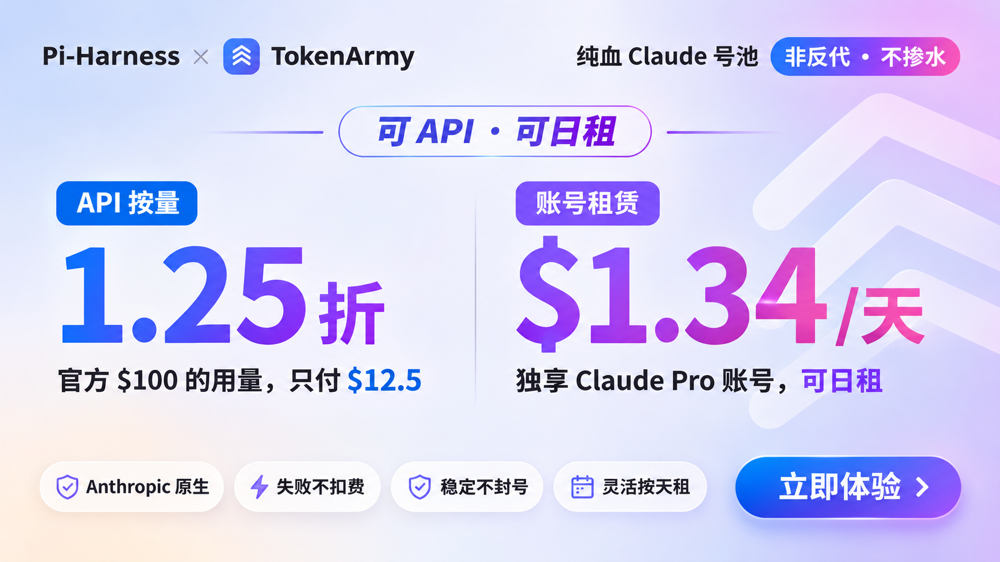
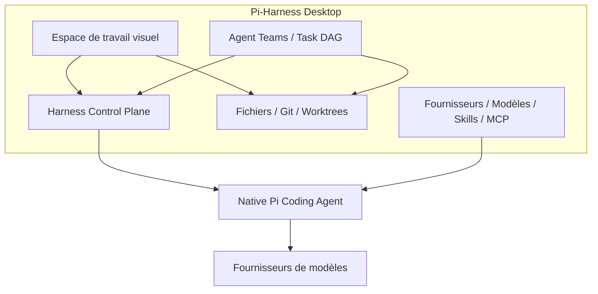

<div align="center">


### L’Operational Superset de Pi Coding Agent

**Observez, contrôlez et orchestrez des agents Native Pi dans un seul espace de travail de bureau.**<br>
Pi exécute toujours chaque agent. Pi-Harness y ajoute l’espace de travail, l’historique des exécutions, la récupération et les équipes d’agents,<br>
et vos sessions, configurations, Skills et extensions Pi continuent de fonctionner dans l’application comme en dehors.

`Pi Coding Agent ⊂ Pi-Harness`

[](https://github.com/wangmiaozero/pi-harness/releases) [](https://github.com/wangmiaozero/pi-harness/stargazers) [](https://github.com/wangmiaozero/pi-harness/actions/workflows/ci.yml) [](LICENSE)<br>
  

**[Télécharger](https://github.com/wangmiaozero/pi-harness/releases)** &nbsp;·&nbsp; **[Vidéo](#watch)** &nbsp;·&nbsp; **[Fonctionnalités](#features)** &nbsp;·&nbsp; **[Harness Plugins](#harness-plugins)** &nbsp;·&nbsp; **[Documentation](#documentation)** &nbsp;·&nbsp; **[Historique des versions](CHANGELOG.md)**

[English](README.md) · [简体中文](README.zh-CN.md) · [繁體中文](README.zh-TW.md) · [日本語](README.ja-JP.md) · [한국어](README.ko-KR.md) · [Русский](README.ru-RU.md) · **Français** · [Deutsch](README.de-DE.md)

<br>


</div>

<br>

## 赞助商

<table>
  <tr>
    <td width="580" align="center" valign="middle">
        <a href="https://infistar.cc/register?aff=S26RFM4B&ref_source=link" style="color:transparent;background-color:transparent;text-decoration:none;border:none;"></a>
    </td>
    <td valign="middle">
      Pi-Harness × Infistar.cc 无限星河｜Claude、GPT、Gemini、Grok、DeepSeek 等，一个 Key，只花官方价的零头，省 99%；低至官方 0.1 折，100% 官方纯血，每个模型都能验真；上千线路安全冗余自动切换，200+ 模型、16 个品牌，一个 Key 搞定。<br>
      Pi-Harness 用户通过<a href="https://infistar.cc/register?aff=S26RFM4B&ref_source=link">专属链接</a>注册直接送人民币 5 元：<a href="https://infistar.cc/register?aff=S26RFM4B&ref_source=link">https://infistar.cc/register?aff=S26RFM4B&ref_source=link</a>
    </td>
  </tr>
  <tr>
    <td width="580" align="center" valign="middle">
        <a href="https://tokenarmy.shop/r/TA-7FBJU-NUSUC" style="color:transparent;background-color:transparent;text-decoration:none;border:none;"></a>
    </td>
    <td valign="middle">
      <strong>Pi-Harness × TokenArmy</strong><br>
      <strong>Claude Pro 日租</strong> · 独享账号，低至 $1.34/天，不封号<br>
      <strong>Claude API 按量计费</strong> · 低至官方价格 1.25 折，失败不扣费<br>
      <a href="https://tokenarmy.shop/r/TA-7FBJU-NUSUC">Pi-Harness 用户专属注册链接</a><br>
      <em>价格与服务以 TokenArmy 平台规则为准。</em>
    </td>
  </tr>
  <tr>
    <td width="580" align="center" valign="middle">
        <a href="https://cloud.tencent.com/act/cps/redirect?redirect=6871&amp;cps_key=ece2099a1da90c2f7a4a4c437ad623f8&amp;from=console" style="color:transparent;background-color:transparent;text-decoration:none;border:none;"></a>
    </td>
    <td valign="middle">
      【腾讯云】WorkBuddy 全场景 AI 办公工作台，团队旗舰版低至198元/月<br>
      <a href="https://cloud.tencent.com/act/cps/redirect?redirect=6871&amp;cps_key=ece2099a1da90c2f7a4a4c437ad623f8&amp;from=console">https://cloud.tencent.com/act/cps/redirect?redirect=6871&amp;cps_key=ece2099a1da90c2f7a4a4c437ad623f8&amp;from=console</a>
    </td>
  </tr>
</table>

## Pi-Harness est-il fait pour vous ?

[Pi Coding Agent](https://github.com/earendil-works/pi) fonctionne bien dans un terminal. Sur de vrais projets, on en veut vite davantage : voir ce que chaque exécution a réellement fait, revenir à un état sain quand une exécution tourne mal et répartir un travail plus important entre plusieurs agents. Pi-Harness réunit tout cela dans une application de bureau, au-dessus du même Pi :

- **Voir chaque exécution** : Runs, Trace, Replay et Evaluation montrent l’activité des outils, comparent les résultats et permettent d’analyser les échecs à partir des données enregistrées.
- **Garder le travail récupérable** : Policy, Budget, Checkpoints et Recovery définissent les autorisations des outils et les limites de dépenses, conservent des points de récupération et permettent de reprendre, créer une branche ou relancer.
- **Coordonner une équipe** : Agent Teams, Task DAG et Worktrees affectent des tâches dépendantes, transmettent les résultats entre agents Pi et séparent les modifications de chaque agent.
- **Rester sur Native Pi** : Pi gère la boucle d’agent, les sessions, le contexte, les outils, les modèles et le raisonnement. Pi-Harness les gère visuellement, et vous pouvez continuer à utiliser Pi en dehors de l’application.

Pi-Harness est fait pour vous si vous utilisez Pi sur de vrais projets et voulez voir, piloter et coordonner son travail depuis une seule fenêtre. Si une conversation dans un terminal vous suffit, Pi seul suffit.

Fonctionne sur macOS, Windows et Linux. Les installateurs communautaires incluent Pi et Node.js : rien d’autre à installer au préalable.

<a id="watch"></a>

## Vidéo

**Mode de travail.** DeepSeek ouvre l’espace de code. 13 secondes.

https://github.com/user-attachments/assets/942b73c9-ece9-485e-ad82-0e51225a73c1

**Bon retour.** Le compagnon apparaît et l’aperçu de l’espace s’ouvre. 11 secondes.

https://github.com/user-attachments/assets/98708766-f490-4506-a33f-f1376d41770f

<a id="download"></a>
<a id="get-started"></a>

## Démarrage rapide

**1 · Installer.** Téléchargez l’installateur adapté à votre système sur **[GitHub Releases](https://github.com/wangmiaozero/pi-harness/releases)** :

| | |
| :-- | :-- |
| **macOS** | Le `.dmg` pour Apple Silicon (`arm64`) ou Intel (`x64`). Ouvrez-le et faites glisser Pi-Harness dans Applications |
| **Windows** | L’installateur `.exe` x64. Lancez-le et choisissez un dossier d’installation |
| **Linux** | Le `.AppImage` x64. Rendez-le exécutable, puis ouvrez-le |

```sh
chmod +x "./Pi-Harness-VERSION.AppImage"   # remplacez VERSION par la version téléchargée
./Pi-Harness-VERSION.AppImage
```

<sub>Les installateurs incluent Pi, Node.js, npm et npx : inutile d’installer Pi ou Node.js, de cloner ce dépôt ou d’installer pnpm. La validation des versions couvre macOS Apple Silicon, macOS Intel, Windows x64 et Linux x64, et les résultats vérifiés de chaque version déterminent les plateformes pour lesquelles elle est publiée. La validation Linux cible Ubuntu 24.04 ; les autres distributions ainsi que FUSE et l’intégration au bureau doivent être vérifiés séparément. Windows et Linux ARM64 sont des cibles en préversion. Les anciens paquets peuvent avoir d’autres exigences : suivez les notes de la version que vous téléchargez. Les builds macOS ont une signature ad hoc et les installateurs Windows ne sont pas signés : voir <a href="#verify-your-download">Vérifier le téléchargement</a>.</sub>

**2 · Vérifier l’environnement.** Lancez Pi-Harness et vérifiez l’environnement dans la vue d’ensemble.

**3 · Ajouter un fournisseur.** Configurez un fournisseur, testez la connexion et choisissez un modèle. L’accès aux modèles peut nécessiter des identifiants et entraîner des frais auprès du fournisseur.

**4 · Commencer à travailler.** Commencez une conversation indépendante ou ouvrez un projet, puis lancez ou reprenez une session Pi et travaillez avec conversations, fichiers et Git dans une seule fenêtre. Ouvrez **Espace de travail → Outils → Harness / Agents** pour examiner les exécutions ou coordonner une équipe.

<a id="verify-your-download"></a>

### Vérifier le téléchargement

Les versions communautaires sont gratuites. Les paquets macOS utilisent une **signature ad hoc, sans Apple Developer ID ni notarisation**. Les installateurs Windows ne sont **pas signés** et peuvent afficher des avertissements SmartScreen. Vérifiez la source officielle du téléchargement et la somme de contrôle avant d’autoriser l’ouverture de l’application. Si macOS bloque le premier lancement, utilisez **Réglages Système → Confidentialité et sécurité → Ouvrir quand même** pour cette application. Laissez les protections de sécurité du système activées.

Téléchargez `SHA256SUMS` avec l’installateur, calculez l’empreinte de votre fichier et comparez-la avec celle du même nom de fichier dans la liste (remplacez `VERSION` et l’architecture par les valeurs de votre téléchargement) :

```sh
shasum -a 256 "Pi-Harness-VERSION-arm64.dmg"   # macOS
sha256sum "Pi-Harness-VERSION.AppImage"        # Linux
```

```powershell
Get-FileHash ".\Pi-Harness-Setup-VERSION.exe" -Algorithm SHA256   # Windows
```

<sub>SHA256 vérifie la cohérence avec la liste des sommes de contrôle ; il ne prouve pas à lui seul l’identité de l’éditeur. Utilisez la page officielle <a href="https://github.com/wangmiaozero/pi-harness/releases">GitHub Releases</a> et signalez en privé toute vulnérabilité présumée à <a href="mailto:tuziling84@gmail.com">tuziling84@gmail.com</a>. Les builds communautaires recherchent les nouvelles versions dans l’application et ouvrent la page Releases pour un téléchargement et une installation manuels sur toutes les plateformes. L’installation automatique reste désactivée tant que l’installation entre versions n’est pas vérifiée, et les installations existantes conservent leur comportement de mise à jour. Voir <a href="docs/release/community-release.md">Community Release</a> et les <a href="docs/release/update-strategy.md">détails des mises à jour</a>.</sub>

<a id="architecture"></a>

## Comment tout s’articule

Pi gère l’exécution et les sessions natives. Harness observe chaque exécution et applique autour d’elle politiques, budgets, points de contrôle, récupération et évaluation. Les équipes d’agents utilisent le même moteur d’exécution Pi. L’historique des conversations et l’architecture du projet sont des outils de l’espace de travail, et les thèmes personnalisent l’apparence. Le diagramme montre les relations entre modules, pas un héritage de classes.



<a id="pi-vs-pi-harness"></a>

<details>
<summary><b>Native Pi et Pi-Harness</b>, fonction par fonction</summary>

<br>

| Fonction                 | Native Pi | Pi-Harness                    |
| ------------------------ | --------- | ----------------------------- |
| Agent Runtime            | Oui       | Native Pi                     |
| Agent Loop               | Oui       | Native Pi                     |
| Sessions                 | Oui       | Oui + gestion visuelle        |
| Context                  | Oui       | Oui + inspection              |
| Compaction               | Oui       | Oui + contrôle visuel         |
| Steering                 | Oui       | Oui                           |
| Follow-up                | Oui       | Oui                           |
| Models                   | Oui       | Oui + gestion                 |
| Thinking                 | Oui       | Oui + contrôle visuel         |
| Tools                    | Oui       | Oui + sélection et politiques |
| Skills                   | Oui       | Oui + gestion                 |
| Extensions               | Oui       | Oui + gestion                 |
| Packages                 | Oui       | Oui + gestion                 |
| MCP / Codemode           | Oui       | Oui + sélection et politiques |
| Runs                     | —         | Oui                           |
| Trace                    | —         | Oui                           |
| Replay                   | —         | Oui                           |
| Run Compare              | —         | Oui                           |
| Evaluation               | —         | Oui                           |
| Policy                   | —         | Oui                           |
| Budget                   | —         | Oui                           |
| Checkpoints              | —         | Oui                           |
| Recovery                 | —         | Oui                           |
| Diagnostics              | —         | Oui                           |
| Regression               | —         | Oui                           |
| Artifacts                | —         | Oui                           |
| Multi-Agent              | —         | Oui                           |
| Task DAG                 | —         | Oui                           |
| Handoff                  | —         | Oui                           |
| Review Gates             | —         | Oui                           |
| Worktree isolation       | —         | Oui                           |
| Project architecture map | —         | Oui                           |

</details>

<a id="features"></a>

## Fonctionnalités

### Espace de travail, fichiers et Git

Commencez une conversation indépendante ou ouvrez un projet pour reprendre une session Pi. Suivez les réponses en streaming, le raisonnement, les appels d’outils, les images et les fichiers modifiés ; choisissez le modèle, le niveau de raisonnement et les outils, ou compactez la conversation. Ouvrir Harness ou Agents depuis les outils de l’espace de travail conserve la conversation et le brouillon.

Parcourez et recherchez les fichiers, prévisualisez médias et documents, et modifiez le texte lisible avec coloration syntaxique, numéros de ligne, recherche, annuler/rétablir, enregistrement explicite et protection contre les conflits de modifications externes. Git propose différences, historique, graphiques d’activité, commits, messages de commit IA facultatifs et worktrees.

<table>
<tr>
<td width="50%"><br><sub>Édition légère de fichiers</sub></td>
<td width="50%"><br><sub>Git</sub></td>
</tr>
</table>

<a id="harness"></a>

### Plan de contrôle Harness

Chaque exécution Pi laisse une trace que vous pouvez examiner, comparer et utiliser pour récupérer le travail.

| | |
| :-- | :-- |
| **Observer** | Runs, Trace, Replay, chronologies et activité des outils. Comparez les exécutions et suivez les branches et les nouvelles tentatives dans Run Tree |
| **Mesurer** | Tokens, coût et durée de chaque exécution, ainsi qu’artefacts et statistiques du projet |
| **Contrôler** | Politiques des outils et budgets par exécution. Créez des points de contrôle, puis reprenez, créez une branche ou relancez le travail |
| **Vérifier** | Evaluation, Diagnostics et références de régression vérifient les résultats et aident à analyser les échecs à partir des données d’exécution enregistrées |

<table>
<tr>
<td width="50%"><br><sub>État de la session et instructions en file d’attente</sub></td>
<td width="50%"><br><sub>Console Harness</sub></td>
</tr>
</table>

<a id="multi-agent"></a>

### Orchestration multi-agents

Ouvrez **Espace de travail → Outils → Agents** pour coordonner les agents Pi avec des équipes et modèles réutilisables. Affectez des tâches avec dépendances et priorités, planifiez-les manuellement, en séquence ou en parallèle, transmettez résultats et artefacts à la tâche suivante et ajoutez des étapes de revue. Les worktrees séparent les modifications de chaque agent. Budgets, alertes de conflit et commandes de pause, reprise, arrêt, nouvelle tentative, saut et réaffectation vous aident à gérer le travail.

<table>
<tr>
<td width="50%"><br><sub>Exemple d’équipe avant exécution : trois agents inactifs, toutes les tâches en attente</sub></td>
<td width="50%"><br><sub>Dépendances entre tâches et revue obligatoire</sub></td>
</tr>
</table>

<a id="conversation-history"></a>

### Historique universel des conversations

Consultez ensemble les historiques de Claude Code, Codex (bureau et archives compris), Cursor, Cursor Agent, Gemini CLI, OpenCode et Pi. Recherchez, filtrez par source, projet ou période, et ajoutez vos propres dossiers d’historique.

Ouvrez la conversation originale en lecture seule, prévisualisez la transmission et modifiez la prochaine instruction avant de continuer dans un nouveau chat Pi du même projet. Consultation, aperçus locaux et nouvelles tentatives de scan ne consomment aucun token de modèle ; les synthèses IA facultatives utilisent votre modèle configuré uniquement à votre demande.

<table>
<tr>
<td width="50%"><br><sub>Historique des conversations</sub></td>
<td width="50%"><br><sub>Nettoyage des sessions</sub></td>
</tr>
</table>

<a id="project-architecture"></a>

### Carte de l’architecture du projet

Ouvrez Architecture dans l’espace de travail pour explorer modules, dépendances, points d’entrée et références au code. Filtrez par paquet, ciblez un module, parcourez la carte page par page, zoomez ou passez en plein écran. Enregistrez des instantanés d’analyse, repérez ceux que des changements dans les sources ont rendus obsolètes et exportez en JSON, en HTML hors ligne ou la vue actuelle en PNG.

| | |
| :-- | :-- |
| **Local d’abord** | L’analyse s’exécute localement et ne consomme aucun token de modèle ; les descriptions IA sont facultatives |
| **Couverture** | Les imports JavaScript, TypeScript et Vue sont analysés localement ; les autres langages compatibles disposent d’un index par fichier. Chaque analyse indique sa couverture et ses limites |
| **Portée** | Les cartes décrivent les dépendances statiques prises en charge ; ce n’est pas un graphe complet des appels de fonctions |


<a id="providers-and-models"></a>
<a id="skills-extensions-packages-and-mcp"></a>

### Fournisseurs, modèles et Skills

| | |
| :-- | :-- |
| **Fournisseurs** | Configurez des fournisseurs compatibles Pi à partir de préréglages ou d’adresses personnalisées, gérez les identifiants, récupérez les modèles lorsque le service le permet, testez la connexion et choisissez votre modèle de conversation |
| **Images** | Utilisez les modèles d’image compatibles pour générer ou modifier des images, puis téléchargez les résultats |
| **OpenCode Zen / Go** | Dans l’onglet OpenCode de Modèles, enregistrez votre clé API et activez les modèles souhaités. Les modèles se chargent automatiquement et peuvent être vérifiés un par un ou tous ensemble. L’accès et les frais dépendent de votre compte officiel et du modèle ; une vérification payante demande d’abord votre autorisation. Consultez les [informations sur les modèles d’OpenCode](https://opencode.ai/v2/docs/console/models/) pour les tarifs et les règles sur les données |
| **Skills** | Parcourez et modifiez les Skills intégrés et locaux. Saisissez `@` dans le champ de message pour rechercher et invoquer un Skill installé |
| **Paquets et extensions** | Gérez les paquets et extensions Pi depuis le centre de capacités. Les compléments facultatifs tels que [Superpowers](https://github.com/obra/superpowers) ne s’installent, ne se mettent à jour ou ne se désinstallent qu’à votre demande |

<table>
<tr>
<td width="50%"><br><sub>Fournisseurs et modèles</sub></td>
<td width="50%"><br><sub>Centre de capacités</sub></td>
</tr>
</table>

<a id="mcp-marketplace"></a>

### Serveurs et catalogue MCP

Ouvrez **Paramètres → MCP** pour ajouter des serveurs lancés par une commande locale ou accessibles par HTTP, filtrer par **Tous / Global / Projet**, choisir un projet, et modifier ou activer chaque serveur dans sa propre portée. Analysez les configurations d’autres outils et vérifiez-les avant de les importer.

Le catalogue propose **15 modèles de serveurs intégrés**, dont Memory, Context7, Playwright, Filesystem et GitHub, ainsi que la recherche et la pagination du registre officiel MCP. Vérifiez la configuration et sa destination avant l’enregistrement. Les modèles sont là pour être installés ; ils ne sont pas tous activés par défaut. Les entrées importées et celles du registre sont enregistrées désactivées, pour que vous puissiez d’abord terminer leur configuration.


<a id="agent-settings"></a>

### Réglages des agents

**Disponible à partir de v2.2.10.** Consultez les notes de version pour savoir si ces réglages sont inclus dans l’installateur téléchargé.

| Page | Ce que vous réglez | |
| :-- | :-- | :-- |
| **AI** | Niveau de raisonnement par défaut, compactage automatique, nouvelles tentatives et préférences de l’espace de travail | [Capture](docs/%E5%8A%9F%E8%83%BD%E7%95%8C%E9%9D%A2/%E7%BB%8F%E5%85%B8%E4%B8%BB%E9%A2%98/AI.png) |
| **Voix en temps réel** | Le service vocal et le compte pour les appels dans l’espace de travail | [Capture](docs/%E5%8A%9F%E8%83%BD%E7%95%8C%E9%9D%A2/%E7%BB%8F%E5%85%B8%E4%B8%BB%E9%A2%98/%E5%AE%9E%E6%97%B6%E8%AF%AD%E9%9F%B3.png) |
| **Raccourcis** | Vos propres raccourcis pour la palette de commandes, les paramètres, les nouvelles sessions et la fermeture des onglets, ou les valeurs par défaut | [Capture](docs/%E5%8A%9F%E8%83%BD%E7%95%8C%E9%9D%A2/%E7%BB%8F%E5%85%B8%E4%B8%BB%E9%A2%98/%E5%BF%AB%E6%8D%B7%E9%94%AE.png) |
| **Instructions** | Instructions globales ou propres à un projet | [Capture](docs/%E5%8A%9F%E8%83%BD%E7%95%8C%E9%9D%A2/%E7%BB%8F%E5%85%B8%E4%B8%BB%E9%A2%98/%E6%8C%87%E4%BB%A4.png) |
| **MCP** | Les serveurs MCP de chaque portée | [Capture](docs/%E5%8A%9F%E8%83%BD%E7%95%8C%E9%9D%A2/%E7%BB%8F%E5%85%B8%E4%B8%BB%E9%A2%98/MCP%E6%9C%8D%E5%8A%A1%E5%99%A8.png) |
| **Sous-agents** | Sous-agents réutilisables avec un rôle, des instructions, un modèle, un niveau de raisonnement et des outils. Choisissez un espace partagé ou un worktree isolé, puis lancez une tâche ou réutilisez le modèle dans une équipe | [Capture](docs/%E5%8A%9F%E8%83%BD%E7%95%8C%E9%9D%A2/%E7%BB%8F%E5%85%B8%E4%B8%BB%E9%A2%98/%E5%AD%90%E6%99%BA%E8%83%BD%E4%BD%93.png) |
| **Hôtes distants** | Hôtes exécutant pi-host, appairés avec une adresse et un jeton d’appairage | [Capture](docs/%E5%8A%9F%E8%83%BD%E7%95%8C%E9%9D%A2/%E7%BB%8F%E5%85%B8%E4%B8%BB%E9%A2%98/%E8%BF%9C%E7%A8%8B%E4%B8%BB%E6%9C%BA.png) |

<a id="realtime-voice"></a>

### Voix en temps réel

Parlez à votre espace de travail avec **OpenAI Realtime, Gemini Live ou Codex Live**. Utilisez un compte de fournisseur compatible ou une clé API distincte ; Codex Live utilise votre connexion Codex existante dans Pi. La disponibilité du service et les frais dépendent de votre compte.

1. Ouvrez **Paramètres → Voix en temps réel**, activez la voix, choisissez le service et le compte, puis enregistrez.
2. Dans une conversation de l’espace de travail, cliquez sur le bouton en forme d’onde à côté du champ de message.
3. Vérifiez la conversation cible et le partage facultatif du contexte, sélectionnez **Démarrer la voix en temps réel** et autorisez l’accès au microphone.
4. Coupez le micro, consultez la transcription ou terminez l’appel depuis les commandes flottantes, même après être passé à une autre page.

Le partage du contexte récent est désactivé par défaut. Une fois activé, il inclut seulement les six derniers messages en texte brut, sans pièces jointes ni résultats d’outils. Les demandes de travail issues d’un appel ne sont envoyées à la conversation de travail qu’après votre vérification.


<a id="remote-hosts"></a>

### Hôtes distants

Appairez un hôte exécutant **pi-host** depuis **Paramètres → Hôtes distants** avec son adresse et son jeton d’appairage. Connectez ou déconnectez les hôtes, parcourez leurs projets et sessions, consultez les conversations, envoyez des prompts et répondez aux demandes d’approbation. L’hôte distant doit déjà être lancé et accessible.

<a id="desktop-companion"></a>

### Compagnon de bureau

Activez un animal de bureau installé dans **Paramètres → Mascotte de bureau** pour suivre sur votre bureau la réflexion, l’activité des outils, l’attente et la fin des tâches. Il est désactivé par défaut et reste disponible lorsque la fenêtre principale est réduite.

Au repos, choisissez parmi 193 actions dans un menu contextuel avec recherche. Pendant les tâches, les interactions manuelles sont suspendues et le déplacement conserve l’animation de travail. Importez des packs locaux et réglez la taille, l’opacité et les bulles avec des curseurs.

<table>
<tr>
<td width="33%"><br><sub>Réglages et curseurs</sub></td>
<td width="33%"><br><sub>Menu contextuel</sub></td>
<td width="33%"><br><sub>Actions avec recherche</sub></td>
</tr>
</table>

<a id="themes-and-custom-skins"></a>
<a id="screenshots"></a>

### Thèmes et habillages personnalisés

Choisissez les palettes classiques, les thèmes Ming, Starship Cockpit, les fonds macOS 27 ou un habillage personnalisé importé. Les nouvelles installations démarrent en **Clair doux**. Personnalisez les noms affichés dans le chat, les icônes de l’application, les images de fond locales, les halos de fenêtre et d’écran et l’effet de flamme du champ de saisie. Une animation de démarrage accompagne la vérification de l’environnement.

Les thèmes de personnages et les animaux de bureau sont des packs facultatifs. Ouvrez **Paramètres → Marché de ressources** pour installer un pack `@piharness` à la fois depuis le catalogue GitHub. L’application démarre sans connexion réseau. Un thème ou un animal déjà choisi reste sélectionné tant que ses fichiers ne sont pas installés, et l’espace de travail utilise l’apparence de base jusqu’à l’installation du pack. Voir [docs/market/MARKET.md](docs/market/MARKET.md).

**Créez votre propre habillage** avec le [modèle d’habillage Pi-Harness](https://github.com/wangmiaozero/pi-harness-skin-starter) :

1. Utilisez le dépôt comme modèle ou téléchargez-le.
2. Ouvrez-le avec votre agent de programmation et décrivez le style souhaité dans le prompt fourni.
3. Importez le projet terminé depuis **Paramètres → Thème → Importer un thème**.

Le modèle multilingue propose des indications pour les couleurs, aperçus, fonds d’écran et illustrations de personnages facultatives. Conservez l’habillage dans son propre dépôt pour le mettre à jour et le partager indépendamment.

<table>
<tr>
<td width="50%"><br><sub>Ming · Dignitaire enneigé</sub></td>
<td width="50%"><br><sub>Ming · Musicienne sous la neige</sub></td>
</tr>
<tr>
<td width="50%"><br><sub>Ming · Lettrée au clair de lune</sub></td>
<td width="50%"><br><sub>Starship Cockpit</sub></td>
</tr>
<tr>
<td width="50%"><br><sub>Ming · Réglages généraux</sub></td>
<td width="50%"><br><sub>Ming · Galerie de thèmes et d’habillages</sub></td>
</tr>
<tr>
<td colspan="2"><br><sub>macOS 27 · Liquid Ether</sub></td>
</tr>
</table>

<a id="harness-plugins"></a>

### Harness Plugins

**Plugin SDK v1.0.0 · Inclus à partir de Pi-Harness v2.2.6.** Les plugins étendent les opérations autour de l’agent, en complément des moyens d’étendre Pi lui-même :

| Extension | Rôle |
| :-- | :-- |
| **Pi Extensions** | Étendre l’agent Pi lui-même |
| **Skills** | Donner à l’agent des instructions et des connaissances sur les workflows |
| **MCP** | Connecter l’agent à des outils et des services externes |
| **Harness Plugins** | Étendre les opérations de Pi-Harness autour de l’agent |

Contribuez des **Harness Event Subscribers, Custom Evaluators, Trace Exporters et Agent Team Templates**. Les évaluations sont complémentaires, les exports utilisent des données JSON autorisées et les modèles d’équipe créent des workflows en attente que vous examinez et lancez vous-même. Essayez les exemples maintenus du SDK : [Run Metrics](examples/harness-plugins/run-metrics/plugin.json), [Quality Evaluator](examples/harness-plugins/quality-evaluator/plugin.json) et [Team Template](examples/harness-plugins/team-template/plugin.json).

Dans un build depuis les sources, ouvrez **Espace de travail → Outils → Harness → Harness Plugins → Install local plugin**, choisissez son dossier, vérifiez les autorisations et activez-le. L’installation n’exécute aucun code. Les plugins exécutables exigent une approbation de confiance native explicite : **le processus séparé n’est pas un bac à sable de sécurité ; le code Node approuvé peut accéder à votre ordinateur**. Utilisez des modèles déclaratifs pour les contenus non fiables.

[Développer et installer](docs/plugins/getting-started.md) · [Architecture](docs/plugins/architecture.md) · [SDK API](docs/plugins/api-reference.md) · [Limites de sécurité](docs/plugins/security.md)

### Et aussi

- **Vérification de l’environnement** : vérifiez Node.js, npm, PATH, Pi Coding Agent et la configuration active ; installez, mettez à jour ou réparez Pi dans les environnements compatibles, consultez le diagnostic et gérez les sauvegardes de configuration.
- **Environnements d’exécution** : les environnements Pi et Node intégrés fonctionnent immédiatement, avec les choix Système et Personnalisé dans les paramètres.
- **Mises à jour de l’application** : recherchez les nouvelles versions depuis l’application.
- **Huit langues** : English, 简体中文, 繁體中文, 日本語, 한국어, Русский, Français et Deutsch.

<a id="documentation"></a>

## Documentation

| | |
| :-- | :-- |
| **[Guide des réglages des agents](docs/agent-settings.md)** | AI, voix en temps réel, raccourcis, instructions, MCP, sous-agents et hôtes distants |
| **[Marché de ressources](docs/market/MARKET.md)** | Installer des packs de thèmes et d’animaux de bureau |
| **[Harness Plugins](docs/plugins/getting-started.md)** | Développer et installer des plugins ; voir aussi [architecture](docs/plugins/architecture.md), [SDK API](docs/plugins/api-reference.md) et [limites de sécurité](docs/plugins/security.md) |
| **[Community Release](docs/release/community-release.md)** | Comment les builds communautaires sont signés, vérifiés et [mis à jour](docs/release/update-strategy.md) |
| **[Dépannage](docs/release/troubleshooting.md)** | Problèmes de somme de contrôle, d’avertissement de sécurité, de lancement et de mise à jour |
| **[Index des captures](docs/README.md)** | Toutes les interfaces et tous les thèmes, par catégorie |
| **[Historique des versions](CHANGELOG.md)** | Les changements de chaque version |

## Développement

Installez **Node.js 24 LTS (≥ 24.22.1)** et **pnpm 9.12.1**, puis exécutez :

```sh
git clone https://github.com/wangmiaozero/pi-harness.git
cd pi-harness
pnpm install --frozen-lockfile
pnpm dev
```

<sub>Pour développer sans installation séparée de Pi, utilisez la configuration d’exemple dans <a href="fixtures/README.md">fixtures</a> : dans les paramètres, faites pointer le dossier de configuration manuel vers le chemin absolu de <code>fixtures/mock-pi</code>. La configuration d’exemple ne donne pas accès à de vrais modèles ; configurez votre propre fournisseur si nécessaire.</sub>

Avant de proposer une modification, lancez les vérifications. Pour les modifications des parcours essentiels de l’application, lancez aussi `pnpm test:e2e`.

```sh
pnpm typecheck
pnpm lint
pnpm test
pnpm compile
```

## Communauté

- **[Issues](https://github.com/wangmiaozero/pi-harness/issues)** : signalez un bug ou proposez une amélioration. Indiquez la version de l’application, le système d’exploitation et les étapes pour reproduire le problème, et retirez identifiants et contenus de conversation privés.
- **[Pull requests](https://github.com/wangmiaozero/pi-harness/pulls)** : décrivez le problème, le changement visible pour l’utilisateur et vos résultats de validation. Documentation, traductions, thèmes et corrections ciblées sont les bienvenus.
- **[Habillages personnalisés](https://github.com/wangmiaozero/pi-harness-skin-starter)** : créez un habillage et partagez-le.
- **Groupe QQ** : pi-harness · **1109717308**. Scannez le code pour rejoindre le groupe.

<p align="center">
  
</p>

Si Pi-Harness vous simplifie le travail avec Pi, **une ⭐ aide d’autres personnes à le découvrir.**

<picture>
  <source media="(prefers-color-scheme: dark)" srcset="https://api.star-history.com/svg?repos=wangmiaozero/pi-harness&type=Date&theme=dark">
  
</picture>

## Remerciements

Pi-Harness est construit autour des projets officiels [Pi Coding Agent et Pi Agent Harness](https://github.com/earendil-works/pi). Créé et maintenu par [wangmiao](https://github.com/wangmiaozero) · [tuziling84@gmail.com](mailto:tuziling84@gmail.com).

**Contributeurs aux PR**

<table>
  <tr>
    <td align="center">
      <br /><a href="https://github.com/HenryArch"><b>HenryArch</b></a><br />
      <a href="https://github.com/wangmiaozero/pi-harness/pull/8">PR #8</a>
    </td>
  </tr>
</table>

Les PR pour améliorer Pi-Harness sont les bienvenues. Merci à toutes les personnes qui contribuent à faire progresser le projet !

## Licence

[GNU Affero General Public License v3.0 only](LICENSE) (`AGPL-3.0-only`).

Copyright © 2026 [wangmiao](https://github.com/wangmiaozero).
