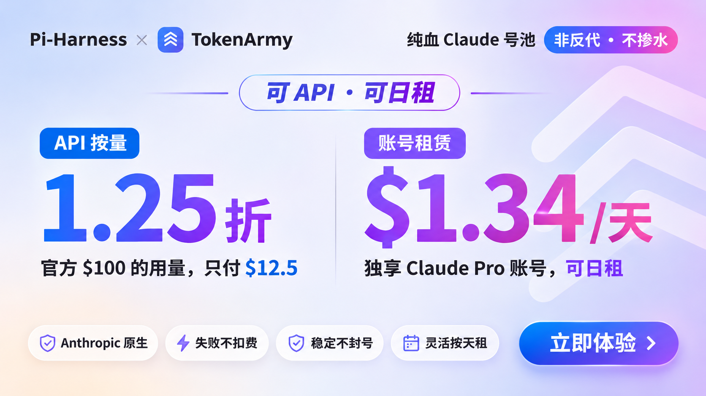
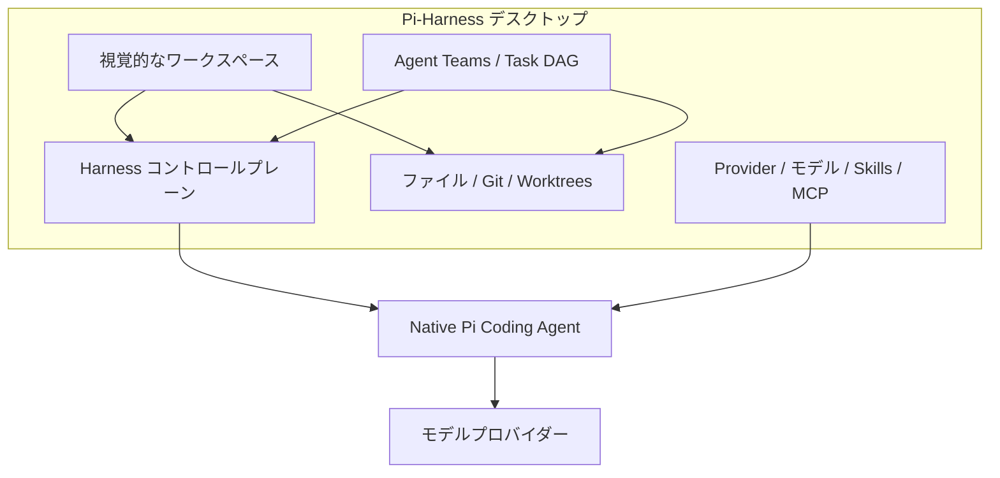

<div align="center">


### Pi Coding Agent の Operational Superset

**Native Pi エージェントの観測、制御、編成を、ひとつのデスクトップワークスペースで。**<br>
エージェントを実行するのは引き続き Pi です。Pi-Harness はその周りにワークスペース、実行履歴、復旧、エージェントチームを加えます。<br>
Pi のセッション、設定、Skills、拡張機能は、アプリの中でも外でもそのまま使えます。

`Pi Coding Agent ⊂ Pi-Harness`

[](https://github.com/wangmiaozero/pi-harness/releases) [](https://github.com/wangmiaozero/pi-harness/stargazers) [](https://github.com/wangmiaozero/pi-harness/actions/workflows/ci.yml) [](LICENSE)<br>
  

**[ダウンロード](https://github.com/wangmiaozero/pi-harness/releases)** &nbsp;·&nbsp; **[動画](#watch)** &nbsp;·&nbsp; **[機能](#features)** &nbsp;·&nbsp; **[Harness Plugins](#harness-plugins)** &nbsp;·&nbsp; **[ドキュメント](#documentation)** &nbsp;·&nbsp; **[変更履歴](CHANGELOG.md)**

[English](README.md) · [简体中文](README.zh-CN.md) · [繁體中文](README.zh-TW.md) · **日本語** · [한국어](README.ko-KR.md) · [Русский](README.ru-RU.md) · [Français](README.fr-FR.md) · [Deutsch](README.de-DE.md)

<br>


</div>

<br>

## 赞助商

<table>
  <tr>
    <td width="580" align="center" valign="middle">
        <a href="https://infistar.cc/register?aff=S26RFM4B&ref_source=link" style="color:transparent;background-color:transparent;text-decoration:none;border:none;"></a>
    </td>
    <td valign="middle">
      Pi-Harness × Infistar.cc 无限星河｜Claude、GPT、Gemini、Grok、DeepSeek 等，一个 Key，只花官方价的零头，省 99%；低至官方 0.1 折，100% 官方纯血，每个模型都能验真；上千线路安全冗余自动切换，200+ 模型、16 个品牌，一个 Key 搞定。<br>
      Pi-Harness 用户通过<a href="https://infistar.cc/register?aff=S26RFM4B&ref_source=link">专属链接</a>注册直接送人民币 5 元：<a href="https://infistar.cc/register?aff=S26RFM4B&ref_source=link">https://infistar.cc/register?aff=S26RFM4B&ref_source=link</a>
    </td>
  </tr>
  <tr>
    <td width="580" align="center" valign="middle">
        <a href="https://tokenarmy.shop/r/TA-7FBJU-NUSUC" style="color:transparent;background-color:transparent;text-decoration:none;border:none;"></a>
    </td>
    <td valign="middle">
      <strong>Pi-Harness × TokenArmy</strong><br>
      <strong>Claude Pro 日租</strong> · 独享账号，低至 $1.34/天，不封号<br>
      <strong>Claude API 按量计费</strong> · 低至官方价格 1.25 折，失败不扣费<br>
      <a href="https://tokenarmy.shop/r/TA-7FBJU-NUSUC">Pi-Harness 用户专属注册链接</a><br>
      <em>价格与服务以 TokenArmy 平台规则为准。</em>
    </td>
  </tr>
  <tr>
    <td width="580" align="center" valign="middle">
        <a href="https://cloud.tencent.com/act/cps/redirect?redirect=6871&amp;cps_key=ece2099a1da90c2f7a4a4c437ad623f8&amp;from=console" style="color:transparent;background-color:transparent;text-decoration:none;border:none;"></a>
    </td>
    <td valign="middle">
      【腾讯云】WorkBuddy 全场景 AI 办公工作台，团队旗舰版低至198元/月<br>
      <a href="https://cloud.tencent.com/act/cps/redirect?redirect=6871&amp;cps_key=ece2099a1da90c2f7a4a4c437ad623f8&amp;from=console">https://cloud.tencent.com/act/cps/redirect?redirect=6871&amp;cps_key=ece2099a1da90c2f7a4a4c437ad623f8&amp;from=console</a>
    </td>
  </tr>
</table>

## Pi-Harness はあなたに合っていますか？

[Pi Coding Agent](https://github.com/earendil-works/pi) はターミナルで十分に使えます。しかし実際のプロジェクトでは、すぐにそれ以上のことが必要になります。各実行が実際に何をしたのかを確認したい、実行がうまくいかなかったときに正常な状態へ戻したい、大きな作業を複数のエージェントに分けたい。Pi-Harness は同じ Pi の上で、これらをひとつのデスクトップアプリにまとめます。

- **すべての実行を確認**：Runs、Trace、Replay、Evaluation でツールの動作を表示し、結果を比較し、記録された証拠から失敗を調査できます。
- **作業を復旧可能に**：Policy、Budget、Checkpoints、Recovery でツールの権限と費用の上限を設定し、復旧ポイントを残して、再開、分岐、再試行ができます。
- **チームを連携**：Agent Teams、Task DAG、Worktrees で依存関係のあるタスクを割り当て、Pi エージェント間で結果を引き渡し、各エージェントの変更を分離します。
- **Native Pi のまま**：エージェントループ、セッション、コンテキスト、ツール、モデル、思考は Pi が実行します。Pi-Harness はそれらを視覚的に管理し、アプリの外でも Pi を使い続けられます。

実際のプロジェクトで Pi を使い、その作業をひとつのウィンドウで確認、誘導、連携したい方に向いています。ターミナルでのチャットひとつで足りるなら、Pi 単体で十分です。

macOS、Windows、Linux で動作します。コミュニティ版のインストーラーには Pi と Node.js が同梱されているため、事前にほかのものをインストールする必要はありません。

<a id="watch"></a>

## 動画

**作業モード。** DeepSeek からコーディングワークスペースへ。13 秒。

https://github.com/user-attachments/assets/942b73c9-ece9-485e-ad82-0e51225a73c1

**おかえり。** コンパニオンが現れ、ワークスペースの概要が開きます。11 秒。

https://github.com/user-attachments/assets/98708766-f490-4506-a33f-f1376d41770f

<a id="download"></a>
<a id="get-started"></a>

## クイックスタート

**1 · インストール。** **[GitHub Releases](https://github.com/wangmiaozero/pi-harness/releases)** からお使いのシステム用のインストーラーをダウンロードします。

| | |
| :-- | :-- |
| **macOS** | Apple Silicon（`arm64`）または Intel（`x64`）用の `.dmg`。開いて Pi-Harness を「アプリケーション」にドラッグします |
| **Windows** | x64 用 `.exe` インストーラー。実行してインストール先を選びます |
| **Linux** | x64 用 `.AppImage`。実行可能にしてから開きます |

```sh
chmod +x "./Pi-Harness-VERSION.AppImage"   # VERSION をダウンロードしたバージョンに置き換えます
./Pi-Harness-VERSION.AppImage
```

<sub>インストーラーには Pi、Node.js、npm、npx が含まれています。Pi や Node.js のインストール、このリポジトリの clone、pnpm のインストールは不要です。リリースの検証は macOS Apple Silicon、macOS Intel、Windows x64、Linux x64 を対象とし、各リリースがどのプラットフォーム向けに提供されるかは検証結果によって決まります。Linux の検証は Ubuntu 24.04 を対象としており、ほかのディストリビューションや FUSE、デスクトップ統合は個別の確認が必要です。Windows と Linux の ARM64 はプレビュー対象です。古いパッケージは要件が異なる場合があるため、ダウンロードするバージョンの説明に従ってください。macOS 版は ad-hoc 署名、Windows インストーラーは未署名です。<a href="#verify-your-download">ダウンロードの検証</a>を参照してください。</sub>

**2 · 環境を確認。** Pi-Harness を起動し、概要で環境を確認します。

**3 · Provider を追加。** Provider を設定して接続をテストし、モデルを選択します。モデルの利用には認証情報が必要な場合があり、Provider の料金が発生することがあります。

**4 · 作業を開始。** 単独のチャットを開始するかプロジェクトを開き、Pi セッションを開始・再開して、会話、ファイル、Git をひとつのウィンドウで操作します。実行の確認やチームの連携には「**ワークスペース → ツール → Harness / エージェント**」を開きます。

<a id="verify-your-download"></a>

### ダウンロードの検証

コミュニティ版は無料です。macOS パッケージは **Apple Developer ID による署名や公証のない ad-hoc 署名**です。Windows インストーラーは**未署名**のため、SmartScreen の警告が表示されることがあります。アプリを開く前に、公式のダウンロード元とチェックサムを確認してください。macOS で初回起動がブロックされた場合は、そのアプリに対して「**システム設定 → プライバシーとセキュリティ → このまま開く**」を使用してください。システムのセキュリティ保護は有効のままにしてください。

インストーラーと一緒に `SHA256SUMS` をダウンロードし、ファイルのハッシュを計算して、一覧の同じファイル名の値と比較します（`VERSION` とアーキテクチャはダウンロードしたものに置き換えてください）。

```sh
shasum -a 256 "Pi-Harness-VERSION-arm64.dmg"   # macOS
sha256sum "Pi-Harness-VERSION.AppImage"        # Linux
```

```powershell
Get-FileHash ".\Pi-Harness-Setup-VERSION.exe" -Algorithm SHA256   # Windows
```

<sub>SHA256 はチェックサム一覧との一致を確認するもので、発行者の身元を単独で証明するものではありません。公式の <a href="https://github.com/wangmiaozero/pi-harness/releases">GitHub Releases</a> ページを利用し、脆弱性の疑いは <a href="mailto:tuziling84@gmail.com">tuziling84@gmail.com</a> へ非公開で報告してください。コミュニティ版はアプリ内で新しいバージョンを確認し、すべてのプラットフォームで Releases ページを開いて手動でダウンロード・インストールします。バージョンをまたぐインストールが検証されるまで自動インストールは無効のままで、既存のインストールは従来の更新動作を維持します。<a href="docs/release/community-release.md">コミュニティリリース</a>と<a href="docs/release/update-strategy.md">更新の詳細</a>を参照してください。</sub>

<a id="architecture"></a>

## 全体の仕組み

実行とネイティブセッションは Pi が担当します。Harness は各実行を観測し、その周りでポリシー、予算、チェックポイント、復旧、評価を適用します。エージェントチームも同じ Pi の実行エンジンを使います。会話履歴とプロジェクト構成図はワークスペースのツールで、テーマで外観をカスタマイズできます。図はモジュールの関係を表したもので、クラスの継承ではありません。



<a id="pi-vs-pi-harness"></a>

<details>
<summary><b>Native Pi と Pi-Harness</b>：機能ごとの比較</summary>

<br>

| 機能                     | Native Pi | Pi-Harness            |
| ------------------------ | --------- | --------------------- |
| Agent Runtime            | 対応      | Native Pi             |
| Agent Loop               | 対応      | Native Pi             |
| Sessions                 | 対応      | 対応 + 視覚的な管理   |
| Context                  | 対応      | 対応 + 確認画面       |
| Compaction               | 対応      | 対応 + 視覚的な制御   |
| Steering                 | 対応      | 対応                  |
| Follow-up                | 対応      | 対応                  |
| Models                   | 対応      | 対応 + 管理画面       |
| Thinking                 | 対応      | 対応 + 視覚的な制御   |
| Tools                    | 対応      | 対応 + 選択とポリシー |
| Skills                   | 対応      | 対応 + 管理画面       |
| Extensions               | 対応      | 対応 + 管理画面       |
| Packages                 | 対応      | 対応 + 管理画面       |
| MCP / Codemode           | 対応      | 対応 + 選択とポリシー |
| Runs                     | —         | 対応                  |
| Trace                    | —         | 対応                  |
| Replay                   | —         | 対応                  |
| Run Compare              | —         | 対応                  |
| Evaluation               | —         | 対応                  |
| Policy                   | —         | 対応                  |
| Budget                   | —         | 対応                  |
| Checkpoints              | —         | 対応                  |
| Recovery                 | —         | 対応                  |
| Diagnostics              | —         | 対応                  |
| Regression               | —         | 対応                  |
| Artifacts                | —         | 対応                  |
| Multi-Agent              | —         | 対応                  |
| Task DAG                 | —         | 対応                  |
| Handoff                  | —         | 対応                  |
| Review Gates             | —         | 対応                  |
| Worktree isolation       | —         | 対応                  |
| Project architecture map | —         | 対応                  |

</details>

<a id="features"></a>

## 機能

### ワークスペース、ファイル、Git

単独のチャットを開始したり、プロジェクトを開いて Pi セッションを再開したりできます。ストリーミング応答、思考、ツール呼び出し、画像、ファイル変更を確認し、モデル、思考レベル、ツールを選択したり、会話を圧縮したりできます。ワークスペースの「ツール」から Harness やエージェントを開いても、会話と下書きは保持されます。

ファイルの閲覧・検索、メディアとドキュメントのプレビューに加え、構文ハイライト、行番号、検索、元に戻す/やり直し、明示的な保存、外部変更との競合保護を備えたテキスト編集ができます。Git では差分、履歴、活動グラフ、コミット、任意の AI コミットメッセージ、worktree を利用できます。

<table>
<tr>
<td width="50%"><br><sub>軽量ファイル編集</sub></td>
<td width="50%"><br><sub>Git</sub></td>
</tr>
</table>

<a id="harness"></a>

### Harness コントロールプレーン

Pi の実行はすべて、確認、比較、復旧に使える記録として残ります。

| | |
| :-- | :-- |
| **観測** | Runs、Trace、Replay、タイムライン、ツールの動作。実行を比較し、Run Tree で分岐や再試行を追跡します |
| **計測** | 実行ごとのトークン、費用、所要時間に加え、成果物とプロジェクト統計 |
| **制御** | ツールのポリシーと実行ごとの予算。チェックポイントを作成し、作業を再開、分岐、再試行します |
| **確認** | Evaluation、Diagnostics、回帰ベースラインで、記録された実行の証拠から結果を確認し、失敗を調査します |

<table>
<tr>
<td width="50%"><br><sub>セッションの状態と待機中の指示</sub></td>
<td width="50%"><br><sub>Harness コンソール</sub></td>
</tr>
</table>

<a id="multi-agent"></a>

### マルチエージェントの編成

「**ワークスペース → ツール → エージェント**」を開き、再利用可能なチームとテンプレートで Pi エージェントを連携させます。タスクに依存関係と優先順位を設定し、手動・順次・並列で実行し、結果と成果物を次のタスクへ引き渡し、レビューゲートを追加できます。Worktrees で各エージェントの変更を分離します。予算、競合の通知、一時停止、再開、中止、再試行、スキップ、再割り当ての操作で作業を管理できます。

<table>
<tr>
<td width="50%"><br><sub>実行前のチーム例：3 つのエージェントは待機中で、タスクはすべて未実行</sub></td>
<td width="50%"><br><sub>タスクの依存関係とレビュー要件</sub></td>
</tr>
</table>

<a id="conversation-history"></a>

### 統合された会話履歴

Claude Code、Codex（デスクトップとアーカイブを含む）、Cursor、Cursor Agent、Gemini CLI、OpenCode、Pi の履歴をまとめて閲覧できます。検索、ソース・プロジェクト・日付範囲での絞り込み、独自の履歴フォルダーの追加に対応します。

元の会話を読み取り専用で開き、引き継ぎをプレビューし、次の指示を編集してから、同じプロジェクトの新しい Pi チャットで続行できます。閲覧、ローカルプレビュー、スキャンの再試行ではモデルのトークンを消費しません。任意の AI 要約は、依頼したときだけ設定済みのモデルを使います。

<table>
<tr>
<td width="50%"><br><sub>会話履歴</sub></td>
<td width="50%"><br><sub>セッションの整理</sub></td>
</tr>
</table>

<a id="project-architecture"></a>

### プロジェクト構成図

ワークスペースの「構成図」を開くと、モジュール、依存関係、エントリーポイント、ソース参照を探索できます。パッケージでの絞り込み、モジュールへのフォーカス、ページ切り替え、ズーム、全画面表示に対応します。分析スナップショットを保存し、ソースの変更で古くなったときに確認でき、JSON、オフライン HTML、現在の表示の PNG を出力できます。

| | |
| :-- | :-- |
| **ローカル優先** | 分析はローカルで実行され、モデルのトークンを消費しません。AI による説明は任意です |
| **対象範囲** | JavaScript、TypeScript、Vue のインポートをローカルで解析し、その他の対応言語にはファイル単位の索引を提供します。分析ごとに対象範囲と制限を表示します |
| **範囲の注意** | 構成図は対応する静的な依存関係を表すもので、完全な関数呼び出しグラフではありません |


<a id="providers-and-models"></a>
<a id="skills-extensions-packages-and-mcp"></a>

### Provider、モデル、Skills

| | |
| :-- | :-- |
| **Provider** | プリセットや独自の接続先で Pi 互換 Provider を設定し、認証情報を管理し、対応している場合はモデルを取得し、接続をテストしてチャットモデルを選択します |
| **画像** | 対応する画像モデルで、テキストからの画像生成や画像編集を行い、結果をダウンロードできます |
| **OpenCode Zen / Go** | 「モデル」の OpenCode タブで API キーを保存し、使いたいモデルを有効にします。モデルは自動で読み込まれ、個別にもまとめても検証できます。利用可否と料金は公式アカウントとモデルによって異なり、有料の検証は事前に許可を求めます。料金とデータポリシーは [OpenCode のモデル情報](https://opencode.ai/v2/docs/console/models/)を参照してください |
| **Skills** | 組み込みとローカルの Skills を閲覧・編集できます。入力欄で `@` を入力すると、インストール済みの Skill を検索して呼び出せます |
| **パッケージと拡張機能** | 機能センターで Pi のパッケージと拡張機能を管理します。[Superpowers](https://github.com/obra/superpowers) などの任意のアドオンは、選択したときだけインストール、更新、削除されます |

<table>
<tr>
<td width="50%"><br><sub>Provider とモデル</sub></td>
<td width="50%"><br><sub>機能センター</sub></td>
</tr>
</table>

<a id="mcp-marketplace"></a>

### MCP サーバーとマーケット

「**設定 → MCP**」でローカルコマンドまたは HTTP サーバーを追加し、「**すべて / グローバル / プロジェクト**」で絞り込み、プロジェクトを選択して、各サーバーをそれぞれの範囲で編集・有効化できます。他のツールの設定をスキャンし、確認してからインポートすることもできます。

マーケットには Memory、Context7、Playwright、Filesystem、GitHub など **15 個の組み込みサーバーテンプレート**があり、公式 MCP レジストリの検索とページ送りにも対応します。保存前に設定と保存先を確認できます。テンプレートは導入のためのもので、すべてが既定で有効になっているわけではありません。インポートした項目とレジストリの項目は無効な状態で保存されるため、先に設定を済ませられます。


<a id="agent-settings"></a>

### エージェント設定

**v2.2.10 以降で利用できます。** インストーラーでの提供状況はリリースノートを確認してください。

| ページ | 設定する内容 | |
| :-- | :-- | :-- |
| **AI** | 既定の思考レベル、自動圧縮、再試行の動作、ワークスペースの設定 | [スクリーンショット](docs/%E5%8A%9F%E8%83%BD%E7%95%8C%E9%9D%A2/%E7%BB%8F%E5%85%B8%E4%B8%BB%E9%A2%98/AI.png) |
| **リアルタイム音声** | ワークスペースでの通話に使う音声サービスとアカウント | [スクリーンショット](docs/%E5%8A%9F%E8%83%BD%E7%95%8C%E9%9D%A2/%E7%BB%8F%E5%85%B8%E4%B8%BB%E9%A2%98/%E5%AE%9E%E6%97%B6%E8%AF%AD%E9%9F%B3.png) |
| **ショートカット** | コマンドパレット、設定、新規セッション、タブを閉じる操作の独自ショートカット、または既定値 | [スクリーンショット](docs/%E5%8A%9F%E8%83%BD%E7%95%8C%E9%9D%A2/%E7%BB%8F%E5%85%B8%E4%B8%BB%E9%A2%98/%E5%BF%AB%E6%8D%B7%E9%94%AE.png) |
| **指示** | 全体またはプロジェクトの指示 | [スクリーンショット](docs/%E5%8A%9F%E8%83%BD%E7%95%8C%E9%9D%A2/%E7%BB%8F%E5%85%B8%E4%B8%BB%E9%A2%98/%E6%8C%87%E4%BB%A4.png) |
| **MCP** | 各範囲の MCP サーバー | [スクリーンショット](docs/%E5%8A%9F%E8%83%BD%E7%95%8C%E9%9D%A2/%E7%BB%8F%E5%85%B8%E4%B8%BB%E9%A2%98/MCP%E6%9C%8D%E5%8A%A1%E5%99%A8.png) |
| **サブエージェント** | 役割、指示、モデル、思考レベル、ツールを持つ再利用可能なサブエージェント。共有ワークスペースか独立した worktree を選び、タスクを開始したり、テンプレートをチームで再利用したりできます | [スクリーンショット](docs/%E5%8A%9F%E8%83%BD%E7%95%8C%E9%9D%A2/%E7%BB%8F%E5%85%B8%E4%B8%BB%E9%A2%98/%E5%AD%90%E6%99%BA%E8%83%BD%E4%BD%93.png) |
| **リモートホスト** | pi-host を実行しているホスト。アドレスとペアリングトークンでペアリングします | [スクリーンショット](docs/%E5%8A%9F%E8%83%BD%E7%95%8C%E9%9D%A2/%E7%BB%8F%E5%85%B8%E4%B8%BB%E9%A2%98/%E8%BF%9C%E7%A8%8B%E4%B8%BB%E6%9C%BA.png) |

<a id="realtime-voice"></a>

### リアルタイム音声

**OpenAI Realtime、Gemini Live、Codex Live** でワークスペースと会話できます。対応するサービスアカウントまたは個別の API キーを使用でき、Codex Live は Pi の既存の Codex ログインを使用します。利用可否と料金はアカウントによって異なります。

1. 「**設定 → リアルタイム音声**」で音声を有効にし、サービスとアカウントを選んで保存します。
2. ワークスペースの会話で、入力欄の横にある波形ボタンをクリックします。
3. 対象の会話と任意のコンテキスト共有を確認し、「**リアルタイム音声を開始**」を選んでマイクへのアクセスを許可します。
4. フローティング操作部からミュート、文字起こしの表示、通話の終了ができます。別のページに移動しても操作できます。

最近のコンテキストの共有は既定でオフです。オンにすると、直近六件のプレーンテキストのメッセージだけを含め、添付ファイルとツール結果は含めません。通話中の作業依頼は、確認してから作業用の会話へ送信されます。


<a id="remote-hosts"></a>

### リモートホスト

「**設定 → リモートホスト**」で、**pi-host** を実行しているホストをアドレスとペアリングトークンでペアリングします。ホストの接続・切断、プロジェクトとセッションの閲覧、会話の確認、プロンプトの送信、承認依頼への応答ができます。リモートホストはあらかじめ起動しており、到達可能である必要があります。

<a id="desktop-companion"></a>

### デスクトップコンパニオン

「**設定 → デスクトップペット**」でインストール済みのデスクトップペットを有効にすると、思考、ツールの動作、入力待ち、完了をデスクトップで確認できます。初期状態では無効で、メインウィンドウを最小化しても表示されます。

待機中は、検索できる右クリックメニューから 193 種類のアクションを選べます。タスク実行中は手動操作を停止し、ドラッグしてもタスクのアニメーションは続きます。ローカルのペットパックを読み込み、サイズ、透明度、吹き出しをスライダーで調整できます。

<table>
<tr>
<td width="33%"><br><sub>設定とスライダー</sub></td>
<td width="33%"><br><sub>右クリックメニュー</sub></td>
<td width="33%"><br><sub>アクションの検索</sub></td>
</tr>
</table>

<a id="themes-and-custom-skins"></a>
<a id="screenshots"></a>

### テーマとカスタムスキン

クラシック配色、Ming テーマ、Starship Cockpit、macOS 27 の背景、読み込んだカスタムスキンから選べます。新規インストールは**ソフトライト**で始まります。チャットの表示名、アプリアイコン、ローカルの背景画像、ウィンドウと画面のグロー、入力欄の炎エフェクトを変更できます。起動時の環境確認にはアニメーションが付きます。

キャラクターテーマとデスクトップペットは任意のパックです。「**設定 → リソースマーケット**」を開き、GitHub カタログから `@piharness` パックを 1 つずつインストールします。アプリはネットワーク接続なしで起動します。以前選んだテーマやペットはファイルが未インストールの間も保持され、そのパックをインストールするまでワークスペースは基本の外観になります。[docs/market/MARKET.md](docs/market/MARKET.md) を参照してください。

[Pi-Harness カスタムスキン・スターター](https://github.com/wangmiaozero/pi-harness-skin-starter)で**自分だけのスキンを作成**できます。

1. スターターリポジトリをテンプレートとして使うか、ダウンロードします。
2. コーディングエージェントで開き、付属のプロンプトで希望するスタイルを説明します。
3. 完成したプロジェクトを「**設定 → テーマ → スキンを読み込む**」から読み込みます。

多言語のスターターには、配色、プレビュー、壁紙、任意のキャラクター画像についての説明があります。スキンを独自のリポジトリで管理すれば、単独で更新・共有できます。

<table>
<tr>
<td width="50%"><br><sub>Ming · 雪景の官人</sub></td>
<td width="50%"><br><sub>Ming · 雪夜の笛奏者</sub></td>
</tr>
<tr>
<td width="50%"><br><sub>Ming · 月城の書姫</sub></td>
<td width="50%"><br><sub>Starship Cockpit</sub></td>
</tr>
<tr>
<td width="50%"><br><sub>Ming · 一般設定</sub></td>
<td width="50%"><br><sub>Ming · テーマとスキンのギャラリー</sub></td>
</tr>
<tr>
<td colspan="2"><br><sub>macOS 27 · Liquid Ether</sub></td>
</tr>
</table>

<a id="harness-plugins"></a>

### Harness Plugins

**Plugin SDK v1.0.0 · Pi-Harness v2.2.6 以降に同梱。** プラグインは、Pi 自体を拡張する方法と並んで、エージェントの周りの運用を拡張します。

| 拡張 | 目的 |
| :-- | :-- |
| **Pi Extensions** | Pi エージェント自体を拡張します |
| **Skills** | エージェントに指示とワークフローの知識を与えます |
| **MCP** | エージェントをツールや外部サービスに接続します |
| **Harness Plugins** | エージェントの周りにある Pi-Harness の運用を拡張します |

**Harness Event Subscribers、Custom Evaluators、Trace Exporters、Agent Team Templates** を提供できます。評価は補助的なもので、エクスポートは許可された JSON データを使い、チームテンプレートは確認してから開始する未実行のワークフローを作成します。メンテナンスされている SDK の例を試せます：[Run Metrics](examples/harness-plugins/run-metrics/plugin.json)、[Quality Evaluator](examples/harness-plugins/quality-evaluator/plugin.json)、[Team Template](examples/harness-plugins/team-template/plugin.json)。

ソースからのビルドでは、「**ワークスペース → ツール → Harness → Harness Plugins → ローカルプラグインをインストール**」を開き、フォルダーを選んで権限を確認し、有効にします。インストール時にコードは実行されません。実行可能なプラグインには明示的なネイティブの信頼承認が必要です。**別プロセスはセキュリティのサンドボックスではなく、承認された Node のコードはコンピューターにアクセスできます**。信頼できない内容には宣言的なテンプレートを使ってください。

[開発とインストール](docs/plugins/getting-started.md) · [アーキテクチャ](docs/plugins/architecture.md) · [SDK API](docs/plugins/api-reference.md) · [セキュリティ境界](docs/plugins/security.md)

### その他

- **環境チェック**：Node.js、npm、PATH、Pi Coding Agent、現在の設定を確認します。対応環境では Pi のインストール、更新、修復を行い、診断の確認と設定のバックアップ管理ができます。
- **ランタイム**：同梱の Pi と Node のランタイムはそのまま使え、設定でシステムまたはカスタムのランタイムも選べます。
- **アプリの更新**：アプリ内で新しいバージョンを確認できます。
- **8 言語**：English、简体中文、繁體中文、日本語、한국어、Русский、Français、Deutsch。

<a id="documentation"></a>

## ドキュメント

| | |
| :-- | :-- |
| **[エージェント設定ガイド](docs/agent-settings.md)** | AI、リアルタイム音声、ショートカット、指示、MCP、サブエージェント、リモートホスト |
| **[リソースマーケット](docs/market/MARKET.md)** | テーマとデスクトップペットのパックをインストール |
| **[Harness Plugins](docs/plugins/getting-started.md)** | プラグインの開発とインストール。[アーキテクチャ](docs/plugins/architecture.md)、[SDK API](docs/plugins/api-reference.md)、[セキュリティ境界](docs/plugins/security.md)も参照 |
| **[コミュニティリリース](docs/release/community-release.md)** | コミュニティ版の署名、検証、[更新](docs/release/update-strategy.md)の仕組み |
| **[トラブルシューティング](docs/release/troubleshooting.md)** | チェックサム、セキュリティ警告、起動、更新の問題 |
| **[スクリーンショット一覧](docs/README.md)** | すべての画面とテーマをカテゴリ別に掲載 |
| **[変更履歴](CHANGELOG.md)** | 各リリースの変更内容 |

## 開発

**Node.js 24 LTS (≥ 24.22.1)** と **pnpm 9.12.1** をインストールしてから、次を実行します。

```sh
git clone https://github.com/wangmiaozero/pi-harness.git
cd pi-harness
pnpm install --frozen-lockfile
pnpm dev
```

<sub>Pi を別途インストールせずに開発する場合は、<a href="fixtures/README.md">fixtures</a> のサンプル設定を使います。設定で、手動の設定ディレクトリを <code>fixtures/mock-pi</code> の絶対パスに指定してください。サンプル設定では実際のモデルにはアクセスできません。必要に応じて独自の Provider を設定してください。</sub>

変更を送る前にチェックを実行してください。主要なデスクトップの操作フローを変更した場合は、`pnpm test:e2e` も実行します。

```sh
pnpm typecheck
pnpm lint
pnpm test
pnpm compile
```

## コミュニティ

- **[Issues](https://github.com/wangmiaozero/pi-harness/issues)**：不具合の報告や改善の提案。アプリのバージョン、OS、再現手順を記載し、認証情報と非公開の会話内容は削除してください。
- **[Pull requests](https://github.com/wangmiaozero/pi-harness/pulls)**：問題、ユーザーに見える変更、検証結果を記載してください。ドキュメント、翻訳、テーマ、焦点を絞った修正を歓迎します。
- **[カスタムスキン](https://github.com/wangmiaozero/pi-harness-skin-starter)**：スキンを作成して共有できます。
- **QQ グループ**：pi-harness · **1109717308**。コードをスキャンして参加できます。

<p align="center">
  
</p>

Pi-Harness で Pi での作業が楽になったら、**⭐ を付けていただくと、ほかの人が見つけやすくなります。**

<picture>
  <source media="(prefers-color-scheme: dark)" srcset="https://api.star-history.com/svg?repos=wangmiaozero/pi-harness&type=Date&theme=dark">
  
</picture>

## 謝辞

Pi-Harness は公式の [Pi Coding Agent と Pi Agent Harness](https://github.com/earendil-works/pi) を中心に構築しています。作成・保守：[wangmiao](https://github.com/wangmiaozero) · [tuziling84@gmail.com](mailto:tuziling84@gmail.com)。

**PR コントリビューター**

<table>
  <tr>
    <td align="center">
      <br /><a href="https://github.com/HenryArch"><b>HenryArch</b></a><br />
      <a href="https://github.com/wangmiaozero/pi-harness/pull/8">PR #8</a>
    </td>
  </tr>
</table>

Pi-Harness をより良くする PR を歓迎します。プロジェクトの改善に協力してくださるすべての方に感謝します！

## ライセンス

[GNU Affero General Public License v3.0 only](LICENSE)（`AGPL-3.0-only`）。

Copyright © 2026 [wangmiao](https://github.com/wangmiaozero).
