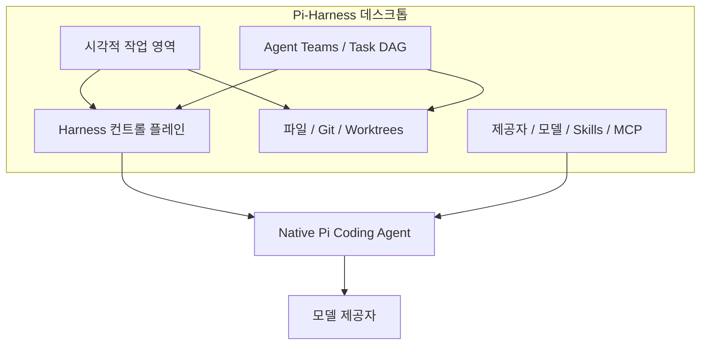

<div align="center">


### Pi Coding Agent의 Operational Superset

**Native Pi 에이전트를 하나의 데스크톱 작업 영역에서 관찰하고, 제어하고, 조율합니다.**<br>
에이전트는 여전히 Pi가 실행합니다. Pi-Harness는 그 주변에 작업 영역, 실행 기록, 복구, 에이전트 팀을 더하며,<br>
Pi 세션, 설정, Skills, 확장 기능은 앱 안과 밖에서 그대로 동작합니다.

`Pi Coding Agent ⊂ Pi-Harness`

[](https://github.com/wangmiaozero/pi-harness/releases) [](https://github.com/wangmiaozero/pi-harness/stargazers) [](https://github.com/wangmiaozero/pi-harness/actions/workflows/ci.yml) [](LICENSE)<br>
  

**[다운로드](https://github.com/wangmiaozero/pi-harness/releases)** &nbsp;·&nbsp; **[영상](#watch)** &nbsp;·&nbsp; **[기능](#features)** &nbsp;·&nbsp; **[Harness Plugins](#harness-plugins)** &nbsp;·&nbsp; **[문서](#documentation)** &nbsp;·&nbsp; **[변경 기록](CHANGELOG.md)**

[English](README.md) · [简体中文](README.zh-CN.md) · [繁體中文](README.zh-TW.md) · [日本語](README.ja-JP.md) · **한국어** · [Русский](README.ru-RU.md) · [Français](README.fr-FR.md) · [Deutsch](README.de-DE.md)

<br>


</div>

<br>

## 赞助商

<table>
  <tr>
    <td width="580" align="center" valign="middle">
        
    </td>
    <td valign="middle">
      Pi-Harness × Infistar.cc 无限星河｜Claude、GPT、Gemini、Grok、DeepSeek 等，一个 Key，只花官方价的零头，省 99%；低至官方 0.1 折，100% 官方纯血，每个模型都能验真；上千线路安全冗余自动切换，200+ 模型、16 个品牌，一个 Key 搞定。<br>
      Pi-Harness 用户通过<a href="https://infistar.cc/register?aff=S26RFM4B&ref_source=link">专属链接</a>注册直接送人民币 5 元：<a href="https://infistar.cc/register?aff=S26RFM4B&ref_source=link">https://infistar.cc/register?aff=S26RFM4B&ref_source=link</a>
    </td>
  </tr>
  <tr>
    <td width="580" align="center" valign="middle">
        
    </td>
    <td valign="middle">
      【腾讯云】WorkBuddy 全场景 AI 办公工作台，团队旗舰版低至198元/月<br>
      <a href="https://cloud.tencent.com/act/cps/redirect?redirect=6871&amp;cps_key=ece2099a1da90c2f7a4a4c437ad623f8&amp;from=console">https://cloud.tencent.com/act/cps/redirect?redirect=6871&amp;cps_key=ece2099a1da90c2f7a4a4c437ad623f8&amp;from=console</a>
    </td>
  </tr>
</table>

## Pi-Harness가 필요한가요?

[Pi Coding Agent](https://github.com/earendil-works/pi)는 터미널에서 잘 동작합니다. 하지만 실제 프로젝트에서는 곧 더 많은 것이 필요해집니다. 각 실행이 실제로 무엇을 했는지 확인하고, 실행이 잘못되면 좋은 상태로 되돌리고, 큰 작업을 여러 에이전트에 나누고 싶어집니다. Pi-Harness는 같은 Pi 위에서 이 모든 것을 하나의 데스크톱 앱으로 제공합니다.

- **모든 실행 확인**: Runs, Trace, Replay, Evaluation으로 도구 활동을 보고 결과를 비교하며, 기록된 근거로 실패 원인을 조사합니다.
- **복구 가능한 작업**: Policy, Budget, Checkpoints, Recovery로 도구 권한과 지출 한도를 정하고 복구 지점을 남기며, 작업을 재개, 분기, 재시도합니다.
- **팀 조율**: Agent Teams, Task DAG, Worktrees로 의존 관계가 있는 작업을 배정하고 Pi 에이전트 사이에 결과를 넘기며, 에이전트별 변경을 분리합니다.
- **Native Pi 그대로**: 에이전트 루프, 세션, 컨텍스트, 도구, 모델, 사고는 Pi가 실행합니다. Pi-Harness는 이를 시각적으로 관리하며, 앱 밖에서도 Pi를 계속 사용할 수 있습니다.

실제 프로젝트에서 Pi를 사용하면서 그 작업을 한 창에서 확인하고, 조정하고, 조율하고 싶다면 Pi-Harness가 맞습니다. 터미널에서 대화 하나로 충분하다면 Pi만으로도 괜찮습니다.

macOS, Windows, Linux에서 실행됩니다. 커뮤니티 설치 파일에는 Pi와 Node.js가 포함되어 있어 미리 설치할 것이 없습니다.

<a id="watch"></a>

## 영상

**작업 모드.** DeepSeek가 코딩 작업 영역으로 들어갑니다. 13초.

https://github.com/user-attachments/assets/942b73c9-ece9-485e-ad82-0e51225a73c1

**다시 만나서.** 컴패니언이 나타나고 작업 영역 개요가 열립니다. 11초.

https://github.com/user-attachments/assets/98708766-f490-4506-a33f-f1376d41770f

<a id="download"></a>
<a id="get-started"></a>

## 빠른 시작

**1 · 설치.** **[GitHub Releases](https://github.com/wangmiaozero/pi-harness/releases)** 페이지에서 시스템에 맞는 설치 파일을 다운로드합니다.

| | |
| :-- | :-- |
| **macOS** | Apple Silicon(`arm64`) 또는 Intel(`x64`)용 `.dmg`. 열고 Pi-Harness를 응용 프로그램 폴더로 드래그합니다 |
| **Windows** | x64 `.exe` 설치 프로그램. 실행하고 설치 디렉터리를 선택합니다 |
| **Linux** | x64 `.AppImage`. 실행 권한을 준 뒤 엽니다 |

```sh
chmod +x "./Pi-Harness-VERSION.AppImage"   # VERSION을 다운로드한 버전으로 바꾸세요
./Pi-Harness-VERSION.AppImage
```

<sub>설치 파일에는 Pi, Node.js, npm, npx가 포함되어 있어 Pi나 Node.js를 설치하거나 이 저장소를 복제하거나 pnpm을 설치할 필요가 없습니다. 릴리스 검증은 macOS Apple Silicon, macOS Intel, Windows x64, Linux x64를 대상으로 하며, 각 릴리스가 제공되는 플랫폼은 검증 결과에 따라 정해집니다. Linux 검증은 Ubuntu 24.04를 기준으로 하며, 다른 배포판과 FUSE 또는 데스크톱 통합은 별도 확인이 필요합니다. Windows와 Linux ARM64는 미리보기 대상입니다. 이전 패키지는 요구 사항이 다를 수 있으니 다운로드한 버전의 안내를 따르세요. macOS 빌드는 ad-hoc 서명되고 Windows 설치 프로그램은 서명되지 않았습니다. <a href="#verify-your-download">다운로드 확인</a>을 참고하세요.</sub>

**2 · 환경 확인.** Pi-Harness를 실행하고 개요에서 환경을 확인합니다.

**3 · 제공자 추가.** 제공자를 설정하고 연결을 테스트한 뒤 모델을 선택합니다. 모델을 사용하려면 인증 정보가 필요하거나 제공자 요금이 발생할 수 있습니다.

**4 · 작업 시작.** 독립 대화를 시작하거나 프로젝트를 연 뒤, Pi 세션을 시작하거나 이어서 대화, 파일, Git을 한 창에서 사용합니다. 실행을 확인하거나 팀을 조율하려면 **작업 영역 → 도구 → Harness / 에이전트**를 엽니다.

<a id="verify-your-download"></a>

### 다운로드 확인

커뮤니티 릴리스는 무료입니다. macOS 패키지는 **Apple Developer ID나 공증 없이 ad-hoc 서명**을 사용합니다. Windows 설치 프로그램은 **서명되지 않았으며** SmartScreen 경고가 표시될 수 있습니다. 앱 실행을 허용하기 전에 공식 다운로드 출처와 체크섬을 확인하세요. macOS에서 첫 실행이 차단되면 해당 앱에 대해 **시스템 설정 → 개인정보 보호 및 보안 → 그래도 열기**를 사용하세요. 시스템 보안 보호 기능은 켜 둔 상태로 유지하세요.

설치 파일과 함께 `SHA256SUMS`를 다운로드하고, 파일의 해시를 계산해 목록에서 같은 파일 이름의 값과 비교합니다(`VERSION`과 아키텍처는 다운로드한 파일에 맞게 바꾸세요).

```sh
shasum -a 256 "Pi-Harness-VERSION-arm64.dmg"   # macOS
sha256sum "Pi-Harness-VERSION.AppImage"        # Linux
```

```powershell
Get-FileHash ".\Pi-Harness-Setup-VERSION.exe" -Algorithm SHA256   # Windows
```

<sub>SHA256은 체크섬 목록과의 일치 여부를 확인할 뿐, 배포자의 신원을 독립적으로 증명하지는 않습니다. 공식 <a href="https://github.com/wangmiaozero/pi-harness/releases">GitHub Releases</a> 페이지를 이용하고, 취약점이 의심되면 <a href="mailto:tuziling84@gmail.com">tuziling84@gmail.com</a>으로 비공개로 알려 주세요. 커뮤니티 빌드는 앱에서 새 버전을 확인하고, 모든 플랫폼에서 수동 다운로드와 설치를 위해 Releases 페이지를 엽니다. 버전 간 설치가 검증될 때까지 자동 설치는 꺼져 있으며, 기존 설치는 이전 업데이트 방식을 유지합니다. <a href="docs/release/community-release.md">Community Release</a>와 <a href="docs/release/update-strategy.md">업데이트 안내</a>를 참고하세요.</sub>

<a id="architecture"></a>

## 구성 방식

실행과 Native 세션은 Pi가 담당합니다. Harness는 각 실행을 관찰하고 그 주변에 정책, 예산, 체크포인트, 복구, 평가를 적용합니다. 에이전트 팀도 같은 Pi 실행 엔진을 사용합니다. 대화 기록과 프로젝트 아키텍처는 작업 영역 도구이며, 테마로 모양을 꾸밀 수 있습니다. 다이어그램은 클래스 상속이 아니라 모듈 관계를 나타냅니다.



<a id="pi-vs-pi-harness"></a>

<details>
<summary><b>Native Pi와 Pi-Harness</b> 기능별 비교</summary>

<br>

| 기능                     | Native Pi | Pi-Harness         |
| ------------------------ | --------- | ------------------ |
| Agent Runtime            | 지원      | Native Pi          |
| Agent Loop               | 지원      | Native Pi          |
| Sessions                 | 지원      | 지원 + 시각적 관리 |
| Context                  | 지원      | 지원 + 확인 화면   |
| Compaction               | 지원      | 지원 + 시각적 제어 |
| Steering                 | 지원      | 지원               |
| Follow-up                | 지원      | 지원               |
| Models                   | 지원      | 지원 + 관리 화면   |
| Thinking                 | 지원      | 지원 + 시각적 제어 |
| Tools                    | 지원      | 지원 + 선택과 정책 |
| Skills                   | 지원      | 지원 + 관리 화면   |
| Extensions               | 지원      | 지원 + 관리 화면   |
| Packages                 | 지원      | 지원 + 관리 화면   |
| MCP / Codemode           | 지원      | 지원 + 선택과 정책 |
| Runs                     | —         | 지원               |
| Trace                    | —         | 지원               |
| Replay                   | —         | 지원               |
| Run Compare              | —         | 지원               |
| Evaluation               | —         | 지원               |
| Policy                   | —         | 지원               |
| Budget                   | —         | 지원               |
| Checkpoints              | —         | 지원               |
| Recovery                 | —         | 지원               |
| Diagnostics              | —         | 지원               |
| Regression               | —         | 지원               |
| Artifacts                | —         | 지원               |
| Multi-Agent              | —         | 지원               |
| Task DAG                 | —         | 지원               |
| Handoff                  | —         | 지원               |
| Review Gates             | —         | 지원               |
| Worktree isolation       | —         | 지원               |
| Project architecture map | —         | 지원               |

</details>

<a id="features"></a>

## 주요 기능

### 작업 영역, 파일, Git

독립 대화를 시작하거나 프로젝트를 열어 Pi 세션을 이어서 실행합니다. 스트리밍 응답, 사고 과정, 도구 호출, 이미지, 변경된 파일을 확인하고 모델, 사고 수준, 도구를 선택하거나 대화를 압축합니다. 작업 영역 도구에서 Harness나 에이전트를 열어도 대화와 초안은 유지됩니다.

파일을 탐색하고 검색하며 미디어와 문서를 미리 보고, 구문 강조, 줄 번호, 찾기, 실행 취소/다시 실행, 명시적 저장, 외부 변경 충돌 보호를 갖춘 편집기로 텍스트를 수정합니다. Git에서는 차이, 이력, 활동 그래프, 커밋, 선택형 AI 커밋 메시지, worktree를 이용합니다.

<table>
<tr>
<td width="50%"><br><sub>가벼운 파일 편집</sub></td>
<td width="50%"><br><sub>Git</sub></td>
</tr>
</table>

<a id="harness"></a>

### Harness 컨트롤 플레인

모든 Pi 실행은 확인하고, 비교하고, 복구할 수 있는 기록을 남깁니다.

| | |
| :-- | :-- |
| **관찰** | Runs, Trace, Replay, 타임라인, 도구 활동. 실행을 비교하고 Run Tree에서 분기와 재시도를 추적합니다 |
| **측정** | 실행별 토큰, 비용, 소요 시간과 결과물, 프로젝트 통계 |
| **제어** | 도구 정책과 실행별 예산. 체크포인트를 만들고 작업을 재개, 분기, 재시도합니다 |
| **검사** | Evaluation, Diagnostics, 회귀 기준선으로 결과를 확인하고 기록된 실행 근거에서 실패 원인을 조사합니다 |

<table>
<tr>
<td width="50%"><br><sub>세션 상태와 대기 중인 지시</sub></td>
<td width="50%"><br><sub>Harness 콘솔</sub></td>
</tr>
</table>

<a id="multi-agent"></a>

### 멀티 에이전트 조율

**작업 영역 → 도구 → 에이전트**를 열어 재사용 가능한 팀과 템플릿으로 Pi 에이전트를 조율합니다. 의존성과 우선순위를 지정해 작업을 배정하고, 수동·순차·병렬로 실행하며, 결과와 산출물을 다음 작업에 넘기고, 검토 관문을 추가합니다. Worktrees로 에이전트별 변경을 분리합니다. 예산, 충돌 알림과 일시 정지, 재개, 중단, 재시도, 건너뛰기, 재할당으로 작업을 관리합니다.

<table>
<tr>
<td width="50%"><br><sub>실행 전 예시 팀: 대기 중인 에이전트 세 명, 모든 작업 대기 중</sub></td>
<td width="50%"><br><sub>작업 의존성과 검토 요구 사항</sub></td>
</tr>
</table>

<a id="conversation-history"></a>

### 통합 대화 기록

Claude Code, Codex(데스크톱과 보관된 대화 포함), Cursor, Cursor Agent, Gemini CLI, OpenCode, Pi 기록을 함께 봅니다. 검색하고 출처, 프로젝트, 날짜 범위로 필터링하며 사용자 지정 기록 폴더를 추가합니다.

원본 대화를 읽기 전용으로 열고, 인계 내용을 미리 보며, 다음 지시를 편집한 뒤 같은 프로젝트의 새 Pi 대화에서 이어갑니다. 기록 보기, 로컬 미리보기, 스캔 재시도는 모델 토큰을 사용하지 않습니다. 선택형 AI 요약은 직접 요청할 때만 설정된 모델을 사용합니다.

<table>
<tr>
<td width="50%"><br><sub>대화 기록</sub></td>
<td width="50%"><br><sub>세션 정리</sub></td>
</tr>
</table>

<a id="project-architecture"></a>

### 프로젝트 아키텍처 맵

작업 영역에서 Architecture를 열어 모듈, 의존성, 진입점, 소스 참조를 탐색합니다. 패키지로 필터링하고, 모듈에 집중하고, 맵을 페이지별로 넘기고, 확대·축소하거나 전체 화면으로 볼 수 있습니다. 분석 스냅샷을 저장하고 소스 변경으로 오래된 스냅샷을 확인하며, JSON, 오프라인 HTML 또는 현재 화면의 PNG로 내보냅니다.

| | |
| :-- | :-- |
| **로컬 우선** | 분석은 로컬에서 실행되며 모델 토큰을 사용하지 않습니다. AI 설명은 선택 사항입니다 |
| **분석 범위** | JavaScript, TypeScript, Vue의 import는 로컬에서 분석하고, 다른 지원 언어는 파일 단위 색인을 제공합니다. 분석마다 범위와 한계를 표시합니다 |
| **적용 범위** | 맵은 지원되는 정적 의존성을 나타내며, 완전한 함수 호출 그래프는 아닙니다 |


<a id="providers-and-models"></a>
<a id="skills-extensions-packages-and-mcp"></a>

### 제공자, 모델, Skills

| | |
| :-- | :-- |
| **제공자** | 프리셋이나 사용자 지정 엔드포인트로 Pi 호환 제공자를 설정하고, 인증 정보를 관리하며, 지원되는 경우 모델 목록을 불러오고, 연결을 테스트하고, 대화 모델을 선택합니다 |
| **이미지** | 지원하는 이미지 모델로 텍스트에서 이미지를 만들거나 이미지를 편집하고 결과를 다운로드합니다 |
| **OpenCode Zen / Go** | 모델의 OpenCode 탭에서 API 키를 저장하고 원하는 모델을 켭니다. 모델은 자동으로 불러오며 하나씩 또는 한꺼번에 확인할 수 있습니다. 이용 가능 여부와 요금은 공식 계정과 모델에 따라 다르며, 유료 확인은 먼저 허락을 구합니다. 요금과 데이터 정책은 [OpenCode 모델 정보](https://opencode.ai/v2/docs/console/models/)를 참고하세요 |
| **Skills** | 내장 및 로컬 Skills를 찾아보고 편집합니다. 입력창에 `@`를 입력해 설치된 Skill을 검색하고 호출합니다 |
| **패키지와 확장 기능** | 기능 센터에서 Pi 패키지와 확장 기능을 관리합니다. [Superpowers](https://github.com/obra/superpowers) 같은 선택형 추가 기능은 원할 때만 설치, 업데이트, 제거됩니다 |

<table>
<tr>
<td width="50%"><br><sub>제공자와 모델</sub></td>
<td width="50%"><br><sub>기능 센터</sub></td>
</tr>
</table>

<a id="mcp-marketplace"></a>

### MCP 서버와 마켓

**설정 → MCP**에서 로컬 명령 또는 HTTP 서버를 추가하고, **전체 / 전역 / 프로젝트**로 필터링하고, 프로젝트를 선택해 각 범위의 서버를 편집하거나 활성화합니다. 다른 도구의 설정을 스캔하고 검토한 뒤 가져올 수 있습니다.

마켓에는 Memory, Context7, Playwright, Filesystem, GitHub 등 **15개의 내장 서버 템플릿**이 있으며, 공식 MCP 레지스트리 검색과 페이지 이동도 지원합니다. 저장하기 전에 설정과 저장 위치를 미리 확인합니다. 템플릿은 설치용이며 모두 기본으로 활성화되지는 않습니다. 가져온 항목과 레지스트리 항목은 비활성 상태로 저장되므로 먼저 설정을 마칠 수 있습니다.


<a id="agent-settings"></a>

### 에이전트 설정

**v2.2.10 이상에서 사용할 수 있습니다.** 설치 파일의 지원 여부는 릴리스 노트를 확인하세요.

| 페이지 | 설정 내용 | |
| :-- | :-- | :-- |
| **AI** | 기본 사고 수준, 자동 압축, 재시도 동작, 작업 영역 기본 설정 | [스크린샷](docs/%E5%8A%9F%E8%83%BD%E7%95%8C%E9%9D%A2/%E7%BB%8F%E5%85%B8%E4%B8%BB%E9%A2%98/AI.png) |
| **실시간 음성** | 작업 영역 통화에 사용할 음성 서비스와 계정 | [스크린샷](docs/%E5%8A%9F%E8%83%BD%E7%95%8C%E9%9D%A2/%E7%BB%8F%E5%85%B8%E4%B8%BB%E9%A2%98/%E5%AE%9E%E6%97%B6%E8%AF%AD%E9%9F%B3.png) |
| **단축키** | 명령 팔레트, 설정, 새 세션, 탭 닫기의 사용자 단축키 또는 기본값 | [스크린샷](docs/%E5%8A%9F%E8%83%BD%E7%95%8C%E9%9D%A2/%E7%BB%8F%E5%85%B8%E4%B8%BB%E9%A2%98/%E5%BF%AB%E6%8D%B7%E9%94%AE.png) |
| **지침** | 전역 또는 프로젝트 지침 | [스크린샷](docs/%E5%8A%9F%E8%83%BD%E7%95%8C%E9%9D%A2/%E7%BB%8F%E5%85%B8%E4%B8%BB%E9%A2%98/%E6%8C%87%E4%BB%A4.png) |
| **MCP** | 범위별 MCP 서버 | [스크린샷](docs/%E5%8A%9F%E8%83%BD%E7%95%8C%E9%9D%A2/%E7%BB%8F%E5%85%B8%E4%B8%BB%E9%A2%98/MCP%E6%9C%8D%E5%8A%A1%E5%99%A8.png) |
| **하위 에이전트** | 역할, 지침, 모델, 사고 수준, 도구를 지정한 재사용 하위 에이전트. 공유 작업 영역이나 격리된 worktree를 선택한 뒤 작업을 시작하거나 팀에서 템플릿을 재사용합니다 | [스크린샷](docs/%E5%8A%9F%E8%83%BD%E7%95%8C%E9%9D%A2/%E7%BB%8F%E5%85%B8%E4%B8%BB%E9%A2%98/%E5%AD%90%E6%99%BA%E8%83%BD%E4%BD%93.png) |
| **원격 호스트** | 주소와 페어링 토큰으로 페어링한 pi-host 실행 호스트 | [스크린샷](docs/%E5%8A%9F%E8%83%BD%E7%95%8C%E9%9D%A2/%E7%BB%8F%E5%85%B8%E4%B8%BB%E9%A2%98/%E8%BF%9C%E7%A8%8B%E4%B8%BB%E6%9C%BA.png) |

<a id="realtime-voice"></a>

### 실시간 음성

**OpenAI Realtime, Gemini Live 또는 Codex Live**로 작업 영역과 대화합니다. 지원 서비스 계정이나 별도 API 키를 사용할 수 있으며, Codex Live는 Pi의 기존 Codex 로그인을 사용합니다. 서비스 이용 가능 여부와 요금은 계정에 따라 다릅니다.

1. **설정 → 실시간 음성**을 열고 음성을 켠 뒤 서비스와 계정을 선택해 저장합니다.
2. 작업 영역 대화에서 입력창 옆의 파형 버튼을 누릅니다.
3. 대상 대화와 선택적 컨텍스트 공유를 확인하고 **실시간 음성 시작**을 선택한 뒤 마이크 접근을 허용합니다.
4. 다른 페이지로 이동한 뒤에도 플로팅 컨트롤에서 음소거, 전사 보기, 통화 종료를 할 수 있습니다.

최근 컨텍스트 공유는 기본적으로 꺼져 있습니다. 켜면 첨부 파일과 도구 결과를 제외한 최근 여섯 개의 일반 텍스트 메시지만 포함합니다. 통화 중의 작업 요청은 확인한 뒤에만 작업 대화로 전송됩니다.


<a id="remote-hosts"></a>

### 원격 호스트

**설정 → 원격 호스트**에서 **pi-host**를 실행하는 호스트의 주소와 페어링 토큰으로 페어링합니다. 호스트를 연결하거나 해제하고, 프로젝트와 세션을 탐색하고, 대화를 보고, 프롬프트를 보내고, 승인 요청에 응답합니다. 원격 호스트는 미리 실행 중이고 연결 가능해야 합니다.

<a id="desktop-companion"></a>

### 데스크톱 컴패니언

**설정 → 데스크톱 펫**에서 설치된 데스크톱 펫을 켜면 생각 중, 도구 활동, 대기, 완료 상태를 데스크톱에서 확인할 수 있습니다. 기본적으로 꺼져 있으며 메인 창을 최소화해도 계속 표시됩니다.

대기 중에는 검색 가능한 우클릭 메뉴에서 193가지 동작을 선택할 수 있습니다. 작업 중에는 수동 상호작용이 멈추고, 드래그해도 작업 애니메이션이 이어집니다. 로컬 펫 팩을 가져오고 크기, 불투명도, 말풍선을 슬라이더로 조절합니다.

<table>
<tr>
<td width="33%"><br><sub>설정과 슬라이더</sub></td>
<td width="33%"><br><sub>우클릭 메뉴</sub></td>
<td width="33%"><br><sub>동작 검색</sub></td>
</tr>
</table>

<a id="themes-and-custom-skins"></a>
<a id="screenshots"></a>

### 테마와 커스텀 스킨

클래식 색상, Ming 테마, Starship Cockpit, macOS 27 배경 또는 가져온 커스텀 스킨을 선택합니다. 새 설치는 **부드러운 라이트**로 시작합니다. 대화 표시 이름, 앱 아이콘, 로컬 배경 이미지, 창·화면 글로우, 입력창 불꽃 효과를 설정합니다. 환경 검사 중에는 시작 애니메이션이 표시됩니다.

캐릭터 테마와 데스크톱 펫은 선택형 팩입니다. **설정 → 리소스 마켓**을 열어 GitHub 카탈로그에서 `@piharness` 팩을 하나씩 설치합니다. 앱은 네트워크 연결 없이도 시작됩니다. 이전에 선택한 테마나 펫은 파일이 아직 설치되지 않아도 유지되며, 해당 팩을 설치할 때까지 작업 영역은 기본 모습을 사용합니다. [docs/market/MARKET.md](docs/market/MARKET.md)를 참고하세요.

[Pi-Harness 커스텀 스킨 스타터](https://github.com/wangmiaozero/pi-harness-skin-starter)로 **나만의 스킨을 만들 수 있습니다**.

1. 스타터 저장소를 템플릿으로 사용하거나 다운로드합니다.
2. 코딩 에이전트로 열고 포함된 프롬프트에 원하는 스타일을 설명합니다.
3. 완성된 프로젝트를 **설정 → 테마 → 스킨 가져오기**에서 가져옵니다.

다국어 스타터는 색상, 미리보기, 배경화면, 선택형 캐릭터 이미지 안내를 제공합니다. 스킨을 별도 저장소에 두면 독립적으로 업데이트하고 공유할 수 있습니다.

<table>
<tr>
<td width="50%"><br><sub>Ming · 눈 속의 관리</sub></td>
<td width="50%"><br><sub>Ming · 눈밤의 피리 연주자</sub></td>
</tr>
<tr>
<td width="50%"><br><sub>Ming · 달빛의 서생</sub></td>
<td width="50%"><br><sub>Starship Cockpit</sub></td>
</tr>
<tr>
<td width="50%"><br><sub>Ming · 일반 설정</sub></td>
<td width="50%"><br><sub>Ming · 테마와 스킨 갤러리</sub></td>
</tr>
<tr>
<td colspan="2"><br><sub>macOS 27 · Liquid Ether</sub></td>
</tr>
</table>

<a id="harness-plugins"></a>

### Harness Plugins

**Plugin SDK v1.0.0 · Pi-Harness v2.2.6부터 포함.** 플러그인은 Pi 자체를 확장하는 방식과 나란히, 에이전트 주변의 운영 기능을 확장합니다.

| 확장 | 용도 |
| :-- | :-- |
| **Pi Extensions** | Pi 에이전트 자체를 확장합니다 |
| **Skills** | 에이전트에 지침과 워크플로 지식을 제공합니다 |
| **MCP** | 에이전트를 도구와 외부 서비스에 연결합니다 |
| **Harness Plugins** | 에이전트 주변의 Pi-Harness 운영 기능을 확장합니다 |

**Harness Event Subscribers, Custom Evaluators, Trace Exporters, Agent Team Templates**를 제공할 수 있습니다. 평가는 보조 수단이고, 내보내기는 승인된 JSON 데이터를 사용하며, 팀 템플릿은 확인 후 시작할 수 있는 대기 중인 워크플로를 만듭니다. 관리되는 SDK 예제를 사용해 보세요: [Run Metrics](examples/harness-plugins/run-metrics/plugin.json), [Quality Evaluator](examples/harness-plugins/quality-evaluator/plugin.json), [Team Template](examples/harness-plugins/team-template/plugin.json).

소스 빌드에서 **작업 영역 → 도구 → Harness → Harness Plugins → 로컬 플러그인 설치**를 열고 폴더를 선택한 뒤 권한을 검토하고 활성화합니다. 설치 과정에서는 코드가 실행되지 않습니다. 실행 가능한 플러그인은 명시적인 Native 신뢰 승인이 필요합니다. **별도 프로세스는 보안 샌드박스가 아니며, 승인된 Node 코드는 컴퓨터에 접근할 수 있습니다**. 신뢰할 수 없는 콘텐츠에는 선언형 템플릿을 사용하세요.

[개발 및 설치](docs/plugins/getting-started.md) · [아키텍처](docs/plugins/architecture.md) · [SDK API](docs/plugins/api-reference.md) · [보안 경계](docs/plugins/security.md)

### 그 밖의 기능

- **환경 검사**: Node.js, npm, PATH, Pi Coding Agent, 현재 설정을 확인합니다. 지원 환경에서 Pi를 설치, 업데이트, 복구하고, 진단을 살펴보고, 설정 백업을 관리합니다.
- **런타임**: 번들된 Pi와 Node 런타임을 바로 사용할 수 있으며, 설정에서 시스템 또는 사용자 지정 런타임을 선택할 수 있습니다.
- **앱 업데이트**: 앱 안에서 새 버전을 확인합니다.
- **여덟 개 언어**: English, 简体中文, 繁體中文, 日本語, 한국어, Русский, Français, Deutsch.

<a id="documentation"></a>

## 문서

| | |
| :-- | :-- |
| **[에이전트 설정 가이드](docs/agent-settings.md)** | AI, 실시간 음성, 단축키, 지침, MCP, 하위 에이전트, 원격 호스트 |
| **[리소스 마켓](docs/market/MARKET.md)** | 테마와 데스크톱 펫 팩 설치 |
| **[Harness Plugins](docs/plugins/getting-started.md)** | 플러그인 개발과 설치. [아키텍처](docs/plugins/architecture.md), [SDK API](docs/plugins/api-reference.md), [보안 경계](docs/plugins/security.md)도 참고하세요 |
| **[Community Release](docs/release/community-release.md)** | 커뮤니티 빌드의 서명, 검증, [업데이트](docs/release/update-strategy.md) 방식 |
| **[문제 해결](docs/release/troubleshooting.md)** | 체크섬, 보안 경고, 실행, 업데이트 문제 |
| **[스크린샷 목록](docs/README.md)** | 모든 화면과 테마를 분류별로 정리 |
| **[변경 기록](CHANGELOG.md)** | 릴리스별 변경 사항 |

## 개발

**Node.js 24 LTS (≥ 24.22.1)**, **pnpm 9.12.1**을 설치한 뒤 다음을 실행합니다.

```sh
git clone https://github.com/wangmiaozero/pi-harness.git
cd pi-harness
pnpm install --frozen-lockfile
pnpm dev
```

<sub>별도의 Pi 설치 없이 개발하려면 <a href="fixtures/README.md">fixtures</a>의 예시 설정을 사용하세요. 설정에서 수동 설정 디렉터리를 <code>fixtures/mock-pi</code>의 절대 경로로 지정합니다. 예시 설정으로는 실제 모델에 접근할 수 없으므로 필요하면 직접 제공자를 설정하세요.</sub>

변경 사항을 보내기 전에 검사를 실행하세요. 주요 데스크톱 흐름을 변경했다면 `pnpm test:e2e`도 실행하세요.

```sh
pnpm typecheck
pnpm lint
pnpm test
pnpm compile
```

## 커뮤니티

- **[Issues](https://github.com/wangmiaozero/pi-harness/issues)**: 버그를 신고하거나 개선을 제안합니다. 앱 버전, 운영체제, 재현 단계를 포함하고 인증 정보와 개인 대화 내용은 지워 주세요.
- **[Pull requests](https://github.com/wangmiaozero/pi-harness/pulls)**: 문제, 사용자에게 보이는 변경, 검증 결과를 설명해 주세요. 문서, 번역, 테마, 범위가 명확한 수정을 환영합니다.
- **[커스텀 스킨](https://github.com/wangmiaozero/pi-harness-skin-starter)**: 스킨을 만들고 공유하세요.
- **QQ 그룹**: pi-harness · **1109717308**. 코드를 스캔해 참여하세요.

<p align="center">
  
</p>

Pi-Harness가 Pi 작업을 더 편하게 해 준다면 **⭐ 하나가 다른 사람들이 찾는 데 도움이 됩니다.**

<picture>
  <source media="(prefers-color-scheme: dark)" srcset="https://api.star-history.com/svg?repos=wangmiaozero/pi-harness&type=Date&theme=dark">
  
</picture>

## 감사의 말

Pi-Harness는 공식 [Pi Coding Agent와 Pi Agent Harness](https://github.com/earendil-works/pi)를 중심으로 만들었습니다. 제작·유지 관리: [wangmiao](https://github.com/wangmiaozero) · [tuziling84@gmail.com](mailto:tuziling84@gmail.com).

**PR 기여자**

<table>
  <tr>
    <td align="center">
      <br /><a href="https://github.com/HenryArch"><b>HenryArch</b></a><br />
      <a href="https://github.com/wangmiaozero/pi-harness/pull/8">PR #8</a>
    </td>
  </tr>
</table>

Pi-Harness를 개선하는 PR을 환영합니다. 프로젝트를 더 좋게 만들어 주시는 모든 기여자분께 감사드립니다!

## 라이선스

[GNU Affero General Public License v3.0 only](LICENSE) (`AGPL-3.0-only`).

Copyright © 2026 [wangmiao](https://github.com/wangmiaozero).
