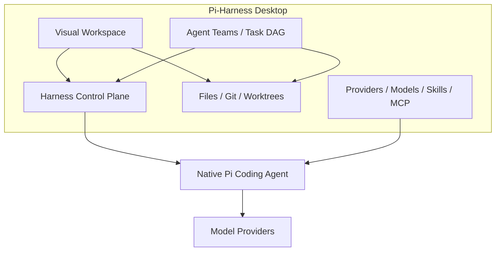

<div align="center">


### The Operational Superset of Pi Coding Agent

**Observe, control, and orchestrate native Pi agents in one desktop workspace.**<br>
Pi still runs every agent. Pi-Harness adds the workspace, run history, recovery and agent teams around it,<br>
and your Pi sessions, configuration, Skills and extensions keep working inside and outside the app.

`Pi Coding Agent ⊂ Pi-Harness`

[](https://github.com/wangmiaozero/pi-harness/releases) [](https://github.com/wangmiaozero/pi-harness/stargazers) [](https://github.com/wangmiaozero/pi-harness/actions/workflows/ci.yml) [](LICENSE)<br>
  

**[Download](https://github.com/wangmiaozero/pi-harness/releases)** &nbsp;·&nbsp; **[Watch](#watch)** &nbsp;·&nbsp; **[Features](#features)** &nbsp;·&nbsp; **[Harness Plugins](#harness-plugins)** &nbsp;·&nbsp; **[Docs](#documentation)** &nbsp;·&nbsp; **[Changelog](CHANGELOG.md)**

**English** · [简体中文](README.zh-CN.md) · [繁體中文](README.zh-TW.md) · [日本語](README.ja-JP.md) · [한국어](README.ko-KR.md) · [Русский](README.ru-RU.md) · [Français](README.fr-FR.md) · [Deutsch](README.de-DE.md)

<br>


</div>

<br>

## 赞助商

<table>
  <tr>
    <td width="580" align="center" valign="middle">
        <a href="https://infistar.cc/register?aff=S26RFM4B&ref_source=link" style="color:transparent;background-color:transparent;text-decoration:none;border:none;"></a>
    </td>
    <td valign="middle">
      Pi-Harness × Infistar.cc 无限星河｜Claude、GPT、Gemini、Grok、DeepSeek 等，一个 Key，只花官方价的零头，省 99%；低至官方 0.1 折，100% 官方纯血，每个模型都能验真；上千线路安全冗余自动切换，200+ 模型、16 个品牌，一个 Key 搞定。<br>
      Pi-Harness 用户通过<a href="https://infistar.cc/register?aff=S26RFM4B&ref_source=link">专属链接</a>注册直接送人民币 5 元：<a href="https://infistar.cc/register?aff=S26RFM4B&ref_source=link">https://infistar.cc/register?aff=S26RFM4B&ref_source=link</a>
    </td>
  </tr>
  <tr>
    <td width="580" align="center" valign="middle">
        <a href="https://cloud.tencent.com/act/cps/redirect?redirect=6871&amp;cps_key=ece2099a1da90c2f7a4a4c437ad623f8&amp;from=console" style="color:transparent;background-color:transparent;text-decoration:none;border:none;"></a>
    </td>
    <td valign="middle">
      【腾讯云】WorkBuddy 全场景 AI 办公工作台，团队旗舰版低至198元/月<br>
      <a href="https://cloud.tencent.com/act/cps/redirect?redirect=6871&amp;cps_key=ece2099a1da90c2f7a4a4c437ad623f8&amp;from=console">https://cloud.tencent.com/act/cps/redirect?redirect=6871&amp;cps_key=ece2099a1da90c2f7a4a4c437ad623f8&amp;from=console</a>
    </td>
  </tr>
</table>

## Is Pi-Harness for you?

[Pi Coding Agent](https://github.com/earendil-works/pi) works well in a terminal. On real projects you soon want more: to see what each run actually did, to get back to a good state when a run goes wrong, and to split a bigger job across several agents. Pi-Harness puts all of that in one desktop app, on top of the same Pi:

- **See every run**: Runs, Trace, Replay and Evaluation show tool activity, compare outcomes, and let you investigate failures from recorded evidence.
- **Keep work recoverable**: Policy, Budget, Checkpoints and Recovery set tool permissions and spending limits, keep recovery points, and let you resume, fork or retry.
- **Coordinate a team**: Agent Teams, Task DAG and Worktrees assign dependent tasks, pass results between Pi agents, and keep each agent's changes separate.
- **Stay on native Pi**: Pi runs the agent loop, sessions, context, tools, models and thinking. Pi-Harness manages them visually, and you can keep using Pi outside the app.

It's for you if you use Pi on real projects and want to see, steer and coordinate its work from one window. If one chat in a terminal is all you need, Pi on its own is enough.

Runs on macOS, Windows and Linux. Community installers bundle Pi and Node.js, so there is nothing else to install first.

<a id="watch"></a>

## Watch

**Work mode.** DeepSeek opens into the coding workspace. 13 seconds.

https://github.com/user-attachments/assets/942b73c9-ece9-485e-ad82-0e51225a73c1

**Welcome back.** The companion appears and the workspace overview opens. 11 seconds.

https://github.com/user-attachments/assets/98708766-f490-4506-a33f-f1376d41770f

<a id="download"></a>
<a id="get-started"></a>

## Quick start

**1 · Install.** Download the installer for your system from **[GitHub Releases](https://github.com/wangmiaozero/pi-harness/releases)**:

| | |
| :-- | :-- |
| **macOS** | The `.dmg` for Apple Silicon (`arm64`) or Intel (`x64`). Open it and drag Pi-Harness to Applications |
| **Windows** | The x64 `.exe` installer. Run it and choose an installation directory |
| **Linux** | The x64 `.AppImage`. Make it executable, then open it |

```sh
chmod +x "./Pi-Harness-VERSION.AppImage"   # replace VERSION with the downloaded version
./Pi-Harness-VERSION.AppImage
```

<sub>Installers include Pi, Node.js, npm and npx: you don't need to install Pi or Node.js, clone this repository or install pnpm. Release validation covers macOS Apple Silicon, macOS Intel, Windows x64 and Linux x64, and each release's verified results decide which platforms it ships for. Linux validation targets Ubuntu 24.04; other distributions and FUSE or desktop integration need their own checks. Windows and Linux ARM64 are preview targets. Older packages may have different requirements, so follow the notes for the version you download. macOS builds are ad-hoc signed and Windows installers are unsigned: see <a href="#verify-your-download">Verify your download</a>.</sub>

**2 · Check the environment.** Launch Pi-Harness and check the environment in Overview.

**3 · Add a provider.** Configure a provider, test the connection and select a model. Model access may require credentials and incur provider charges.

**4 · Start working.** Start a standalone chat or open a project, then start or resume a Pi session and work with conversations, files and Git in one window. Open **Workspace → Tools → Harness / Agents** to inspect runs or coordinate a team.

<a id="verify-your-download"></a>

### Verify your download

Community releases are free. macOS packages use **ad-hoc signing without Apple Developer ID or notarization**. Windows installers are **unsigned** and may show SmartScreen warnings. Verify the official download source and checksum before allowing the app to open. If macOS blocks the first launch, use **System Settings → Privacy & Security → Open Anyway** for that app. Keep system security protections enabled.

Download `SHA256SUMS` alongside the installer, calculate the hash of your file and compare it with the same filename in the list (replace `VERSION` and the architecture with your download's values):

```sh
shasum -a 256 "Pi-Harness-VERSION-arm64.dmg"   # macOS
sha256sum "Pi-Harness-VERSION.AppImage"        # Linux
```

```powershell
Get-FileHash ".\Pi-Harness-Setup-VERSION.exe" -Algorithm SHA256   # Windows
```

<sub>SHA256 checks consistency with the checksum list; it does not independently prove publisher identity. Use the official <a href="https://github.com/wangmiaozero/pi-harness/releases">GitHub Releases</a> page, and report suspected vulnerabilities privately to <a href="mailto:tuziling84@gmail.com">tuziling84@gmail.com</a>. Community builds check for new versions in the app and open the Releases page for manual download and installation on all platforms. Automatic installation stays disabled until cross-version installation is verified, and existing installations keep their previous update behavior. See <a href="docs/release/community-release.md">Community Release</a> and <a href="docs/release/update-strategy.md">update details</a>.</sub>

<a id="architecture"></a>

## How it fits together

Pi owns execution and native sessions. Harness observes each run and applies policies, budgets, checkpoints, recovery and evaluation around it. Agent teams use the same Pi execution engine. Conversation history and project architecture are workspace tools, and themes customize the look. The diagram shows module relationships, not class inheritance.



<a id="pi-vs-pi-harness"></a>

<details>
<summary><b>Native Pi and Pi-Harness</b>, capability by capability</summary>

<br>

| Capability               | Native Pi | Pi-Harness                 |
| ------------------------ | --------- | -------------------------- |
| Agent Runtime            | Yes       | Native Pi                  |
| Agent Loop               | Yes       | Native Pi                  |
| Sessions                 | Yes       | Yes + visual management    |
| Context                  | Yes       | Yes + inspection           |
| Compaction               | Yes       | Yes + visual control       |
| Steering                 | Yes       | Yes                        |
| Follow-up                | Yes       | Yes                        |
| Models                   | Yes       | Yes + manager              |
| Thinking                 | Yes       | Yes + visual control       |
| Tools                    | Yes       | Yes + selection and policy |
| Skills                   | Yes       | Yes + manager              |
| Extensions               | Yes       | Yes + manager              |
| Packages                 | Yes       | Yes + manager              |
| MCP / Codemode           | Yes       | Yes + selection and policy |
| Runs                     | —         | Yes                        |
| Trace                    | —         | Yes                        |
| Replay                   | —         | Yes                        |
| Run Compare              | —         | Yes                        |
| Evaluation               | —         | Yes                        |
| Policy                   | —         | Yes                        |
| Budget                   | —         | Yes                        |
| Checkpoints              | —         | Yes                        |
| Recovery                 | —         | Yes                        |
| Diagnostics              | —         | Yes                        |
| Regression               | —         | Yes                        |
| Artifacts                | —         | Yes                        |
| Multi-Agent              | —         | Yes                        |
| Task DAG                 | —         | Yes                        |
| Handoff                  | —         | Yes                        |
| Review Gates             | —         | Yes                        |
| Worktree isolation       | —         | Yes                        |
| Project architecture map | —         | Yes                        |

</details>

<a id="features"></a>

## What it does

### Workspace, files and Git

Start a standalone chat, or open a project and resume a Pi session. Follow streaming replies, thinking, tool calls, images and changed files; choose the model, thinking level and tools, or compact the conversation. Opening Harness or Agents from Workspace Tools keeps your conversation and draft.

Browse and search files, preview media and documents, and edit readable text with syntax highlighting, line numbers, find, undo/redo, explicit save and external-change conflict protection. Git gives you diffs, history, activity graphs, commits, optional AI commit messages and worktrees.

<table>
<tr>
<td width="50%"><br><sub>Lightweight file editing</sub></td>
<td width="50%"><br><sub>Git</sub></td>
</tr>
</table>

<a id="harness"></a>

### Harness control plane

Every Pi run leaves a record you can inspect, compare and recover from.

| | |
| :-- | :-- |
| **Observe** | Runs, Trace, Replay, timelines and tool activity. Compare runs and follow forks and retries in the Run Tree |
| **Measure** | Tokens, cost and duration for each run, plus artifacts and project statistics |
| **Control** | Tool policies and per-run budgets. Create checkpoints, then resume, fork or retry work |
| **Check** | Evaluation, Diagnostics and regression baselines check results and investigate failures from recorded run evidence |

<table>
<tr>
<td width="50%"><br><sub>Session status and queued instructions</sub></td>
<td width="50%"><br><sub>Harness console</sub></td>
</tr>
</table>

<a id="multi-agent"></a>

### Multi-agent orchestration

Open **Workspace → Tools → Agents** to coordinate Pi agents with reusable teams and templates. Assign tasks with dependencies and priorities, schedule them manually, sequentially or in parallel, pass results and artifacts to the next task, and add review gates. Worktrees keep each agent's changes separate. Budgets, conflict hints, and pause, resume, abort, retry, skip and reassign controls help you manage the work.

<table>
<tr>
<td width="50%"><br><sub>A sample team before execution: three idle agents, all tasks pending</sub></td>
<td width="50%"><br><sub>Task dependencies and a review requirement</sub></td>
</tr>
</table>

<a id="conversation-history"></a>

### Universal conversation history

Browse Claude Code, Codex (including desktop and archived conversations), Cursor, Cursor Agent, Gemini CLI, OpenCode and Pi history together. Search, filter by source, project or date range, and add custom history folders.

Open the original conversation read-only, preview a handoff, and edit the next instruction before continuing in a new Pi chat under the same project. Browsing, local previews and scan retries use no model tokens; optional AI summaries use your configured model only when you ask for them.

<table>
<tr>
<td width="50%"><br><sub>Conversation history</sub></td>
<td width="50%"><br><sub>Session cleanup</sub></td>
</tr>
</table>

<a id="project-architecture"></a>

### Project architecture map

Open Architecture in Workspace to explore modules, dependencies, entrypoints and source references. Filter by package, focus on a module, page through the map, zoom or go fullscreen. Save analysis snapshots, see when source changes make them stale, and export JSON, offline HTML or the current view as PNG.

| | |
| :-- | :-- |
| **Local first** | Analysis runs locally and uses no model tokens; AI descriptions are optional |
| **Coverage** | JavaScript, TypeScript and Vue imports are analyzed locally; other supported languages get a file-level index. Each analysis shows its coverage and limits |
| **Scope** | Maps describe supported static dependencies; they are not a complete function-call graph |


<a id="providers-and-models"></a>
<a id="skills-extensions-packages-and-mcp"></a>

### Providers, models and Skills

| | |
| :-- | :-- |
| **Providers** | Configure Pi-compatible providers with presets or custom endpoints, manage credentials, discover models where supported, test connections and choose your chat model |
| **Images** | Use supported image models for text-to-image or image editing, then download the results |
| **OpenCode Zen / Go** | In the OpenCode tab under Models, save your API key and enable the models you want. Models load automatically and can be verified one by one or together. Access and charges depend on your official account and model; paid verification asks for your permission first. See [OpenCode's model information](https://opencode.ai/v2/docs/console/models/) for pricing and data policies |
| **Skills** | Browse built-in and local Skills and edit them. Type `@` in the composer to search and invoke an installed Skill |
| **Packages and extensions** | Manage Pi packages and extensions from Capabilities. Optional add-ons such as [Superpowers](https://github.com/obra/superpowers) install, update or uninstall only when you choose |

<table>
<tr>
<td width="50%"><br><sub>Providers and models</sub></td>
<td width="50%"><br><sub>Capabilities</sub></td>
</tr>
</table>

<a id="mcp-marketplace"></a>

### MCP servers and marketplace

Open **Settings → MCP** to add local-command or HTTP servers, filter by **All / Global / Project**, choose a project, and edit or enable each server in its own scope. Scan configurations from other tools and review them before importing.

The marketplace has **15 built-in server templates**, including Memory, Context7, Playwright, Filesystem and GitHub, plus search and pagination for the official MCP registry. Preview the configuration and destination before saving. Templates are there to install; they are not all enabled by default. Imported and registry entries are saved disabled, so you can finish configuring them first.


<a id="agent-settings"></a>

### Agent settings

**Available in v2.2.10 and later.** Check the release notes for availability in downloaded installers.

| Page | What you set | |
| :-- | :-- | :-- |
| **AI** | Default thinking, automatic compaction, retry behavior and workspace preferences | [Screenshot](docs/%E5%8A%9F%E8%83%BD%E7%95%8C%E9%9D%A2/%E7%BB%8F%E5%85%B8%E4%B8%BB%E9%A2%98/AI.png) |
| **Realtime voice** | The voice service and account for workspace calls | [Screenshot](docs/%E5%8A%9F%E8%83%BD%E7%95%8C%E9%9D%A2/%E7%BB%8F%E5%85%B8%E4%B8%BB%E9%A2%98/%E5%AE%9E%E6%97%B6%E8%AF%AD%E9%9F%B3.png) |
| **Shortcuts** | Your own shortcuts for the command palette, settings, new sessions and closing tabs, or the defaults | [Screenshot](docs/%E5%8A%9F%E8%83%BD%E7%95%8C%E9%9D%A2/%E7%BB%8F%E5%85%B8%E4%B8%BB%E9%A2%98/%E5%BF%AB%E6%8D%B7%E9%94%AE.png) |
| **Instructions** | Global or project instructions | [Screenshot](docs/%E5%8A%9F%E8%83%BD%E7%95%8C%E9%9D%A2/%E7%BB%8F%E5%85%B8%E4%B8%BB%E9%A2%98/%E6%8C%87%E4%BB%A4.png) |
| **MCP** | MCP servers in each scope | [Screenshot](docs/%E5%8A%9F%E8%83%BD%E7%95%8C%E9%9D%A2/%E7%BB%8F%E5%85%B8%E4%B8%BB%E9%A2%98/MCP%E6%9C%8D%E5%8A%A1%E5%99%A8.png) |
| **Subagents** | Reusable subagents with a role, instructions, model, thinking level and tools. Choose a shared workspace or an isolated worktree, then start a task or reuse the template in a team | [Screenshot](docs/%E5%8A%9F%E8%83%BD%E7%95%8C%E9%9D%A2/%E7%BB%8F%E5%85%B8%E4%B8%BB%E9%A2%98/%E5%AD%90%E6%99%BA%E8%83%BD%E4%BD%93.png) |
| **Remote hosts** | Hosts running pi-host, paired with an address and pairing token | [Screenshot](docs/%E5%8A%9F%E8%83%BD%E7%95%8C%E9%9D%A2/%E7%BB%8F%E5%85%B8%E4%B8%BB%E9%A2%98/%E8%BF%9C%E7%A8%8B%E4%B8%BB%E6%9C%BA.png) |

<a id="realtime-voice"></a>

### Realtime voice

Talk to your workspace with **OpenAI Realtime, Gemini Live or Codex Live**. Use a supported provider account or a separate API key; Codex Live uses your existing Codex sign-in in Pi. Service availability and charges depend on your account.

1. Open **Settings → Realtime voice**, enable voice, choose the service and account, and save.
2. In a workspace conversation, click the waveform button beside the composer.
3. Review the target conversation and optional context sharing, select **Start realtime voice** and allow microphone access.
4. Mute, view transcripts or end the call from the floating controls, even after you move to another page.

Sharing recent context is off by default. When you turn it on, it includes only the last six plain-text messages, without attachments or tool results. Work requests from a call are sent to the work conversation only after you review them.


<a id="remote-hosts"></a>

### Remote hosts

Pair a host running **pi-host** from **Settings → Remote hosts** with its address and pairing token. Connect or disconnect hosts, browse their projects and sessions, view conversations, send prompts and respond to approval requests. The remote host must already be running and reachable.

<a id="desktop-companion"></a>

### Desktop companion

Enable an installed desktop pet in **Settings → Desktop Pet** to see thinking, tool activity, waiting and completion feedback on your desktop. It is off by default and stays available when the main window is minimized.

While idle, choose from 193 actions in a searchable right-click menu. During tasks, manual interactions pause, and dragging keeps the task animation going. Import local pet packs and adjust size, opacity and bubbles with sliders.

<table>
<tr>
<td width="33%"><br><sub>Settings and sliders</sub></td>
<td width="33%"><br><sub>Context menu</sub></td>
<td width="33%"><br><sub>Searchable actions</sub></td>
</tr>
</table>

<a id="themes-and-custom-skins"></a>
<a id="screenshots"></a>

### Themes and custom skins

Choose classic palettes, Ming themes, Starship Cockpit, macOS 27 backgrounds or an imported custom skin. New installations start in **Soft Light**. Customize chat display names, app icons, local background images, window and screen glow, and the input flame effect. A startup animation accompanies the environment check.

Character themes and desktop pets are optional packs. Open **Settings → Resource Market** to install one `@piharness` pack at a time from the GitHub catalog. The app starts without a network connection. A previously selected theme or pet is kept while its files are not installed yet, and the workspace uses the base appearance until you install that pack. See [docs/market/MARKET.md](docs/market/MARKET.md).

**Create your own skin** with the [Pi-Harness Custom Skin Starter](https://github.com/wangmiaozero/pi-harness-skin-starter):

1. Use the starter repository as a template, or download it.
2. Open it with your coding agent and describe the style you want with the included prompt.
3. Import the finished project from **Settings → Theme → Import Skin**.

The multilingual starter includes guidance for colors, previews, wallpapers and optional character artwork. Keep your skin in its own repository to update and share it on its own.

<table>
<tr>
<td width="50%"><br><sub>Ming · Snowbound official</sub></td>
<td width="50%"><br><sub>Ming · Snow flute scholar</sub></td>
</tr>
<tr>
<td width="50%"><br><sub>Ming · Moon scholar</sub></td>
<td width="50%"><br><sub>Starship Cockpit</sub></td>
</tr>
<tr>
<td width="50%"><br><sub>Ming · General settings</sub></td>
<td width="50%"><br><sub>Ming · Theme and skin gallery</sub></td>
</tr>
<tr>
<td colspan="2"><br><sub>macOS 27 · Liquid Ether</sub></td>
</tr>
</table>

<a id="harness-plugins"></a>

### Harness plugins

**Plugin SDK v1.0.0 · Included starting with Pi-Harness v2.2.6.** Plugins extend the operations around the agent, next to the ways Pi itself is extended:

| Extension | Purpose |
| :-- | :-- |
| **Pi Extensions** | Extend the Pi agent itself |
| **Skills** | Give the agent instructions and workflow knowledge |
| **MCP** | Connect the agent to tools and external services |
| **Harness Plugins** | Extend Pi-Harness operations around the agent |

Contribute **Harness Event Subscribers, Custom Evaluators, Trace Exporters and Agent Team Templates**. Evaluations are supplementary, exports use authorized JSON data, and team templates create pending workflows for you to inspect and start. Try the maintained SDK examples: [Run Metrics](examples/harness-plugins/run-metrics/plugin.json), [Quality Evaluator](examples/harness-plugins/quality-evaluator/plugin.json) and [Team Template](examples/harness-plugins/team-template/plugin.json).

In a source build, open **Workspace → Tools → Harness → Harness Plugins → Install local plugin**, choose its folder, review permissions and enable it. Installation executes no code. Executable plugins require explicit native trust approval: **the separate process is not a security sandbox; approved Node code can access your computer**. Use declarative templates for untrusted content.

[Develop and install](docs/plugins/getting-started.md) · [Architecture](docs/plugins/architecture.md) · [SDK API](docs/plugins/api-reference.md) · [Security boundary](docs/plugins/security.md)

### Also

- **Environment checks**: check Node.js, npm, PATH, Pi Coding Agent and the active configuration; install, update or repair Pi where supported, inspect diagnostics and manage configuration backups.
- **Runtimes**: the bundled Pi and Node runtimes work out of the box, with System and Custom runtime choices in settings.
- **App updates**: check for new versions from inside the app.
- **Eight languages**: English, 简体中文, 繁體中文, 日本語, 한국어, Русский, Français and Deutsch.

<a id="documentation"></a>

## Documentation

| | |
| :-- | :-- |
| **[Agent settings guide](docs/agent-settings.md)** | AI, realtime voice, shortcuts, instructions, MCP, subagents and remote hosts |
| **[Resource Market](docs/market/MARKET.md)** | Install theme and desktop pet packs |
| **[Harness plugins](docs/plugins/getting-started.md)** | Develop and install plugins; see also [architecture](docs/plugins/architecture.md), [SDK API](docs/plugins/api-reference.md) and [security boundary](docs/plugins/security.md) |
| **[Community Release](docs/release/community-release.md)** | How community builds are signed, verified and [updated](docs/release/update-strategy.md) |
| **[Troubleshooting](docs/release/troubleshooting.md)** | Checksum, security warning, launch and update problems |
| **[Screenshot index](docs/README.md)** | Every interface and theme, by category |
| **[Changelog](CHANGELOG.md)** | What changed in each release |

## Development

Install **Node.js 24 LTS (≥ 24.22.1)** and **pnpm 9.12.1**, then run:

```sh
git clone https://github.com/wangmiaozero/pi-harness.git
cd pi-harness
pnpm install --frozen-lockfile
pnpm dev
```

<sub>To develop without a separate Pi installation, use the sample configuration in <a href="fixtures/README.md">fixtures</a>: in Settings, point the manual configuration directory at the absolute path to <code>fixtures/mock-pi</code>. Sample configuration does not provide live model access; configure your own provider when needed.</sub>

Before sending a change, run the checks. For changes to key desktop flows, also run `pnpm test:e2e`.

```sh
pnpm typecheck
pnpm lint
pnpm test
pnpm compile
```

## Community

- **[Issues](https://github.com/wangmiaozero/pi-harness/issues)**: report a bug or suggest an improvement. Include your app version, operating system and steps to reproduce, and remove credentials and private conversation content.
- **[Pull requests](https://github.com/wangmiaozero/pi-harness/pulls)**: describe the problem, the user-visible change and your validation results. Documentation, translations, themes and focused fixes are welcome.
- **[Custom skins](https://github.com/wangmiaozero/pi-harness-skin-starter)**: create a skin and share it.
- **QQ group**: pi-harness · **1109717308**. Scan the code to join.

<p align="center">
  
</p>

If Pi-Harness makes your work with Pi easier, **a ⭐ helps others find it.**

<picture>
  <source media="(prefers-color-scheme: dark)" srcset="https://api.star-history.com/svg?repos=wangmiaozero/pi-harness&type=Date&theme=dark">
  
</picture>

## Credits

Pi-Harness is built around the official [Pi Coding Agent and Pi Agent Harness](https://github.com/earendil-works/pi). Created and maintained by [wangmiao](https://github.com/wangmiaozero) · [tuziling84@gmail.com](mailto:tuziling84@gmail.com).

**PR contributors**

<table>
  <tr>
    <td align="center">
      <br /><a href="https://github.com/HenryArch"><b>HenryArch</b></a><br />
      <a href="https://github.com/wangmiaozero/pi-harness/pull/8">PR #8</a>
    </td>
  </tr>
</table>

We welcome pull requests that improve Pi-Harness. Thank you to every contributor for helping make the project better!

## License

[GNU Affero General Public License v3.0 only](LICENSE) (`AGPL-3.0-only`).

Copyright © 2026 [wangmiao](https://github.com/wangmiaozero).
