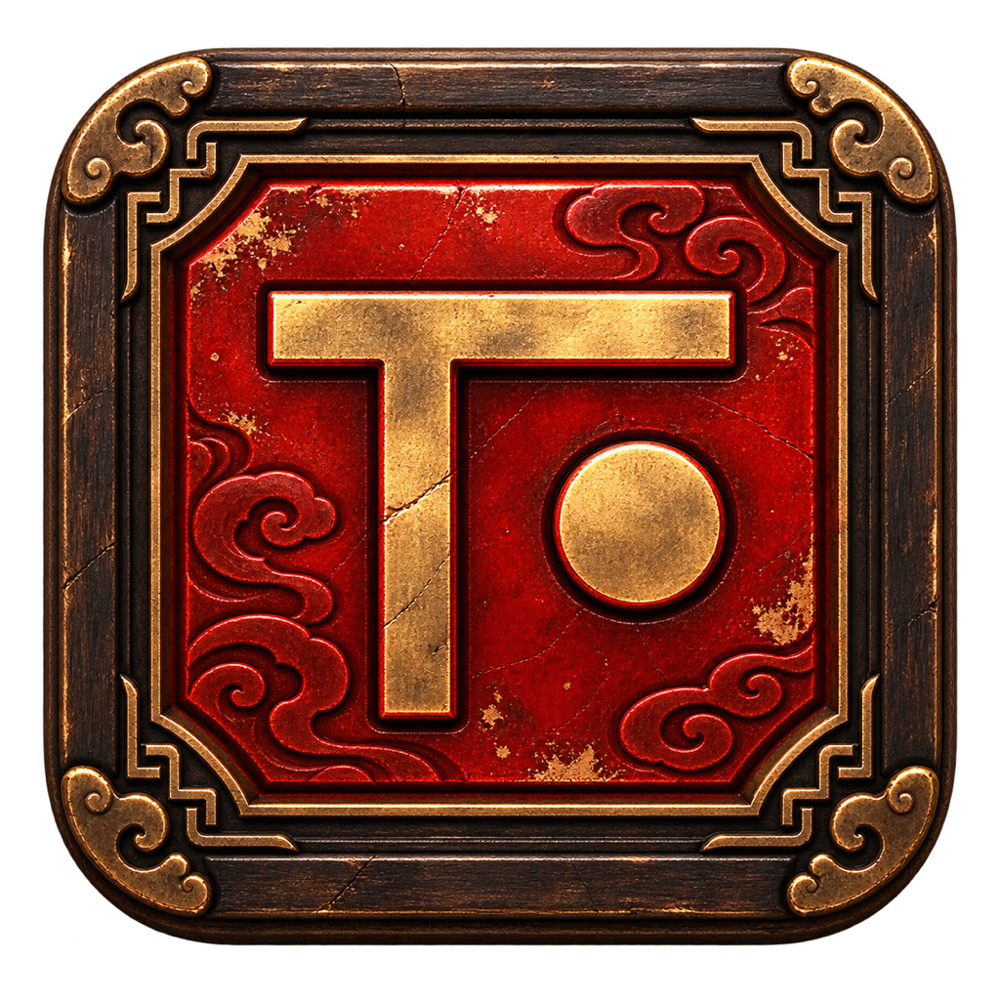
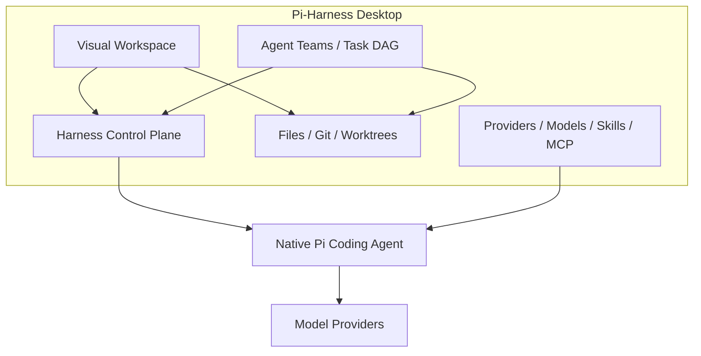

# Pi-Harness

<p align="center">
  <a href="README.md">English</a> ·
  <a href="README.zh-CN.md">简体中文</a> ·
  <a href="README.zh-TW.md">繁體中文</a> ·
  <a href="README.ja-JP.md">日本語</a> ·
  <a href="README.ko-KR.md">한국어</a> ·
  <a href="README.ru-RU.md">Русский</a> ·
  <a href="README.fr-FR.md">Français</a> ·
  <a href="README.de-DE.md">Deutsch</a>
</p>

<p align="center">
  
</p>

<h3 align="center">The Operational Superset of Pi Coding Agent</h3>

<p align="center">
  <strong>Observe, control, and orchestrate native Pi agents in one desktop workspace.</strong>
</p>

<p align="center"><code>Pi Coding Agent ⊂ Pi-Harness</code></p>

<p align="center">
  <a href="#download"><strong>Download</strong></a> ·
  <a href="#features">Features</a> ·
  <a href="#harness-plugins">Harness Plugins</a> ·
  <a href="#documentation">Documentation</a>
</p>

<p align="center">
  <a href="https://github.com/wangmiaozero/pi-harness/releases"></a>
  
  <a href="https://github.com/wangmiaozero/pi-harness/actions/workflows/ci.yml"></a>
  <a href="LICENSE"></a>
  <a href="https://github.com/wangmiaozero/pi-harness"></a>
</p>

Pi-Harness is the desktop workspace and operational control plane around [Pi Coding Agent](https://github.com/earendil-works/pi). Pi is the native execution engine; Pi-Harness adds visual operations, governance, recovery, evaluation, and multi-agent orchestration. Your Pi sessions, configuration, tools, Skills, and extensions remain compatible, and you can continue using Pi outside the app.

**macOS · Windows · Linux. Community installers bundle Pi and Node.js — no separate runtime installation needed.** [Get started →](#download)

<a id="product-preview"></a>

## Product Preview

Real screenshots from this repository. Click an image to view it at full size.

### Workspace

Keep conversations, project files, and Git close to the work.

[](docs/%E5%8A%9F%E8%83%BD%E7%95%8C%E9%9D%A2/%E7%BB%8F%E5%85%B8%E4%B8%BB%E9%A2%98/%E5%B7%A5%E4%BD%9C%E5%8C%BA.png)

### Harness

Set tool policies and run budgets in the Harness console.

[](docs/%E5%8A%9F%E8%83%BD%E7%95%8C%E9%9D%A2/%E7%BB%8F%E5%85%B8%E4%B8%BB%E9%A2%98/%E5%B7%A5%E5%85%B7Harness-1.png)

### Multi-Agent

Open **Workspace → Tools → Agents** to coordinate teams, task dependencies, handoffs, review gates, and isolated worktrees. [Explore multi-agent orchestration →](#multi-agent)

A sample team configured in the desktop app, before execution: three agents are idle and all tasks are pending.

[](docs/%E5%8A%9F%E8%83%BD%E7%95%8C%E9%9D%A2/%E7%BB%8F%E5%85%B8%E4%B8%BB%E9%A2%98/%E5%A4%9A%E6%99%BA%E8%83%BD%E4%BD%93-%E5%9B%A2%E9%98%9F.png)

<details>
<summary>View task dependencies and review settings</summary>

[](docs/%E5%8A%9F%E8%83%BD%E7%95%8C%E9%9D%A2/%E7%BB%8F%E5%85%B8%E4%B8%BB%E9%A2%98/%E5%A4%9A%E6%99%BA%E8%83%BD%E4%BD%93-%E4%BB%BB%E5%8A%A1%E4%BE%9D%E8%B5%96.png)

</details>

[More interfaces and themes →](#screenshots) · [Complete screenshot index](docs/README.md)

## Why Pi-Harness

### Observe — understand each run

Inspect **Runs, Trace, Replay, and Evaluation** to see tool activity, compare outcomes, and investigate failures from recorded evidence.

### Control — keep work recoverable

Use **Policy, Budget, Checkpoints, and Recovery** to set tool permissions and spending limits, preserve recovery points, and resume, fork, or retry work.

### Orchestrate — coordinate a team

Use **Agent Teams, Task DAG, and Worktrees** to assign dependent tasks, pass results between Pi agents, and keep their changes separate.

<a id="features"></a>

## Key Features

### Native Pi Runtime

Pi Coding Agent runs the agent loop, sessions, context, compaction, steering, follow-up, tools, models, and thinking. Pi-Harness provides visual management around those native capabilities.

<a id="pi-vs-pi-harness"></a>

<details>
<summary>Native Pi and Pi-Harness: full capability overview</summary>

| Capability               | Native Pi | Pi-Harness                 |
| ------------------------ | --------- | -------------------------- |
| Agent Runtime            | Yes       | Native Pi                  |
| Agent Loop               | Yes       | Native Pi                  |
| Sessions                 | Yes       | Yes + visual management    |
| Context                  | Yes       | Yes + inspection           |
| Compaction               | Yes       | Yes + visual control       |
| Steering                 | Yes       | Yes                        |
| Follow-up                | Yes       | Yes                        |
| Models                   | Yes       | Yes + manager              |
| Thinking                 | Yes       | Yes + visual control       |
| Tools                    | Yes       | Yes + selection and policy |
| Skills                   | Yes       | Yes + manager              |
| Extensions               | Yes       | Yes + manager              |
| Packages                 | Yes       | Yes + manager              |
| MCP / Codemode           | Yes       | Yes + selection and policy |
| Runs                     | —         | Yes                        |
| Trace                    | —         | Yes                        |
| Replay                   | —         | Yes                        |
| Run Compare              | —         | Yes                        |
| Evaluation               | —         | Yes                        |
| Policy                   | —         | Yes                        |
| Budget                   | —         | Yes                        |
| Checkpoints              | —         | Yes                        |
| Recovery                 | —         | Yes                        |
| Diagnostics              | —         | Yes                        |
| Regression               | —         | Yes                        |
| Artifacts                | —         | Yes                        |
| Multi-Agent              | —         | Yes                        |
| Task DAG                 | —         | Yes                        |
| Handoff                  | —         | Yes                        |
| Review Gates             | —         | Yes                        |
| Worktree isolation       | —         | Yes                        |
| Project architecture map | —         | Yes                        |

</details>

<a id="harness"></a>

<a id="harness-observe-control-and-recover"></a>

### Agent Harness Control Plane

Inspect Runs, Trace, Replay, timelines, and tool activity. Compare runs, follow forks and retries in the Run Tree, review tokens, cost, and duration, and browse artifacts and project statistics.

Set tool policies and per-run budgets, create checkpoints, and resume, fork, or retry work. Evaluation, Diagnostics, and regression baselines help you check results and investigate failures using recorded run evidence.

<a id="multi-agent"></a>

<a id="agent-teams-and-task-orchestration"></a>

### Multi-Agent Orchestration

Coordinate Pi agents with reusable teams and templates. Assign tasks with dependencies and priorities, schedule them manually, sequentially, or in parallel, pass results and artifacts to the next task, and use review gates. Worktrees keep agent changes separate; budgets, conflict hints, and pause, resume, abort, retry, skip, and reassign controls help you manage the work.

<a id="conversation-history"></a>

<a id="local-conversation-history"></a>

### Universal Conversation History

Browse Claude Code, Codex (including desktop and archived conversations), Cursor, Cursor Agent, Gemini CLI, OpenCode, and Pi history together. Search, filter by source, project, or date range, and add custom history folders.

View the original conversation in read-only mode, preview a handoff, and edit the next instruction before continuing in a new Pi chat under the same project. Browsing, local previews, and scan retries use no model tokens. Optional AI summaries use your configured model only when requested.

<a id="project-architecture"></a>

### Project Architecture Visualization

Open Architecture in Workspace to explore modules, dependencies, entrypoints, and source references. Filter by package, focus on a module, browse map pages, zoom, or use fullscreen. Save analysis snapshots, see when source changes make them stale, and export JSON, offline HTML, or the current view as PNG.

Maps describe supported static dependencies; they do not establish a complete function-call graph.

Local analysis uses no model tokens; AI descriptions are optional. JavaScript, TypeScript, and Vue import relationships are analyzed locally, while other supported languages have a file-level index. The analysis shows its coverage and limitations.

<a id="providers-and-models"></a>

<a id="skills-extensions-packages-and-mcp"></a>

### Providers / Models / Skills / MCP

Configure Pi-compatible providers with presets or custom endpoints, manage credentials, discover models where supported, test connections, and choose your chat model. Use supported image models for text-to-image or image editing, then download the results.

Configure OpenCode Zen / Go from the OpenCode tab under Models: save your API key and enable the models you want in the workspace. Models load automatically and can be verified individually or together. Access and charges depend on your official account and selected model; paid verification requires your permission. See [OpenCode's official model information](https://opencode.ai/v2/docs/console/models/) for pricing and data policies.

Browse built-in and local Skills, edit them, and manage Pi packages and extensions from Capabilities. Type `@` in the composer to search and invoke an installed Skill. Connect MCP through supported packages. Optional add-ons such as [Superpowers](https://github.com/obra/superpowers) and [Odai](https://github.com/orziz/odai) can be installed, updated, or removed when you choose.

<a id="themes-and-custom-skins"></a>

### Custom Themes and Skins

Choose classic palettes, Ming themes, Starship Cockpit, macOS 27 backgrounds, or an imported custom skin. New installations start in Dark. Customize chat display names, app icons, local background images, window and screen glow, and the input flame effect. Startup animation accompanies the environment check; mascot-free builds retain the general appearance controls.

#### Create your own skin

Use the [Pi-Harness Custom Skin Starter](https://github.com/wangmiaozero/pi-harness-skin-starter) to create the visual style you want.

1. Use the starter repository as a template or download it.
2. Open it with your coding agent and describe your preferred style using the included prompt.
3. Import the completed project from **Settings → Theme → Import Skin**.

The multilingual starter includes guidance for colors, previews, wallpapers, and optional character artwork. Keep your skin in its own repository to update and share it independently.

### Workspace, files, and Git

Start a standalone chat or open a project and resume a Pi session. Follow streaming replies, thinking, tool calls, images, and changed files; choose the model, thinking level, and tools, or compact the conversation. Workspace Tools gives you access to Harness and Agents while preserving your conversation and draft.

Browse and search files, preview media and documents, and edit readable text with syntax highlighting, line numbers, find, undo/redo, explicit save, and external-change conflict protection. The lightweight editor keeps file editing focused. Git provides diffs, history, activity graphs, commits, optional AI commit messages, and worktrees.

### Environment and app settings

Check Node.js, npm, PATH, Pi Coding Agent, and the active configuration. Install, update, or repair Pi where supported, inspect environment diagnostics, manage configuration backups, and check for app updates. The interface is available in eight languages.

<a id="harness-plugins"></a>

## Harness Plugins — Extend the Control Plane

**Plugin SDK v1.0.0 · Included starting with Pi-Harness v2.2.6.**

| Extension       | Purpose                                             |
| --------------- | --------------------------------------------------- |
| Pi Extensions   | Extend the Pi agent itself.                         |
| Skills          | Give the agent instructions and workflow knowledge. |
| MCP             | Connect the agent to tools and external services.   |
| Harness Plugins | Extend Pi-Harness operations around the agent.      |

Contribute **Harness Event Subscribers, Custom Evaluators, Trace Exporters, and Agent Team Templates**. Evaluations are supplementary, exports use authorized JSON data, and team templates create pending workflows for you to inspect and start.

Try the maintained SDK examples: [Run Metrics](examples/harness-plugins/run-metrics/plugin.json), [Quality Evaluator](examples/harness-plugins/quality-evaluator/plugin.json), and [Team Template](examples/harness-plugins/team-template/plugin.json).

In a source build, open **Workspace → Tools → Harness → Harness Plugins → Install local plugin**, choose its folder, review permissions and enable it. Installation executes no code. Executable plugins require explicit native trust approval: **the separate process is not a security sandbox; approved Node code can access your computer**. Use declarative templates for untrusted content.

[Develop and install](docs/plugins/getting-started.md) · [Architecture](docs/plugins/architecture.md) · [SDK API](docs/plugins/api-reference.md) · [Security boundary](docs/plugins/security.md)

## Architecture

Pi-Harness surrounds the native Pi runtime with a workspace and operational controls. Agent teams use the same Pi execution engine; the diagram shows module relationships, not class inheritance.



Pi owns execution and native sessions. Harness observes runs and applies policies, budgets, checkpoints, recovery, and evaluation around that execution. Conversation history and project architecture analysis are workspace tools; themes customize the visual experience.

<a id="download"></a>

## Quick Start

[**Download from GitHub Releases →**](https://github.com/wangmiaozero/pi-harness/releases)

Community installers include **Pi, Node.js, npm, and npx**. You do not need to install Pi or Node.js beforehand, clone this repository, or install pnpm to use the app. Choose the standard package or `nomascot` without mascot artwork. Follow the notes for the version you download; older packages may have different requirements.

### macOS

Choose the `.dmg` for **Apple Silicon (`arm64`)** or **Intel (`x64`)**, open it, and drag Pi-Harness to Applications.

### Windows

Download the **x64 `.exe` installer**, run it, and choose an installation directory.

### Linux

Download the **x64 `.AppImage`**, grant it executable permission, and open it:

```sh
chmod +x "./Pi-Harness-VERSION.AppImage"
./Pi-Harness-VERSION.AppImage
```

Replace `VERSION` with the downloaded version. Linux native validation targets Ubuntu 24.04; other distributions and FUSE/desktop integration need their own checks. Windows/Linux ARM64 remain preview targets; check the release notes for availability and validation results.

### Community Release signing and verification

Community releases are free. macOS packages use **ad-hoc signing without Apple Developer ID or notarization**. Windows installers are **unsigned** and may show SmartScreen warnings. Verify the official download source and checksum before allowing the app to open. If macOS blocks first launch, use **System Settings → Privacy & Security → Open Anyway** for that app. Keep system security protections enabled.

Download `SHA256SUMS` alongside the installer. Calculate its hash and compare it with the same filename in the list (replace `VERSION` and the architecture with your download's values):

```sh
# macOS
shasum -a 256 "Pi-Harness-VERSION-arm64.dmg"
# Linux
sha256sum "Pi-Harness-VERSION.AppImage"
```

```powershell
# Windows
Get-FileHash ".\Pi-Harness-Setup-VERSION.exe" -Algorithm SHA256
```

SHA256 checks consistency with the checksum list; it does not independently prove publisher identity. Use the official [GitHub Releases](https://github.com/wangmiaozero/pi-harness/releases) page. Report suspected vulnerabilities privately to [tuziling84@gmail.com](mailto:tuziling84@gmail.com).

Community builds check for new versions in the app and open the official Releases page for manual download and installation on all platforms. Automatic installation remains disabled until cross-version installation is verified. Existing installations keep their previous update behavior. See [Community Release](docs/release/community-release.md) and [update details](docs/release/update-strategy.md).

<a id="get-started"></a>

### Your first Pi session

1. Launch Pi-Harness and check the environment in Overview.
2. Configure a provider, test the connection, and select a model. Model access may require credentials and incur provider charges.
3. Start a standalone chat or open a project.
4. Start or resume a Pi session, then work with conversations, files, and Git.
5. Open **Workspace → Tools → Harness / Agents** to inspect runs or coordinate a team.

### Requirements

Community release validation covers macOS Apple Silicon, macOS Intel, Windows x64, and Linux x64; platform availability is subject to each release's verified results. The bundled Pi and Node runtimes are ready to use, with System and Custom runtime choices available in settings. Source development and packaging require Node.js ≥ 22.22.2 and pnpm 9.12.1; installed users do not need these build tools.

<a id="screenshots"></a>

## Screenshots

Product screenshots are grouped by theme. Browse the [complete screenshot index](docs/README.md) for additional views.

<details>
<summary>Browse interfaces and themes</summary>

### Classic theme

#### Workspace

[](docs/%E5%8A%9F%E8%83%BD%E7%95%8C%E9%9D%A2/%E7%BB%8F%E5%85%B8%E4%B8%BB%E9%A2%98/%E5%B7%A5%E4%BD%9C%E5%8C%BA.png)

<details>
<summary>Git · Providers and models · Capabilities · Harness · Project architecture</summary>

#### Git

[](docs/%E5%8A%9F%E8%83%BD%E7%95%8C%E9%9D%A2/%E7%BB%8F%E5%85%B8%E4%B8%BB%E9%A2%98/Git.png)

<a id="providers-and-models-1"></a>

#### Providers and models

[](docs/%E5%8A%9F%E8%83%BD%E7%95%8C%E9%9D%A2/%E7%BB%8F%E5%85%B8%E4%B8%BB%E9%A2%98/Provider%E4%B8%8E%E6%A8%A1%E5%9E%8B-1.png)

#### Capabilities

[](docs/%E5%8A%9F%E8%83%BD%E7%95%8C%E9%9D%A2/%E7%BB%8F%E5%85%B8%E4%B8%BB%E9%A2%98/%E8%83%BD%E5%8A%9B%E4%B8%AD%E5%BF%83-1.png)

#### Harness

[](docs/%E5%8A%9F%E8%83%BD%E7%95%8C%E9%9D%A2/%E7%BB%8F%E5%85%B8%E4%B8%BB%E9%A2%98/%E5%B7%A5%E5%85%B7Harness-1.png)

<a id="project-architecture-1"></a>

#### Project architecture

[](docs/%E5%8A%9F%E8%83%BD%E7%95%8C%E9%9D%A2/%E7%BB%8F%E5%85%B8%E4%B8%BB%E9%A2%98/%E9%A1%B9%E7%9B%AE%E6%9E%B6%E6%9E%84-1.png)

</details>

### Ming interfaces

<details>
<summary>General settings · Theme and skin gallery</summary>

#### General settings

[](docs/%E5%8A%9F%E8%83%BD%E7%95%8C%E9%9D%A2/%E5%A4%A7%E6%98%8E/%E9%80%9A%E7%94%A8%E8%AE%BE%E7%BD%AE.png)

#### Theme and skin gallery

[](docs/%E5%8A%9F%E8%83%BD%E7%95%8C%E9%9D%A2/%E5%A4%A7%E6%98%8E/%E4%B8%BB%E9%A2%98%E7%9A%AE%E8%82%A4%E5%BA%93.png)

</details>

### Theme gallery

<details>
<summary>Ming · Snowbound official · Ming · Snow flute scholar · Ming · Moon scholar · Starship Cockpit · macOS 27 · Liquid Ether</summary>

#### Ming · Snowbound official

[](docs/%E4%B8%BB%E9%A2%98%E5%B1%95%E7%A4%BA/%E5%A4%A7%E6%98%8E/%E9%9B%AA%E5%A2%83%E6%9C%9D%E8%87%A3.png)

#### Ming · Snow flute scholar

[](docs/%E4%B8%BB%E9%A2%98%E5%B1%95%E7%A4%BA/%E5%A4%A7%E6%98%8E/%E9%9B%AA%E5%A4%9C%E7%AC%9B%E5%A7%AC.png)

#### Ming · Moon scholar

[](docs/%E4%B8%BB%E9%A2%98%E5%B1%95%E7%A4%BA/%E5%A4%A7%E6%98%8E/%E6%9C%88%E5%9F%8E%E4%B9%A6%E5%A7%AC.png)

#### Starship Cockpit

[](docs/%E4%B8%BB%E9%A2%98%E5%B1%95%E7%A4%BA/%E6%98%9F%E8%88%B0/%E9%9C%9C%E6%98%9F%E9%A2%86%E8%88%AA.png)

#### macOS 27 · Liquid Ether

[](docs/%E4%B8%BB%E9%A2%98%E5%B1%95%E7%A4%BA/macOS%2027/Liquid%20Ether.png)

</details>

</details>

## Developers & Community

### Local development

Install **Node.js ≥ 22.22.2** and **pnpm 9.12.1**, then run:

```sh
git clone https://github.com/wangmiaozero/pi-harness.git
cd pi-harness
pnpm install --frozen-lockfile
pnpm dev
```

For development without a separate Pi installation, use the sample configuration in [fixtures](fixtures/README.md). In Settings, point the manual configuration directory at the absolute path to `fixtures/mock-pi`. Sample configuration does not provide live model access; configure your own provider when needed.

### Checks

```sh
pnpm typecheck
pnpm lint
pnpm test
pnpm compile
```

For changes to key desktop flows, also run `pnpm test:e2e`.

### Participate

- [Report a bug or suggest an improvement](https://github.com/wangmiaozero/pi-harness/issues). Include your app version, operating system, and steps to reproduce; remove credentials and private conversation content.
- [Open a pull request](https://github.com/wangmiaozero/pi-harness/pulls) with the problem, user-visible change, and validation results. Documentation, translations, themes, and focused fixes are welcome.
- [Create and share a custom skin](https://github.com/wangmiaozero/pi-harness-skin-starter).
- [Community QQ group: pi-harness · 1109717308](docs/社区/qq-group.jpg).

<a id="documentation"></a>

### Documentation

- [Screenshot index](docs/README.md) · [Changelog](CHANGELOG.md)
- [Community Release](docs/release/community-release.md) · [Troubleshooting](docs/release/troubleshooting.md)
- [English](README.md) · [简体中文](README.zh-CN.md) · [繁體中文](README.zh-TW.md) · [日本語](README.ja-JP.md) · [한국어](README.ko-KR.md) · [Русский](README.ru-RU.md) · [Français](README.fr-FR.md) · [Deutsch](README.de-DE.md)

## Credits

Pi-Harness is built around the official [Pi Coding Agent and Pi Agent Harness](https://github.com/earendil-works/pi).

Created and maintained by [wangmiao](https://github.com/wangmiaozero) · [tuziling84@gmail.com](mailto:tuziling84@gmail.com).

### PR contributors

<table>
  <tr>
    <td align="center">
      <a href="https://github.com/HenryArch"><br /><b>HenryArch</b></a><br />
      <a href="https://github.com/wangmiaozero/pi-harness/pull/8">PR #8</a>
    </td>
  </tr>
</table>

We welcome pull requests that improve Pi-Harness. Thank you to every contributor for helping make the project better!

## License

Pi-Harness is licensed under the [GNU Affero General Public License v3.0 only](LICENSE) (`AGPL-3.0-only`).

Copyright © 2026 [wangmiao](https://github.com/wangmiaozero).
