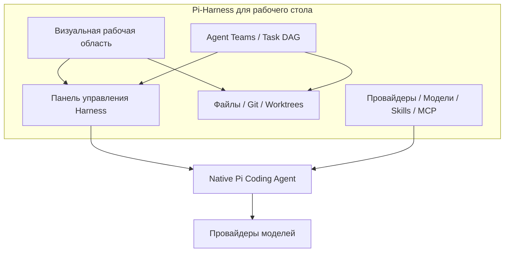

<div align="center">


### Operational Superset для Pi Coding Agent

**Наблюдайте, управляйте и координируйте агентов Native Pi в одной настольной рабочей области.**<br>
Каждого агента по-прежнему запускает Pi. Pi-Harness добавляет вокруг него рабочую область, историю запусков, восстановление и команды агентов,<br>
а ваши сессии, конфигурация, Skills и расширения Pi продолжают работать как в приложении, так и вне его.

`Pi Coding Agent ⊂ Pi-Harness`

[](https://github.com/wangmiaozero/pi-harness/releases) [](https://github.com/wangmiaozero/pi-harness/stargazers) [](https://github.com/wangmiaozero/pi-harness/actions/workflows/ci.yml) [](LICENSE)<br>
  

**[Скачать](https://github.com/wangmiaozero/pi-harness/releases)** &nbsp;·&nbsp; **[Видео](#watch)** &nbsp;·&nbsp; **[Возможности](#features)** &nbsp;·&nbsp; **[Harness Plugins](#harness-plugins)** &nbsp;·&nbsp; **[Документация](#documentation)** &nbsp;·&nbsp; **[История изменений](CHANGELOG.md)**

[English](README.md) · [简体中文](README.zh-CN.md) · [繁體中文](README.zh-TW.md) · [日本語](README.ja-JP.md) · [한국어](README.ko-KR.md) · **Русский** · [Français](README.fr-FR.md) · [Deutsch](README.de-DE.md)

<br>


</div>

<br>

## 赞助商

<table>
  <tr>
    <td width="580" align="center" valign="middle">
        <a href="https://infistar.cc/register?aff=S26RFM4B&ref_source=link" style="color:transparent;background-color:transparent;text-decoration:none;border:none;"></a>
    </td>
    <td valign="middle">
      Pi-Harness × Infistar.cc 无限星河｜Claude、GPT、Gemini、Grok、DeepSeek 等，一个 Key，只花官方价的零头，省 99%；低至官方 0.1 折，100% 官方纯血，每个模型都能验真；上千线路安全冗余自动切换，200+ 模型、16 个品牌，一个 Key 搞定。<br>
      Pi-Harness 用户通过<a href="https://infistar.cc/register?aff=S26RFM4B&ref_source=link">专属链接</a>注册直接送人民币 5 元：<a href="https://infistar.cc/register?aff=S26RFM4B&ref_source=link">https://infistar.cc/register?aff=S26RFM4B&ref_source=link</a>
    </td>
  </tr>
  <tr>
    <td width="580" align="center" valign="middle">
        <a href="https://cloud.tencent.com/act/cps/redirect?redirect=6871&amp;cps_key=ece2099a1da90c2f7a4a4c437ad623f8&amp;from=console" style="color:transparent;background-color:transparent;text-decoration:none;border:none;"></a>
    </td>
    <td valign="middle">
      【腾讯云】WorkBuddy 全场景 AI 办公工作台，团队旗舰版低至198元/月<br>
      <a href="https://cloud.tencent.com/act/cps/redirect?redirect=6871&amp;cps_key=ece2099a1da90c2f7a4a4c437ad623f8&amp;from=console">https://cloud.tencent.com/act/cps/redirect?redirect=6871&amp;cps_key=ece2099a1da90c2f7a4a4c437ad623f8&amp;from=console</a>
    </td>
  </tr>
</table>

## Нужен ли вам Pi-Harness?

[Pi Coding Agent](https://github.com/earendil-works/pi) хорошо работает в терминале. Но на реальных проектах быстро хочется большего: видеть, что на самом деле сделал каждый запуск, возвращаться к рабочему состоянию, если запуск пошёл не так, и делить крупную задачу между несколькими агентами. Pi-Harness собирает всё это в одном настольном приложении поверх того же Pi:

- **Каждый запуск на виду**: Runs, Trace, Replay и Evaluation показывают действия инструментов, сравнивают результаты и помогают разбирать сбои по записанным данным.
- **Работу можно восстановить**: Policy, Budget, Checkpoints и Recovery задают права инструментов и лимиты расходов, сохраняют точки восстановления и позволяют продолжить, ответвить или повторить работу.
- **Координация команды**: Agent Teams, Task DAG и Worktrees распределяют зависимые задачи, передают результаты между агентами Pi и разделяют изменения каждого агента.
- **Всё на Native Pi**: цикл агента, сессии, контекст, инструменты, модели и рассуждения выполняет Pi. Pi-Harness управляет ими визуально, а Pi можно и дальше использовать вне приложения.

Pi-Harness подойдёт, если вы используете Pi на реальных проектах и хотите видеть, направлять и координировать его работу из одного окна. Если вам достаточно одного чата в терминале, хватит и самого Pi.

Работает на macOS, Windows и Linux. Установщики сообщества включают Pi и Node.js, поэтому заранее ничего устанавливать не нужно.

<a id="watch"></a>

## Видео

**Рабочий режим.** DeepSeek открывает рабочую область для программирования. 13 секунд.

https://github.com/user-attachments/assets/942b73c9-ece9-485e-ad82-0e51225a73c1

**С возвращением.** Появляется компаньон и открывается обзор рабочей области. 11 секунд.

https://github.com/user-attachments/assets/98708766-f490-4506-a33f-f1376d41770f

<a id="download"></a>
<a id="get-started"></a>

## Быстрый старт

**1 · Установка.** Скачайте установщик для своей системы на **[GitHub Releases](https://github.com/wangmiaozero/pi-harness/releases)**:

| | |
| :-- | :-- |
| **macOS** | `.dmg` для Apple Silicon (`arm64`) или Intel (`x64`). Откройте его и перетащите Pi-Harness в «Программы» |
| **Windows** | Установщик `.exe` для x64. Запустите его и выберите папку установки |
| **Linux** | `.AppImage` для x64. Сделайте файл исполняемым и откройте его |

```sh
chmod +x "./Pi-Harness-VERSION.AppImage"   # замените VERSION на скачанную версию
./Pi-Harness-VERSION.AppImage
```

<sub>Установщики включают Pi, Node.js, npm и npx: не нужно устанавливать Pi или Node.js, клонировать этот репозиторий или устанавливать pnpm. Проверка выпусков охватывает macOS Apple Silicon, macOS Intel, Windows x64 и Linux x64; платформы каждого выпуска определяются по результатам проверки. Проверка для Linux ориентирована на Ubuntu 24.04; другие дистрибутивы, FUSE и интеграцию с рабочим столом нужно проверять отдельно. Windows и Linux ARM64 — предварительные платформы. У более старых пакетов могут быть другие требования, поэтому следуйте примечаниям к скачанной версии. Сборки для macOS подписаны ad-hoc, а установщики Windows не подписаны: см. <a href="#verify-your-download">Проверка загрузки</a>.</sub>

**2 · Проверка среды.** Запустите Pi-Harness и проверьте среду на странице обзора.

**3 · Добавление провайдера.** Настройте провайдера, проверьте подключение и выберите модель. Для доступа к модели могут понадобиться учётные данные, а провайдер может взимать плату.

**4 · Начало работы.** Начните отдельный чат или откройте проект, затем начните или продолжите сессию Pi и работайте с разговорами, файлами и Git в одном окне. Чтобы просмотреть запуски или координировать команду, откройте **Рабочая область → Инструменты → Harness / Агенты**.

<a id="verify-your-download"></a>

### Проверка загрузки

Выпуски сообщества бесплатны. Пакеты для macOS используют **подпись ad-hoc без Apple Developer ID и нотариального заверения**. Установщики Windows **не подписаны**, и SmartScreen может показать предупреждение. Прежде чем разрешить запуск приложения, проверьте официальный источник загрузки и контрольную сумму. Если macOS блокирует первый запуск, используйте **Системные настройки → Конфиденциальность и безопасность → Всё равно открыть** для этого приложения. Не отключайте системную защиту.

Скачайте `SHA256SUMS` вместе с установщиком, вычислите хеш своего файла и сравните его со значением для того же имени файла в списке (замените `VERSION` и архитектуру на значения своей загрузки):

```sh
shasum -a 256 "Pi-Harness-VERSION-arm64.dmg"   # macOS
sha256sum "Pi-Harness-VERSION.AppImage"        # Linux
```

```powershell
Get-FileHash ".\Pi-Harness-Setup-VERSION.exe" -Algorithm SHA256   # Windows
```

<sub>SHA256 подтверждает совпадение со списком контрольных сумм, но не доказывает личность издателя независимо. Пользуйтесь официальной страницей <a href="https://github.com/wangmiaozero/pi-harness/releases">GitHub Releases</a>, а о предполагаемых уязвимостях сообщайте конфиденциально на <a href="mailto:tuziling84@gmail.com">tuziling84@gmail.com</a>. Сборки сообщества проверяют наличие новых версий в приложении и открывают страницу Releases для ручного скачивания и установки на всех платформах. Автоматическая установка остаётся выключенной, пока не проверена установка между версиями, а существующие установки сохраняют прежнее поведение обновлений. См. <a href="docs/release/community-release.md">Community Release</a> и <a href="docs/release/update-strategy.md">подробности об обновлениях</a>.</sub>

<a id="architecture"></a>

## Как всё устроено

Pi отвечает за выполнение и нативные сессии. Harness наблюдает за каждым запуском и применяет вокруг него политики, бюджеты, контрольные точки, восстановление и оценку. Команды агентов используют тот же движок выполнения Pi. История разговоров и архитектура проекта — инструменты рабочей области, а темы меняют внешний вид. Схема показывает связи модулей, а не наследование классов.



<a id="pi-vs-pi-harness"></a>

<details>
<summary><b>Native Pi и Pi-Harness</b>: сравнение по возможностям</summary>

<br>

| Возможность              | Native Pi | Pi-Harness                 |
| ------------------------ | --------- | -------------------------- |
| Agent Runtime            | Да        | Native Pi                  |
| Agent Loop               | Да        | Native Pi                  |
| Sessions                 | Да        | Да + визуальное управление |
| Context                  | Да        | Да + просмотр              |
| Compaction               | Да        | Да + визуальное управление |
| Steering                 | Да        | Да                         |
| Follow-up                | Да        | Да                         |
| Models                   | Да        | Да + менеджер              |
| Thinking                 | Да        | Да + визуальное управление |
| Tools                    | Да        | Да + выбор и политики      |
| Skills                   | Да        | Да + менеджер              |
| Extensions               | Да        | Да + менеджер              |
| Packages                 | Да        | Да + менеджер              |
| MCP / Codemode           | Да        | Да + выбор и политики      |
| Runs                     | —         | Да                         |
| Trace                    | —         | Да                         |
| Replay                   | —         | Да                         |
| Run Compare              | —         | Да                         |
| Evaluation               | —         | Да                         |
| Policy                   | —         | Да                         |
| Budget                   | —         | Да                         |
| Checkpoints              | —         | Да                         |
| Recovery                 | —         | Да                         |
| Diagnostics              | —         | Да                         |
| Regression               | —         | Да                         |
| Artifacts                | —         | Да                         |
| Multi-Agent              | —         | Да                         |
| Task DAG                 | —         | Да                         |
| Handoff                  | —         | Да                         |
| Review Gates             | —         | Да                         |
| Worktree isolation       | —         | Да                         |
| Project architecture map | —         | Да                         |

</details>

<a id="features"></a>

## Возможности

### Рабочая область, файлы и Git

Начните отдельный чат или откройте проект и продолжите сессию Pi. Следите за потоковыми ответами, рассуждениями, вызовами инструментов, изображениями и изменёнными файлами; выбирайте модель, уровень рассуждений и инструменты или сжимайте разговор. Если открыть Harness или Агенты из инструментов рабочей области, разговор и черновик сохраняются.

Просматривайте и ищите файлы, открывайте предпросмотр медиа и документов, редактируйте текст с подсветкой синтаксиса, номерами строк, поиском, отменой/повтором, явным сохранением и защитой от конфликтов внешних изменений. Git даёт различия, историю, графики активности, коммиты, необязательные сообщения коммитов с ИИ и worktree.

<table>
<tr>
<td width="50%"><br><sub>Лёгкое редактирование файлов</sub></td>
<td width="50%"><br><sub>Git</sub></td>
</tr>
</table>

<a id="harness"></a>

### Панель управления Harness

Каждый запуск Pi оставляет запись, которую можно изучить, сравнить и использовать для восстановления.

| | |
| :-- | :-- |
| **Наблюдение** | Runs, Trace, Replay, временные шкалы и действия инструментов. Сравнивайте запуски и отслеживайте ветвления и повторы в Run Tree |
| **Измерение** | Токены, стоимость и длительность каждого запуска, а также артефакты и статистика проекта |
| **Управление** | Политики инструментов и бюджеты запусков. Создавайте контрольные точки, затем продолжайте, ответвляйте или повторяйте работу |
| **Проверка** | Evaluation, Diagnostics и базовые запуски для регрессий проверяют результаты и помогают разбирать сбои по записанным данным запусков |

<table>
<tr>
<td width="50%"><br><sub>Состояние сессии и инструкции в очереди</sub></td>
<td width="50%"><br><sub>Консоль Harness</sub></td>
</tr>
</table>

<a id="multi-agent"></a>

### Координация нескольких агентов

Откройте **Рабочая область → Инструменты → Агенты**, чтобы координировать агентов Pi с помощью повторно используемых команд и шаблонов. Назначайте задачи с зависимостями и приоритетами, запускайте их вручную, последовательно или параллельно, передавайте результаты и артефакты следующей задаче и добавляйте этапы проверки. Worktrees разделяют изменения каждого агента. Бюджеты, подсказки о конфликтах, а также пауза, продолжение, остановка, повтор, пропуск и переназначение помогают управлять работой.

<table>
<tr>
<td width="50%"><br><sub>Пример команды до запуска: три агента в ожидании, все задачи ожидают выполнения</sub></td>
<td width="50%"><br><sub>Зависимости задач и требование проверки</sub></td>
</tr>
</table>

<a id="conversation-history"></a>

### Единая история разговоров

Просматривайте историю Claude Code, Codex (включая настольное приложение и архивные разговоры), Cursor, Cursor Agent, Gemini CLI, OpenCode и Pi вместе. Ищите, фильтруйте по источнику, проекту или диапазону дат и добавляйте собственные папки истории.

Откройте исходный разговор только для чтения, просмотрите передачу задачи и отредактируйте следующую инструкцию, прежде чем продолжить в новом чате Pi в том же проекте. Просмотр, локальный предпросмотр и повторное сканирование не расходуют токены модели; необязательные сводки с ИИ используют настроенную модель только по вашему запросу.

<table>
<tr>
<td width="50%"><br><sub>История разговоров</sub></td>
<td width="50%"><br><sub>Очистка сессий</sub></td>
</tr>
</table>

<a id="project-architecture"></a>

### Карта архитектуры проекта

Откройте Architecture в рабочей области, чтобы изучить модули, зависимости, точки входа и ссылки на исходный код. Фильтруйте по пакету, выделяйте модуль, листайте карту, меняйте масштаб или включайте полный экран. Сохраняйте снимки анализа, смотрите, когда изменения исходников делают их устаревшими, и экспортируйте JSON, автономный HTML или текущий вид в PNG.

| | |
| :-- | :-- |
| **Локально** | Анализ выполняется локально и не расходует токены модели; описания ИИ необязательны |
| **Охват** | Импорты JavaScript, TypeScript и Vue анализируются локально; для других поддерживаемых языков строится файловый индекс. Каждый анализ показывает свой охват и ограничения |
| **Границы** | Карты описывают поддерживаемые статические зависимости; это не полный граф вызовов функций |


<a id="providers-and-models"></a>
<a id="skills-extensions-packages-and-mcp"></a>

### Провайдеры, модели и Skills

| | |
| :-- | :-- |
| **Провайдеры** | Настраивайте совместимые с Pi провайдеры по шаблонам или собственным адресам, управляйте учётными данными, получайте список моделей там, где это поддерживается, проверяйте подключение и выбирайте модель чата |
| **Изображения** | Используйте поддерживаемые модели изображений для создания изображений по тексту или их редактирования, затем скачивайте результат |
| **OpenCode Zen / Go** | На вкладке OpenCode в разделе «Модели» сохраните API-ключ и включите нужные модели. Модели загружаются автоматически, их можно проверить по одной или все сразу. Доступ и стоимость зависят от вашего официального аккаунта и модели; платная проверка сначала запрашивает ваше разрешение. Цены и политику данных см. в [информации о моделях OpenCode](https://opencode.ai/v2/docs/console/models/) |
| **Skills** | Просматривайте и редактируйте встроенные и локальные Skills. Введите `@` в поле сообщения, чтобы найти и вызвать установленный Skill |
| **Пакеты и расширения** | Управляйте пакетами и расширениями Pi в центре возможностей. Дополнения, например [Superpowers](https://github.com/obra/superpowers), устанавливаются, обновляются и удаляются только по вашему выбору |

<table>
<tr>
<td width="50%"><br><sub>Провайдеры и модели</sub></td>
<td width="50%"><br><sub>Центр возможностей</sub></td>
</tr>
</table>

<a id="mcp-marketplace"></a>

### Серверы и каталог MCP

Откройте **Настройки → MCP**, чтобы добавить серверы с локальной командой или HTTP, фильтровать по **Все / Глобальные / Проект**, выбрать проект, а также редактировать и включать каждый сервер в его области. Сканируйте настройки других инструментов и просматривайте их перед импортом.

В каталоге есть **15 встроенных шаблонов серверов**, включая Memory, Context7, Playwright, Filesystem и GitHub, а также поиск и постраничный просмотр официального реестра MCP. Перед сохранением просмотрите конфигурацию и место назначения. Шаблоны предназначены для установки и не все включены по умолчанию. Импортированные записи и записи реестра сохраняются выключенными, чтобы вы могли сначала их настроить.


<a id="agent-settings"></a>

### Настройки агентов

**Доступно начиная с v2.2.10.** Наличие в скачанных установщиках смотрите в примечаниях к выпуску.

| Страница | Что настраивается | |
| :-- | :-- | :-- |
| **AI** | Уровень рассуждений по умолчанию, автоматическое сжатие, повторы и параметры рабочей области | [Скриншот](docs/%E5%8A%9F%E8%83%BD%E7%95%8C%E9%9D%A2/%E7%BB%8F%E5%85%B8%E4%B8%BB%E9%A2%98/AI.png) |
| **Голос в реальном времени** | Голосовая служба и аккаунт для звонков в рабочей области | [Скриншот](docs/%E5%8A%9F%E8%83%BD%E7%95%8C%E9%9D%A2/%E7%BB%8F%E5%85%B8%E4%B8%BB%E9%A2%98/%E5%AE%9E%E6%97%B6%E8%AF%AD%E9%9F%B3.png) |
| **Сочетания клавиш** | Собственные сочетания для палитры команд, настроек, новых сессий и закрытия вкладок или значения по умолчанию | [Скриншот](docs/%E5%8A%9F%E8%83%BD%E7%95%8C%E9%9D%A2/%E7%BB%8F%E5%85%B8%E4%B8%BB%E9%A2%98/%E5%BF%AB%E6%8D%B7%E9%94%AE.png) |
| **Инструкции** | Глобальные или проектные инструкции | [Скриншот](docs/%E5%8A%9F%E8%83%BD%E7%95%8C%E9%9D%A2/%E7%BB%8F%E5%85%B8%E4%B8%BB%E9%A2%98/%E6%8C%87%E4%BB%A4.png) |
| **MCP** | Серверы MCP в каждой области | [Скриншот](docs/%E5%8A%9F%E8%83%BD%E7%95%8C%E9%9D%A2/%E7%BB%8F%E5%85%B8%E4%B8%BB%E9%A2%98/MCP%E6%9C%8D%E5%8A%A1%E5%99%A8.png) |
| **Субагенты** | Повторно используемые субагенты с ролью, инструкциями, моделью, уровнем рассуждений и инструментами. Выберите общую рабочую область или отдельный worktree, затем запустите задачу или используйте шаблон в команде | [Скриншот](docs/%E5%8A%9F%E8%83%BD%E7%95%8C%E9%9D%A2/%E7%BB%8F%E5%85%B8%E4%B8%BB%E9%A2%98/%E5%AD%90%E6%99%BA%E8%83%BD%E4%BD%93.png) |
| **Удалённые хосты** | Хосты с запущенным pi-host, сопряжённые по адресу и токену сопряжения | [Скриншот](docs/%E5%8A%9F%E8%83%BD%E7%95%8C%E9%9D%A2/%E7%BB%8F%E5%85%B8%E4%B8%BB%E9%A2%98/%E8%BF%9C%E7%A8%8B%E4%B8%BB%E6%9C%BA.png) |

<a id="realtime-voice"></a>

### Голос в реальном времени

Разговаривайте с рабочей областью через **OpenAI Realtime, Gemini Live или Codex Live**. Используйте поддерживаемую учётную запись провайдера или отдельный API-ключ; Codex Live использует существующий вход Codex в Pi. Доступность службы и стоимость зависят от вашего аккаунта.

1. Откройте **Настройки → Голос в реальном времени**, включите голос, выберите службу и аккаунт и сохраните.
2. В разговоре рабочей области нажмите кнопку звуковой волны рядом с полем сообщения.
3. Проверьте целевой разговор и необязательную передачу контекста, выберите **Начать голос в реальном времени** и разрешите доступ к микрофону.
4. Отключайте микрофон, смотрите расшифровку или завершайте звонок с помощью плавающих элементов управления, даже после перехода на другую страницу.

Передача недавнего контекста по умолчанию выключена. Если её включить, передаются только последние шесть текстовых сообщений, без вложений и результатов инструментов. Рабочие запросы из звонка отправляются в рабочий разговор только после вашей проверки.


<a id="remote-hosts"></a>

### Удалённые хосты

Выполните сопряжение с хостом, на котором запущен **pi-host**, в разделе **Настройки → Удалённые хосты**, указав его адрес и токен сопряжения. Подключайте и отключайте хосты, просматривайте их проекты и сессии, читайте разговоры, отправляйте запросы и отвечайте на запросы подтверждения. Удалённый хост должен быть уже запущен и доступен.

<a id="desktop-companion"></a>

### Настольный компаньон

Включите установленного питомца в **Настройки → Домашний питомец**, чтобы видеть на рабочем столе размышления, действия инструментов, ожидание и завершение. По умолчанию он выключен и остаётся доступным, когда главное окно свёрнуто.

Во время простоя в контекстном меню с поиском доступны 193 действия. Во время задач ручные взаимодействия приостанавливаются, а при перетаскивании рабочая анимация продолжается. Импортируйте локальные наборы питомцев и настраивайте размер, непрозрачность и подсказки ползунками.

<table>
<tr>
<td width="33%"><br><sub>Настройки и ползунки</sub></td>
<td width="33%"><br><sub>Контекстное меню</sub></td>
<td width="33%"><br><sub>Действия с поиском</sub></td>
</tr>
</table>

<a id="themes-and-custom-skins"></a>
<a id="screenshots"></a>

### Темы и собственное оформление

Выбирайте классические палитры, темы Ming, Starship Cockpit, фоны macOS 27 или импортированное оформление. Новые установки начинают с темы **Мягкий светлый**. Настраивайте имена в чате, значок приложения, локальные фоновые изображения, свечение окна и экрана и эффект пламени в поле ввода. Проверку среды сопровождает стартовая анимация.

Темы персонажей и настольные питомцы — необязательные наборы. Откройте **Настройки → Рынок ресурсов**, чтобы устанавливать наборы `@piharness` по одному из каталога GitHub. Приложение запускается без подключения к сети. Ранее выбранные тема или питомец сохраняются, пока их файлы ещё не установлены, а рабочая область использует базовое оформление до установки этого набора. См. [docs/market/MARKET.md](docs/market/MARKET.md).

**Создайте собственное оформление** с помощью [шаблона оформления Pi-Harness](https://github.com/wangmiaozero/pi-harness-skin-starter):

1. Используйте репозиторий как шаблон или скачайте его.
2. Откройте его с агентом для программирования и опишите нужный стиль в готовом запросе.
3. Импортируйте готовый проект через **Настройки → Тема → Импортировать тему**.

Многоязычный шаблон содержит рекомендации по цветам, превью, обоям и необязательному изображению персонажа. Храните оформление в отдельном репозитории, чтобы обновлять и распространять его независимо.

<table>
<tr>
<td width="50%"><br><sub>Ming · Чиновник среди снегов</sub></td>
<td width="50%"><br><sub>Ming · Флейтистка в снежную ночь</sub></td>
</tr>
<tr>
<td width="50%"><br><sub>Ming · Книжница при луне</sub></td>
<td width="50%"><br><sub>Starship Cockpit</sub></td>
</tr>
<tr>
<td width="50%"><br><sub>Ming · Общие настройки</sub></td>
<td width="50%"><br><sub>Ming · Галерея тем и оформления</sub></td>
</tr>
<tr>
<td colspan="2"><br><sub>macOS 27 · Liquid Ether</sub></td>
</tr>
</table>

<a id="harness-plugins"></a>

### Harness Plugins

**Plugin SDK v1.0.0 · Входит в Pi-Harness начиная с v2.2.6.** Плагины расширяют операции вокруг агента — наряду со способами расширения самого Pi:

| Расширение | Назначение |
| :-- | :-- |
| **Pi Extensions** | Расширяют самого агента Pi |
| **Skills** | Дают агенту инструкции и знания о рабочих процессах |
| **MCP** | Подключают агента к инструментам и внешним сервисам |
| **Harness Plugins** | Расширяют операции Pi-Harness вокруг агента |

Добавляйте **Harness Event Subscribers, Custom Evaluators, Trace Exporters и Agent Team Templates**. Оценки носят вспомогательный характер, экспорт использует разрешённые данные JSON, а шаблоны команд создают ожидающие процессы, которые вы проверяете и запускаете сами. Попробуйте поддерживаемые примеры SDK: [Run Metrics](examples/harness-plugins/run-metrics/plugin.json), [Quality Evaluator](examples/harness-plugins/quality-evaluator/plugin.json) и [Team Template](examples/harness-plugins/team-template/plugin.json).

В сборке из исходников откройте **Рабочая область → Инструменты → Harness → Harness Plugins → Установить локальный плагин**, выберите его папку, проверьте разрешения и включите его. Установка не выполняет код. Исполняемым плагинам нужно явное нативное подтверждение доверия: **отдельный процесс не является защитной песочницей; одобренный код Node может получить доступ к вашему компьютеру**. Для недоверенного содержимого используйте декларативные шаблоны.

[Разработка и установка](docs/plugins/getting-started.md) · [Архитектура](docs/plugins/architecture.md) · [SDK API](docs/plugins/api-reference.md) · [Граница безопасности](docs/plugins/security.md)

### Также

- **Проверка среды**: проверяйте Node.js, npm, PATH, Pi Coding Agent и текущую конфигурацию; устанавливайте, обновляйте или восстанавливайте Pi там, где это поддерживается, изучайте диагностику и управляйте резервными копиями конфигурации.
- **Среды выполнения**: встроенные среды Pi и Node работают сразу, а в настройках можно выбрать системную или собственную среду.
- **Обновления приложения**: проверяйте наличие новых версий прямо в приложении.
- **Восемь языков**: English, 简体中文, 繁體中文, 日本語, 한국어, Русский, Français и Deutsch.

<a id="documentation"></a>

## Документация

| | |
| :-- | :-- |
| **[Руководство по настройкам агентов](docs/agent-settings.md)** | AI, голос в реальном времени, сочетания клавиш, инструкции, MCP, субагенты и удалённые хосты |
| **[Рынок ресурсов](docs/market/MARKET.md)** | Установка наборов тем и настольных питомцев |
| **[Harness Plugins](docs/plugins/getting-started.md)** | Разработка и установка плагинов; см. также [архитектуру](docs/plugins/architecture.md), [SDK API](docs/plugins/api-reference.md) и [границу безопасности](docs/plugins/security.md) |
| **[Community Release](docs/release/community-release.md)** | Как подписываются, проверяются и [обновляются](docs/release/update-strategy.md) сборки сообщества |
| **[Устранение неполадок](docs/release/troubleshooting.md)** | Проблемы с контрольной суммой, предупреждениями безопасности, запуском и обновлением |
| **[Указатель скриншотов](docs/README.md)** | Все интерфейсы и темы по категориям |
| **[История изменений](CHANGELOG.md)** | Что изменилось в каждом выпуске |

## Разработка

Установите **Node.js 24 LTS (≥ 24.22.1)** и **pnpm 9.12.1**, затем выполните:

```sh
git clone https://github.com/wangmiaozero/pi-harness.git
cd pi-harness
pnpm install --frozen-lockfile
pnpm dev
```

<sub>Чтобы разрабатывать без отдельной установки Pi, используйте пример конфигурации из <a href="fixtures/README.md">fixtures</a>: в настройках укажите для ручного каталога конфигурации абсолютный путь к <code>fixtures/mock-pi</code>. Пример конфигурации не даёт доступа к реальным моделям; при необходимости настройте собственного провайдера.</sub>

Перед отправкой изменений запустите проверки. При изменении ключевых сценариев приложения также запустите `pnpm test:e2e`.

```sh
pnpm typecheck
pnpm lint
pnpm test
pnpm compile
```

## Сообщество

- **[Issues](https://github.com/wangmiaozero/pi-harness/issues)**: сообщите об ошибке или предложите улучшение. Укажите версию приложения, операционную систему и шаги воспроизведения, удалив учётные данные и содержимое личных разговоров.
- **[Pull requests](https://github.com/wangmiaozero/pi-harness/pulls)**: опишите проблему, видимое пользователю изменение и результаты проверки. Приветствуются документация, переводы, темы и точечные исправления.
- **[Собственное оформление](https://github.com/wangmiaozero/pi-harness-skin-starter)**: создайте оформление и поделитесь им.
- **Группа QQ**: pi-harness · **1109717308**. Отсканируйте код, чтобы присоединиться.

<p align="center">
  
</p>

Если Pi-Harness упрощает вашу работу с Pi, **⭐ поможет другим его найти.**

<picture>
  <source media="(prefers-color-scheme: dark)" srcset="https://api.star-history.com/svg?repos=wangmiaozero/pi-harness&type=Date&theme=dark">
  
</picture>

## Благодарности

Pi-Harness создан вокруг официальных [Pi Coding Agent и Pi Agent Harness](https://github.com/earendil-works/pi). Автор и сопровождающий: [wangmiao](https://github.com/wangmiaozero) · [tuziling84@gmail.com](mailto:tuziling84@gmail.com).

**Участники PR**

<table>
  <tr>
    <td align="center">
      <br /><a href="https://github.com/HenryArch"><b>HenryArch</b></a><br />
      <a href="https://github.com/wangmiaozero/pi-harness/pull/8">PR #8</a>
    </td>
  </tr>
</table>

Мы приветствуем PR, которые улучшают Pi-Harness. Спасибо всем участникам за помощь в развитии проекта!

## Лицензия

[GNU Affero General Public License v3.0 only](LICENSE) (`AGPL-3.0-only`).

Copyright © 2026 [wangmiao](https://github.com/wangmiaozero).
