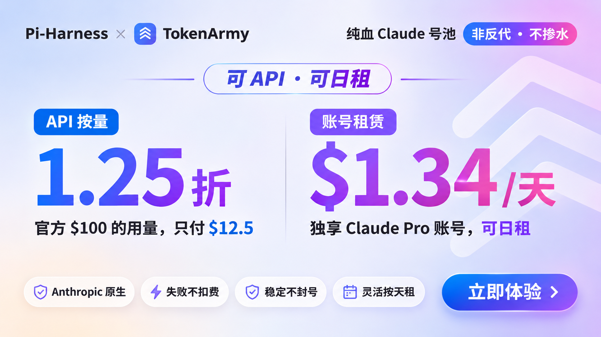
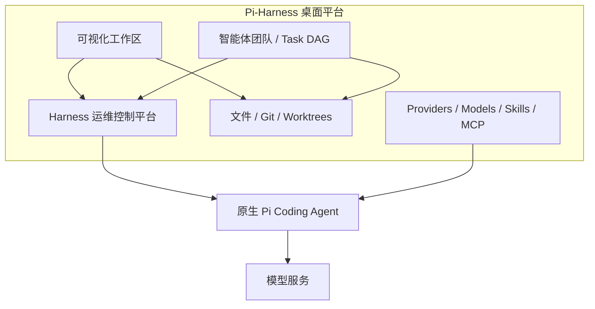

<div align="center">


### Pi Coding Agent 的 Operational Superset

**在一个桌面工作区中观测、控制与编排原生 Pi 智能体。**<br>
智能体始终由 Pi 运行。Pi-Harness 在它周围加上工作区、运行记录、恢复和智能体团队，<br>
你的 Pi 会话、配置、Skills 和扩展在应用内外都照常可用。

`Pi Coding Agent ⊂ Pi-Harness`

[](https://github.com/wangmiaozero/pi-harness/releases) [](https://github.com/wangmiaozero/pi-harness/stargazers) [](https://github.com/wangmiaozero/pi-harness/actions/workflows/ci.yml) [](LICENSE)<br>
  

**[下载](https://github.com/wangmiaozero/pi-harness/releases)** &nbsp;·&nbsp; **[实拍](#watch)** &nbsp;·&nbsp; **[功能](#features)** &nbsp;·&nbsp; **[Harness Plugins](#harness-plugins)** &nbsp;·&nbsp; **[文档](#documentation)** &nbsp;·&nbsp; **[更新记录](CHANGELOG.md)**

[English](README.md) · **简体中文** · [繁體中文](README.zh-TW.md) · [日本語](README.ja-JP.md) · [한국어](README.ko-KR.md) · [Русский](README.ru-RU.md) · [Français](README.fr-FR.md) · [Deutsch](README.de-DE.md)

<br>


</div>

<br>

## 赞助商

<table>
  <tr>
    <td width="580" align="center" valign="middle">
        <a href="https://infistar.cc/register?aff=S26RFM4B&ref_source=link" style="color:transparent;background-color:transparent;text-decoration:none;border:none;"></a>
    </td>
    <td valign="middle">
      Pi-Harness × Infistar.cc 无限星河｜Claude、GPT、Gemini、Grok、DeepSeek 等，一个 Key，只花官方价的零头，省 99%；低至官方 0.1 折，100% 官方纯血，每个模型都能验真；上千线路安全冗余自动切换，200+ 模型、16 个品牌，一个 Key 搞定。<br>
      Pi-Harness 用户通过<a href="https://infistar.cc/register?aff=S26RFM4B&ref_source=link">专属链接</a>注册直接送人民币 5 元：<a href="https://infistar.cc/register?aff=S26RFM4B&ref_source=link">https://infistar.cc/register?aff=S26RFM4B&ref_source=link</a>
    </td>
  </tr>
  <tr>
    <td width="580" align="center" valign="middle">
        <a href="https://tokenarmy.shop/r/TA-7FBJU-NUSUC" style="color:transparent;background-color:transparent;text-decoration:none;border:none;"></a>
    </td>
    <td valign="middle">
      <strong>Pi-Harness × TokenArmy</strong><br>
      <strong>Claude Pro 日租</strong> · 独享账号，低至 $1.34/天，不封号<br>
      <strong>Claude API 按量计费</strong> · 低至官方价格 1.25 折，失败不扣费<br>
      <a href="https://tokenarmy.shop/r/TA-7FBJU-NUSUC">Pi-Harness 用户专属注册链接</a><br>
      <em>价格与服务以 TokenArmy 平台规则为准。</em>
    </td>
  </tr>
  <tr>
    <td width="580" align="center" valign="middle">
        <a href="https://cloud.tencent.com/act/cps/redirect?redirect=6871&amp;cps_key=ece2099a1da90c2f7a4a4c437ad623f8&amp;from=console" style="color:transparent;background-color:transparent;text-decoration:none;border:none;"></a>
    </td>
    <td valign="middle">
      【腾讯云】WorkBuddy 全场景 AI 办公工作台，团队旗舰版低至198元/月<br>
      <a href="https://cloud.tencent.com/act/cps/redirect?redirect=6871&amp;cps_key=ece2099a1da90c2f7a4a4c437ad623f8&amp;from=console">https://cloud.tencent.com/act/cps/redirect?redirect=6871&amp;cps_key=ece2099a1da90c2f7a4a4c437ad623f8&amp;from=console</a>
    </td>
  </tr>
</table>

## Pi-Harness 适合你吗？

[Pi Coding Agent](https://github.com/earendil-works/pi) 在终端里已经很好用。可一旦用在真实项目上，你很快会想要更多：看清每次运行到底做了什么，运行出错时能回到正常状态，大一点的任务能拆给几个智能体一起做。Pi-Harness 把这些放进一个桌面应用，底层仍是同一个 Pi：

- **看清每次运行**：Runs、Trace、Replay 与 Evaluation 展示工具活动、对比结果，并依据运行记录分析失败原因。
- **工作随时可恢复**：Policy、Budget、Checkpoints 与 Recovery 设置工具权限和费用上限，保留恢复点，可继续、分支或重试。
- **协调一个团队**：Agent Teams、Task DAG 与 Worktrees 分配有依赖关系的任务，在 Pi 智能体之间交接结果，并隔离各自的修改。
- **始终是原生 Pi**：智能体循环、会话、上下文、工具、模型与思考都由 Pi 负责。Pi-Harness 提供可视化管理，你也可以继续在应用之外使用 Pi。

如果你在真实项目中使用 Pi，希望在一个窗口里查看、引导和协调它的工作，Pi-Harness 适合你。如果你只需要在终端里聊一个会话，单独用 Pi 就够了。

支持 macOS、Windows 和 Linux。Community 安装包内置 Pi 与 Node.js，无需提前安装其他环境。

<a id="watch"></a>

## 实拍

**工作模式。** DeepSeek 进入编程工作区。13 秒。

https://github.com/user-attachments/assets/942b73c9-ece9-485e-ad82-0e51225a73c1

**欢迎回来。** 角色亮起，工作区概览打开。11 秒。

https://github.com/user-attachments/assets/98708766-f490-4506-a33f-f1376d41770f

<a id="download"></a>
<a id="get-started"></a>

## 快速开始

**1 · 安装。** 从 **[GitHub Releases](https://github.com/wangmiaozero/pi-harness/releases)** 下载适合你系统的安装包：

| | |
| :-- | :-- |
| **macOS** | 选择 Apple Silicon（`arm64`）或 Intel（`x64`）对应的 `.dmg`，打开后将 Pi-Harness 拖入“应用程序” |
| **Windows** | x64 `.exe` 安装程序，运行后选择安装目录 |
| **Linux** | x64 `.AppImage`，授予执行权限后打开 |

```sh
chmod +x "./Pi-Harness-VERSION.AppImage"   # 将 VERSION 替换为下载的版本号
./Pi-Harness-VERSION.AppImage
```

<sub>安装包内置 Pi、Node.js、npm 与 npx：无需提前安装 Pi 或 Node.js，也无需克隆仓库或安装 pnpm。版本验证覆盖 macOS Apple Silicon、macOS Intel、Windows x64 与 Linux x64，每个版本提供哪些平台以其验证结果为准。Linux 验证以 Ubuntu 24.04 为目标；其他发行版以及 FUSE、桌面集成需分别确认。Windows/Linux ARM64 仍为预览目标。旧版安装包的要求可能不同，请以所下载版本的说明为准。macOS 安装包为 Ad-hoc 签名，Windows 安装程序未签名，详见<a href="#verify-your-download">校验下载文件</a>。</sub>

**2 · 检查环境。** 启动 Pi-Harness，在概览页检查运行环境。

**3 · 添加 Provider。** 配置 Provider、测试连接并选择模型。模型访问可能需要凭证，并产生对应服务商费用。

**4 · 开始工作。** 直接新建对话或打开项目，新建或继续 Pi 会话，在同一个窗口中处理对话、文件和 Git。打开“**工作区 → 工具 → Harness / 智能体**”，查看运行或协调团队。

<a id="verify-your-download"></a>

### 校验下载文件

Community 版本免费发布。macOS 安装包使用 **Ad-hoc 签名，未经 Apple Developer ID 签名或公证**；Windows 安装程序**未签名**，可能触发 SmartScreen 提示。允许应用打开前，请核对官方下载来源与校验值。macOS 首次启动若被拦截，可对该应用使用“**系统设置 → 隐私与安全性 → 仍要打开**”。请保持系统安全防护开启。

同时下载 `SHA256SUMS`，计算安装包的哈希，并与列表中相同文件名的值比较（将 `VERSION` 和架构替换为实际下载值）：

```sh
shasum -a 256 "Pi-Harness-VERSION-arm64.dmg"   # macOS
sha256sum "Pi-Harness-VERSION.AppImage"        # Linux
```

```powershell
Get-FileHash ".\Pi-Harness-Setup-VERSION.exe" -Algorithm SHA256   # Windows
```

<sub>SHA256 用于确认文件与校验列表一致，不能独立证明发布者身份。请使用官方 <a href="https://github.com/wangmiaozero/pi-harness/releases">GitHub Releases</a> 页面，疑似安全漏洞请私下联系 <a href="mailto:tuziling84@gmail.com">tuziling84@gmail.com</a>。Community 版本在应用内检查新版本，并在各平台打开官方 Releases 页面供手动下载安装。自动安装在跨版本升级验证完成前保持关闭，已有安装保留原有更新行为。详见 <a href="docs/release/community-release.md">Community Release</a> 与<a href="docs/release/update-strategy.md">更新说明</a>。</sub>

<a id="architecture"></a>

## 整体结构

Pi 负责执行与原生会话。Harness 观测每次运行，并围绕它提供策略、预算、检查点、恢复与评估。智能体团队使用同一个 Pi 执行引擎。会话历史和项目架构是工作区工具，主题用于定制外观。下图表示模块协作关系，不表示类继承。



<a id="pi-vs-pi-harness"></a>

<details>
<summary><b>原生 Pi 与 Pi-Harness</b>：逐项能力对比</summary>

<br>

| 能力                     | Native Pi | Pi-Harness        |
| ------------------------ | --------- | ----------------- |
| Agent Runtime            | 支持      | Native Pi         |
| Agent Loop               | 支持      | Native Pi         |
| Sessions                 | 支持      | 支持 + 可视化管理 |
| Context                  | 支持      | 支持 + 检查视图   |
| Compaction               | 支持      | 支持 + 可视化控制 |
| Steering                 | 支持      | 支持              |
| Follow-up                | 支持      | 支持              |
| Models                   | 支持      | 支持 + 管理器     |
| Thinking                 | 支持      | 支持 + 可视化控制 |
| Tools                    | 支持      | 支持 + 选择与策略 |
| Skills                   | 支持      | 支持 + 管理器     |
| Extensions               | 支持      | 支持 + 管理器     |
| Packages                 | 支持      | 支持 + 管理器     |
| MCP / Codemode           | 支持      | 支持 + 选择与策略 |
| Runs                     | —         | 支持              |
| Trace                    | —         | 支持              |
| Replay                   | —         | 支持              |
| Run Compare              | —         | 支持              |
| Evaluation               | —         | 支持              |
| Policy                   | —         | 支持              |
| Budget                   | —         | 支持              |
| Checkpoints              | —         | 支持              |
| Recovery                 | —         | 支持              |
| Diagnostics              | —         | 支持              |
| Regression               | —         | 支持              |
| Artifacts                | —         | 支持              |
| Multi-Agent              | —         | 支持              |
| Task DAG                 | —         | 支持              |
| Handoff                  | —         | 支持              |
| Review Gates             | —         | 支持              |
| Worktree isolation       | —         | 支持              |
| Project architecture map | —         | 支持              |

</details>

<a id="features"></a>

## 功能

### 工作区、文件与 Git

可以直接开始独立对话，也可以打开项目并继续 Pi 会话。集中查看流式回复、思考过程、工具调用、图片和文件变更；选择模型、思考级别与工具，或压缩对话上下文。从工作区“工具”打开 Harness 和智能体时，对话与未发送草稿会保留。

支持文件浏览与搜索、媒体和文档预览，以及带语法高亮、行号、查找、撤销/重做、显式保存和外部变更冲突保护的轻量文本编辑。Git 提供差异、提交历史、活动图、提交操作、可选 AI 提交信息和 worktree。

<table>
<tr>
<td width="50%"><br><sub>轻量文件编辑</sub></td>
<td width="50%"><br><sub>Git</sub></td>
</tr>
</table>

<a id="harness"></a>

### Harness 运行控制平台

每次 Pi 运行都会留下记录，可以查看、对比，也可以从中恢复。

| | |
| :-- | :-- |
| **观测** | 运行记录、Trace、回放、时间线与工具活动；对比不同运行，在运行树中追踪分支和重试 |
| **度量** | 每次运行的 Token、费用和耗时，以及产物和项目统计 |
| **控制** | 工具策略与单次运行预算；创建检查点，再恢复、分支或重试任务 |
| **检查** | 评估、诊断和回归基线依据实际运行记录检查结果、定位失败原因 |

<table>
<tr>
<td width="50%"><br><sub>会话状态与待处理指令</sub></td>
<td width="50%"><br><sub>Harness 控制台</sub></td>
</tr>
</table>

<a id="multi-agent"></a>

### 多智能体编排

打开“**工作区 → 工具 → 智能体**”，使用可复用团队和模板协调多个 Pi 智能体。为任务指定依赖和优先级，支持手动、顺序或并行调度，把结果与产物交给下一个任务，并设置审核关卡。worktree 隔离各智能体的修改；预算、冲突提示，以及暂停、继续、中止、重试、跳过和重新分配帮助你管理任务。

<table>
<tr>
<td width="50%"><br><sub>尚未启动的示例团队：三个智能体空闲，任务均待处理</sub></td>
<td width="50%"><br><sub>任务依赖与审核要求</sub></td>
</tr>
</table>

<a id="conversation-history"></a>

### 通用会话历史

统一浏览 Claude Code、Codex（含桌面及归档会话）、Cursor、Cursor Agent、Gemini CLI、OpenCode 和 Pi 历史，支持搜索、按来源/项目/日期范围筛选，以及自定义历史目录。

原始会话只读；查看交接预览、编辑下一步指令后，可以在同一项目下新建 Pi 对话继续任务。浏览、本地预览和扫描重试不消耗模型 Token；可选 AI 整理只在你主动使用时调用已配置的模型。

<table>
<tr>
<td width="50%"><br><sub>会话历史</sub></td>
<td width="50%"><br><sub>会话清理</sub></td>
</tr>
</table>

<a id="project-architecture"></a>

### 项目架构可视化

在工作区打开“项目架构”，浏览模块、依赖、入口文件和源码引用。支持按包筛选、模块聚焦、地图翻页、缩放与全屏；保存分析快照并提示源码变化，可导出 JSON、离线 HTML 或当前视图 PNG。

| | |
| :-- | :-- |
| **本地优先** | 分析在本地进行，不消耗模型 Token；AI 说明按需使用 |
| **覆盖范围** | JavaScript、TypeScript 和 Vue 提供本地导入关系分析，其他支持语言提供文件级索引；每次分析都会标明覆盖范围与限制 |
| **适用范围** | 架构图展示支持范围内的静态依赖，不代表完整的函数调用关系 |


<a id="providers-and-models"></a>
<a id="skills-extensions-packages-and-mcp"></a>

### Provider、模型与 Skills

| | |
| :-- | :-- |
| **Provider** | 通过预设或自定义地址配置 Pi 兼容 Provider，管理凭证、获取服务支持的模型列表、测试连接并选择聊天模型 |
| **图像** | 支持的图像模型可用于文生图或图片编辑，结果可以下载 |
| **OpenCode Zen / Go** | 在“模型 → OpenCode”中保存 API Key 并启用需要的模型。模型会自动加载，可单独或批量验证。访问权限与费用取决于官方账号和所选模型；付费验证需经你同意。定价与数据政策见 [OpenCode 官方模型说明](https://opencode.ai/v2/docs/console/models/) |
| **Skills** | 浏览并编辑内置与本地 Skills。在输入框键入 `@`，即可搜索并调用已安装的 Skill |
| **包与扩展** | 在能力中心管理 Pi 包和扩展。[Superpowers](https://github.com/obra/superpowers) 等可选增强能力只在你选择时安装、更新或卸载 |

<table>
<tr>
<td width="50%"><br><sub>Provider 与模型</sub></td>
<td width="50%"><br><sub>能力中心</sub></td>
</tr>
</table>

<a id="mcp-marketplace"></a>

### MCP 服务器与市场

在“**设置 → MCP**”中添加本地命令或 HTTP 服务器，使用“**全部 / 全局 / 项目**”筛选、选择项目，并分别编辑或启用各作用范围内的服务器。也可从其他工具扫描配置，审阅后导入。

市场提供 **15 个内置服务器模板**，包括 Memory、Context7、Playwright、Filesystem、GitHub，并支持官方 MCP 注册表搜索与分页。保存前可预览配置及目标范围。模板供按需安装，不代表已经全部启用；扫描导入和注册表条目保存后默认关闭，补齐配置后再启用。


<a id="agent-settings"></a>

### 智能体设置

**v2.2.10 及后续版本提供。** 下载的安装包是否包含这些功能，以对应版本的发布说明为准。

| 页面 | 可以设置 | |
| :-- | :-- | :-- |
| **AI** | 默认思考级别、自动压缩、错误重试与工作区偏好 | [截图](docs/%E5%8A%9F%E8%83%BD%E7%95%8C%E9%9D%A2/%E7%BB%8F%E5%85%B8%E4%B8%BB%E9%A2%98/AI.png) |
| **实时语音** | 工作区通话使用的语音服务与账号 | [截图](docs/%E5%8A%9F%E8%83%BD%E7%95%8C%E9%9D%A2/%E7%BB%8F%E5%85%B8%E4%B8%BB%E9%A2%98/%E5%AE%9E%E6%97%B6%E8%AF%AD%E9%9F%B3.png) |
| **快捷键** | 为命令面板、打开设置、新建会话和关闭标签页录制组合键，或恢复默认 | [截图](docs/%E5%8A%9F%E8%83%BD%E7%95%8C%E9%9D%A2/%E7%BB%8F%E5%85%B8%E4%B8%BB%E9%A2%98/%E5%BF%AB%E6%8D%B7%E9%94%AE.png) |
| **指令** | 全局或项目指令 | [截图](docs/%E5%8A%9F%E8%83%BD%E7%95%8C%E9%9D%A2/%E7%BB%8F%E5%85%B8%E4%B8%BB%E9%A2%98/%E6%8C%87%E4%BB%A4.png) |
| **MCP** | 各作用范围内的 MCP 服务器 | [截图](docs/%E5%8A%9F%E8%83%BD%E7%95%8C%E9%9D%A2/%E7%BB%8F%E5%85%B8%E4%B8%BB%E9%A2%98/MCP%E6%9C%8D%E5%8A%A1%E5%99%A8.png) |
| **子智能体** | 可复用的子智能体，配置角色、指令、模型、思考级别与工具；选择共享工作区或独立 worktree，再启动任务或将模板用于团队 | [截图](docs/%E5%8A%9F%E8%83%BD%E7%95%8C%E9%9D%A2/%E7%BB%8F%E5%85%B8%E4%B8%BB%E9%A2%98/%E5%AD%90%E6%99%BA%E8%83%BD%E4%BD%93.png) |
| **远程主机** | 用地址和配对令牌配对运行 pi-host 的主机 | [截图](docs/%E5%8A%9F%E8%83%BD%E7%95%8C%E9%9D%A2/%E7%BB%8F%E5%85%B8%E4%B8%BB%E9%A2%98/%E8%BF%9C%E7%A8%8B%E4%B8%BB%E6%9C%BA.png) |

<a id="realtime-voice"></a>

### 工作区实时语音

通过 **OpenAI Realtime、Gemini Live 或 Codex Live** 与工作区对话。可选择支持的服务账号或独立 API 密钥；Codex Live 使用你在 Pi 中已有的 Codex 登录账号。服务可用性与费用取决于对应账号。

1. 打开“**设置 → 实时语音**”，启用语音、选择服务与账号并保存。
2. 在工作区对话中，点击输入框旁的波形按钮。
3. 确认目标会话与可选的上下文共享，点击“**开始实时语音**”并允许使用麦克风。
4. 通过浮动控件静音、查看转写或结束通话，切换页面后仍可控制。

近期上下文共享默认关闭；主动开启后，只共享最近六条纯文本消息，不包含附件和工具结果。通话中提出的工作请求经你确认后才会发送到工作会话。


<a id="remote-hosts"></a>

### 远程主机

在“**设置 → 远程主机**”中输入运行 **pi-host** 的主机地址与配对令牌。配对后可连接或断开主机、浏览项目和会话、查看对话、发送提示词并处理审批请求。远程主机需要预先运行服务并保持可连接。

<a id="desktop-companion"></a>

### 桌面伴侣

在“**设置 → 桌宠**”启用已安装的桌宠，在桌面上查看思考、工具执行、等待操作和任务完成反馈。桌宠默认关闭，主窗口最小化后仍可显示。

空闲时，可从支持搜索的右键菜单中选择 193 个动作。任务运行期间暂停手动互动，拖动不会打断任务动画。支持导入本地宠物包，并通过滑块调整大小、透明度与气泡设置。

<table>
<tr>
<td width="33%"><br><sub>设置与滑块</sub></td>
<td width="33%"><br><sub>右键菜单</sub></td>
<td width="33%"><br><sub>动作搜索</sub></td>
</tr>
</table>

<a id="themes-and-custom-skins"></a>
<a id="screenshots"></a>

### 主题与自定义皮肤

选择经典配色、大明、星舰驾驶舱、macOS 27 背景或导入自定义皮肤。新安装默认使用**柔和浅色**；支持自定义聊天显示名称、应用图标、本地背景图，以及窗口光圈、屏幕光圈和输入框火焰效果。启动动画伴随环境检查。

人物主题和桌宠是可选资源包。在“**设置 → 资源市场**”从 GitHub 清单逐个安装 `@piharness` 资源包。应用不内置这些可选媒体，没有网络也可以启动。已经选过的主题或桌宠会保留；资源还没安装时使用基础外观，安装后恢复。说明见 [docs/market/MARKET.md](docs/market/MARKET.md)。

使用 [Pi-Harness 自定义皮肤模板](https://github.com/wangmiaozero/pi-harness-skin-starter)**制作你自己的皮肤**：

1. 使用模板仓库，或下载它。
2. 用编码智能体打开项目，通过内置提示词描述你喜欢的风格。
3. 完成后从“**设置 → 主题 → 导入皮肤**”导入项目。

多语言模板提供配色、预览图、壁纸和可选角色图的制作说明。皮肤可以保存在独立仓库中，单独更新和分享。

<table>
<tr>
<td width="50%"><br><sub>大明·雪境朝臣</sub></td>
<td width="50%"><br><sub>大明·雪夜笛姬</sub></td>
</tr>
<tr>
<td width="50%"><br><sub>大明·月城书姬</sub></td>
<td width="50%"><br><sub>星舰驾驶舱</sub></td>
</tr>
<tr>
<td width="50%"><br><sub>大明·通用设置</sub></td>
<td width="50%"><br><sub>大明·主题皮肤库</sub></td>
</tr>
<tr>
<td colspan="2"><br><sub>macOS 27 · Liquid Ether</sub></td>
</tr>
</table>

<a id="harness-plugins"></a>

### Harness Plugins

**Plugin SDK v1.0.0 · 自 Pi-Harness v2.2.6 起提供。** 插件扩展的是围绕 Agent 的运维能力，与扩展 Pi 自身的方式并列：

| 扩展类型 | 作用 |
| :-- | :-- |
| **Pi Extensions** | 扩展 Pi Agent 自身能力 |
| **Skills** | 为 Agent 提供指令和工作流知识 |
| **MCP** | 为 Agent 连接工具与外部服务 |
| **Harness Plugins** | 扩展围绕 Agent 的 Pi-Harness 运维能力 |

支持 **Harness Event Subscribers、Custom Evaluators、Trace Exporters 和 Agent Team Templates**。自定义评估结果作为补充，导出使用经过授权的 JSON 数据，团队模板只创建待执行工作流，由你检查后启动。可以先试试维护中的 SDK 示例：[Run Metrics](examples/harness-plugins/run-metrics/plugin.json)、[Quality Evaluator](examples/harness-plugins/quality-evaluator/plugin.json)、[Team Template](examples/harness-plugins/team-template/plugin.json)。

在源码构建中打开“**工作区 → 工具 → Harness → Harness 插件 → 安装本地插件**”，选择目录、查看权限后启用。安装不执行代码；可执行插件必须经过原生弹窗的明确代码信任确认：**独立进程不是安全沙箱，获准执行的 Node 代码可访问本机资源**。未经信任的内容请使用声明式模板。

[开发与安装](docs/plugins/getting-started.md) · [架构](docs/plugins/architecture.md) · [SDK API](docs/plugins/api-reference.md) · [安全边界](docs/plugins/security.md)

### 其他

- **环境检查**：检查 Node.js、npm、PATH、Pi Coding Agent 和当前配置；在支持的环境中安装、更新或修复 Pi，查看环境诊断并管理配置备份。
- **运行时**：内置 Pi 与 Node 运行时开箱即用，设置中也提供系统与自定义运行时选项。
- **应用更新**：在应用内检查新版本。
- **八种语言**：English、简体中文、繁體中文、日本語、한국어、Русский、Français、Deutsch。

<a id="documentation"></a>

## 文档

| | |
| :-- | :-- |
| **[智能体设置使用指南](docs/agent-settings.md)** | AI、实时语音、快捷键、指令、MCP、子智能体和远程主机 |
| **[资源市场](docs/market/MARKET.md)** | 安装主题和桌宠资源包 |
| **[Harness Plugins](docs/plugins/getting-started.md)** | 开发与安装插件；另见[架构](docs/plugins/architecture.md)、[SDK API](docs/plugins/api-reference.md) 和[安全边界](docs/plugins/security.md) |
| **[Community Release](docs/release/community-release.md)** | Community 版本如何签名、校验与[更新](docs/release/update-strategy.md) |
| **[故障排查](docs/release/troubleshooting.md)** | 校验值、安全提示、启动与更新问题 |
| **[截图分类索引](docs/README.md)** | 按分类浏览全部界面与主题 |
| **[更新记录](CHANGELOG.md)** | 每个版本的变化 |

## 本地开发

安装 **Node.js 24 LTS (≥ 24.22.1)** 与 **pnpm 9.12.1**，然后执行：

```sh
git clone https://github.com/wangmiaozero/pi-harness.git
cd pi-harness
pnpm install --frozen-lockfile
pnpm dev
```

<sub>未单独安装 Pi 时，可使用 <a href="fixtures/README.md">fixtures 示例配置</a>：在设置中将手动配置目录指向 <code>fixtures/mock-pi</code> 的绝对路径。示例配置不提供真实模型访问；需要时请配置自己的 Provider。</sub>

提交修改前请运行检查；修改关键桌面流程时，还应运行 `pnpm test:e2e`。

```sh
pnpm typecheck
pnpm lint
pnpm test
pnpm compile
```

## 社区

- **[Issues](https://github.com/wangmiaozero/pi-harness/issues)**：报告问题或提出建议。请附上应用版本、操作系统和复现步骤，并移除凭证与私密会话内容。
- **[Pull Requests](https://github.com/wangmiaozero/pi-harness/pulls)**：说明问题、用户可见的变化及验证结果。欢迎文档、翻译、主题和针对性修复。
- **[自定义皮肤](https://github.com/wangmiaozero/pi-harness-skin-starter)**：制作并分享你的皮肤。
- **QQ 群**：pi-harness · **1109717308**，扫码加入，交流使用与开发问题。

<p align="center">
  
</p>

如果 Pi-Harness 让你用 Pi 更顺手，**点一个 ⭐ 能帮更多人发现它。**

<picture>
  <source media="(prefers-color-scheme: dark)" srcset="https://api.star-history.com/svg?repos=wangmiaozero/pi-harness&type=Date&theme=dark">
  
</picture>

## 致谢与作者

Pi-Harness 围绕官方 [Pi Coding Agent 与 Pi Agent Harness](https://github.com/earendil-works/pi) 构建。由 [wangmiao](https://github.com/wangmiaozero) 创建并维护 · [tuziling84@gmail.com](mailto:tuziling84@gmail.com)。

**PR 贡献者**

<table>
  <tr>
    <td align="center">
      <br /><a href="https://github.com/HenryArch"><b>HenryArch</b></a><br />
      <a href="https://github.com/wangmiaozero/pi-harness/pull/8">PR #8</a>
    </td>
  </tr>
</table>

欢迎大家提交 PR，一起完善 Pi-Harness，让项目变得更好。感谢每一位贡献者的支持与付出！

## 许可协议

Pi-Harness 采用 [GNU Affero General Public License v3.0 only](LICENSE)（`AGPL-3.0-only`）发布。

Copyright © 2026 [wangmiao](https://github.com/wangmiaozero).
