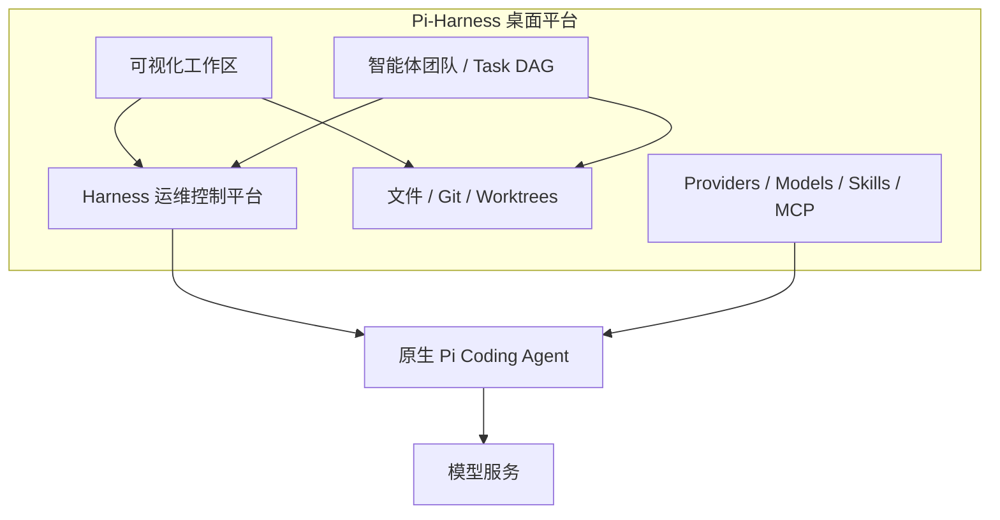

# Pi-Harness

<p align="center">
  <a href="README.md">English</a> ·
  <a href="README.zh-CN.md">简体中文</a> ·
  <a href="README.zh-TW.md">繁體中文</a> ·
  <a href="README.ja-JP.md">日本語</a> ·
  <a href="README.ko-KR.md">한국어</a> ·
  <a href="README.ru-RU.md">Русский</a> ·
  <a href="README.fr-FR.md">Français</a> ·
  <a href="README.de-DE.md">Deutsch</a>
</p>

<p align="center">
  
</p>

<h3 align="center">Pi Coding Agent 的 Operational Superset</h3>

<p align="center">
  <strong>在一个桌面工作区中观测、治理、恢复与编排原生 Pi 智能体。</strong>
</p>

<p align="center"><code>Pi Coding Agent ⊂ Pi-Harness</code></p>

<p align="center">
  <a href="#download"><strong>下载</strong></a> ·
  <a href="#features">功能</a> ·
  <a href="#agent-settings">智能体设置</a> ·
  <a href="#harness-plugins">Harness Plugins</a> ·
  <a href="#documentation">文档</a>
</p>

<p align="center">
  <a href="https://github.com/wangmiaozero/pi-harness/releases"></a>
  
  <a href="https://github.com/wangmiaozero/pi-harness/actions/workflows/ci.yml"></a>
  <a href="LICENSE"></a>
  <a href="https://github.com/wangmiaozero/pi-harness"></a>
</p>

Pi-Harness 是围绕 [Pi Coding Agent](https://github.com/earendil-works/pi) 构建的桌面工作区与运维控制平台。Pi 负责原生执行；Pi-Harness 在其周围提供可视化运维、治理、恢复、评估与多智能体编排。Pi 会话、配置、工具、Skills 与扩展保持兼容，也可以继续在桌面应用之外使用 Pi。

**支持 macOS、Windows、Linux。Community 安装包内置 Pi 与 Node.js，无需提前单独安装运行环境。** [开始使用 →](#download)

<a id="product-preview"></a>

## 产品预览

以下为仓库已有的真实截图，点击可查看原图。

### Workspace · 工作区

在项目工作区中处理对话、文件与 Git。

[](docs/%E5%8A%9F%E8%83%BD%E7%95%8C%E9%9D%A2/%E7%BB%8F%E5%85%B8%E4%B8%BB%E9%A2%98/%E5%B7%A5%E4%BD%9C%E5%8C%BA.png)

### Harness · 运行控制

在 Harness 控制台中查看会话状态与待处理指令。

[](docs/%E5%8A%9F%E8%83%BD%E7%95%8C%E9%9D%A2/%E7%BB%8F%E5%85%B8%E4%B8%BB%E9%A2%98/%E5%B7%A5%E5%85%B7Harness-1.png)

### Multi-Agent · 多智能体

打开 **工作区 → 工具 → 智能体**，管理团队、任务依赖、交接、审核关卡与隔离的 worktree。[了解多智能体编排 →](#multi-agent)

在桌面应用中配置的示例团队，尚未启动运行：三个智能体均为空闲状态，任务均待处理。

[](docs/%E5%8A%9F%E8%83%BD%E7%95%8C%E9%9D%A2/%E7%BB%8F%E5%85%B8%E4%B8%BB%E9%A2%98/%E5%A4%9A%E6%99%BA%E8%83%BD%E4%BD%93-%E5%9B%A2%E9%98%9F.png)

<details>
<summary>查看任务依赖与审核设置</summary>

[](docs/%E5%8A%9F%E8%83%BD%E7%95%8C%E9%9D%A2/%E7%BB%8F%E5%85%B8%E4%B8%BB%E9%A2%98/%E5%A4%9A%E6%99%BA%E8%83%BD%E4%BD%93-%E4%BB%BB%E5%8A%A1%E4%BE%9D%E8%B5%96.png)

</details>

[更多界面与主题 →](#screenshots) · [完整截图索引](docs/README.md)

<a id="为什么是-pi-harness"></a>

## 为什么选择 Pi-Harness

### Observe · 看清每次运行

通过 **Run、Trace、Replay 与 Evaluation** 查看工具活动、对比结果，并依据记录分析失败原因。

### Control · 控制边界，恢复工作

通过 **Policy、Budget、Checkpoints 与 Recovery** 设置工具权限和预算，保留恢复点，并继续、分支或重试任务。

### Orchestrate · 协调团队协作

通过 **Agent Teams、Task DAG 与 Worktrees** 分配有依赖关系的任务，在 Pi 智能体之间交接结果，并隔离各自的修改。

<a id="features"></a>

<a id="功能介绍"></a>

## 核心功能

### Native Pi Runtime · 原生执行引擎

Pi Coding Agent 负责智能体循环、会话、上下文、压缩、引导、后续指令、工具、模型与思考。Pi-Harness 围绕这些原生能力提供可视化管理。

<a id="原生-pi-与-pi-harness"></a>

<details>
<summary>原生 Pi 与 Pi-Harness：完整能力概览</summary>

| 能力                     | Native Pi | Pi-Harness        |
| ------------------------ | --------- | ----------------- |
| Agent Runtime            | 支持      | Native Pi         |
| Agent Loop               | 支持      | Native Pi         |
| Sessions                 | 支持      | 支持 + 可视化管理 |
| Context                  | 支持      | 支持 + 检查视图   |
| Compaction               | 支持      | 支持 + 可视化控制 |
| Steering                 | 支持      | 支持              |
| Follow-up                | 支持      | 支持              |
| Models                   | 支持      | 支持 + 管理器     |
| Thinking                 | 支持      | 支持 + 可视化控制 |
| Tools                    | 支持      | 支持 + 选择与策略 |
| Skills                   | 支持      | 支持 + 管理器     |
| Extensions               | 支持      | 支持 + 管理器     |
| Packages                 | 支持      | 支持 + 管理器     |
| MCP / Codemode           | 支持      | 支持 + 选择与策略 |
| Runs                     | —         | 支持              |
| Trace                    | —         | 支持              |
| Replay                   | —         | 支持              |
| Run Compare              | —         | 支持              |
| Evaluation               | —         | 支持              |
| Policy                   | —         | 支持              |
| Budget                   | —         | 支持              |
| Checkpoints              | —         | 支持              |
| Recovery                 | —         | 支持              |
| Diagnostics              | —         | 支持              |
| Regression               | —         | 支持              |
| Artifacts                | —         | 支持              |
| Multi-Agent              | —         | 支持              |
| Task DAG                 | —         | 支持              |
| Handoff                  | —         | 支持              |
| Review Gates             | —         | 支持              |
| Worktree isolation       | —         | 支持              |
| Project architecture map | —         | 支持              |

</details>

<a id="harness"></a>

<a id="harness观测控制与恢复"></a>

### Agent Harness Control Plane · 运行控制平台

查看运行记录、Trace、回放、时间线与工具活动；对比不同运行，在运行树中追踪分支和重试，检查 Token、费用、耗时、产物及项目统计。

设置工具策略与单次运行预算，创建检查点，并恢复、分支或重试任务。评估、诊断和回归基线帮助你依据实际运行记录检查结果、定位失败原因。

<a id="multi-agent"></a>

<a id="智能体团队与任务编排"></a>

### Multi-Agent Orchestration · 多智能体编排

使用可复用团队和模板协调多个 Pi 智能体，为任务指定依赖、优先级和负责人，支持手动、顺序或并行调度、结果与产物交接、审核关卡。通过 worktree 隔离修改，并使用预算、冲突提示，以及暂停、继续、中止、重试、跳过和重新分配来管理任务。

<a id="conversation-history"></a>

<a id="本地会话历史"></a>

### Universal Conversation History · 通用会话历史

统一浏览 Claude Code、Codex（含桌面及归档会话）、Cursor、Cursor Agent、Gemini CLI、OpenCode 和 Pi 历史，支持搜索、来源/项目/日期范围筛选和自定义历史目录。

原始会话只读；查看交接预览、编辑下一步指令后，可以在同一项目下新建 Pi 对话继续任务。浏览、本地预览和扫描重试不消耗模型 Token；可选 AI 整理只在主动使用时调用已配置的模型。

<a id="project-architecture"></a>

<a id="项目架构"></a>

### Project Architecture Visualization · 项目架构可视化

在工作区打开“项目架构”，浏览模块、依赖、入口文件和源码引用。支持按包筛选、模块聚焦、地图翻页、缩放与全屏，保存分析快照并提示源码变化，可导出 JSON、离线 HTML 或当前视图 PNG。

架构图展示支持范围内的静态依赖，不代表完整的函数调用关系。

本地分析不消耗模型 Token，AI 说明按需使用。JavaScript、TypeScript 和 Vue 提供本地导入关系分析，其他支持语言提供文件级索引，分析结果会标明覆盖范围与限制。

<a id="provider-与模型"></a>

<a id="skills扩展包与-mcp"></a>

### Providers / Models / Skills / MCP · 模型与能力

通过预设或自定义地址配置 Pi 兼容 Provider，管理凭证、获取服务支持的模型列表、测试连接并选择聊天模型。支持的图像模型可用于文生图或图片编辑，结果可以下载。

在“模型 → OpenCode”中配置 OpenCode Zen / Go：保存 API Key，启用需要的模型，再在工作区选择使用。模型会自动加载，可单独或批量验证。访问权限与费用取决于官方账号和所选模型；付费验证需经你同意。定价与数据政策见 [OpenCode 官方模型说明](https://opencode.ai/v2/docs/console/models/)。

在能力中心浏览内置与本地 Skills、编辑 Skill，并管理 Pi 包和扩展。在输入框键入 `@`，即可搜索并调用已安装的 Skill。在“**设置 → MCP**”中管理 MCP 服务器。[Superpowers](https://github.com/obra/superpowers) 和 [Odai](https://github.com/orziz/odai) 等可选增强能力可按需安装、更新或卸载。

<a id="agent-settings"></a>

### Agent Settings · 智能体设置

**v2.2.10 及后续版本提供** **AI、实时语音、快捷键、指令、MCP、子智能体、远程主机**七个设置页面。下载的安装包是否包含这些功能，以对应版本的发布说明为准。

在“**设置 → AI**”中调整默认思考级别、自动压缩、错误重试与工作区偏好。在“快捷键”中录制命令面板、打开设置、新建会话和关闭标签页的组合键，或恢复默认设置。在“**设置 → 指令**”中编辑全局或项目指令。

在“**设置 → 子智能体**”中创建可复用模板，配置角色、指令、模型、思考级别与工具，选择共享工作区或独立 worktree，再启动任务或将模板用于团队。

<a id="realtime-voice"></a>

### Realtime Voice · 工作区实时语音

在“**设置 → 实时语音**”中配置 **OpenAI Realtime、Gemini Live 或 Codex Live**，再点击工作区输入框旁的波形按钮。可选择支持的服务账号或独立 API 密钥；Codex Live 使用你在 Pi 中已有的 Codex 登录账号。服务可用性与费用取决于对应账号。

开始通话前可确认目标工作会话。近期上下文共享默认关闭；主动开启后，只共享最近六条纯文本消息，不包含附件和工具结果。通话期间可通过浮动控件静音、结束通话或查看转写，切换页面后仍可控制通话。语音提出的工作请求需要确认后才会发送到工作会话。

<a id="mcp-marketplace"></a>

### MCP Servers and Marketplace · MCP 服务器与市场

在“**设置 → MCP**”中添加本地命令或 HTTP 服务器，使用“**全部 / 全局 / 项目**”筛选、选择项目，并分别编辑或启用各作用范围内的服务器。也可从其他工具扫描配置，审阅后导入。

市场提供 **15 个内置服务器模板**，包括 Memory、Context7、Playwright、Filesystem、GitHub，并支持官方 MCP 注册表搜索与分页。保存前可预览配置及目标范围。模板供按需安装，不代表已经全部启用；扫描导入和官方注册表条目保存后默认关闭，补齐配置后再启用。

<a id="remote-hosts"></a>

### Remote Hosts · 远程主机

在“**设置 → 远程主机**”中输入运行 **pi-host** 的主机地址与配对令牌。配对后可连接或断开主机、浏览项目和会话、查看对话、发送提示词并处理审批请求。远程主机需要预先运行服务并保持可连接。

<a id="主题与自定义皮肤"></a>

### Custom Themes and Skins · 主题与皮肤

选择经典配色、大明、星舰驾驶舱、macOS 27 背景或导入自定义皮肤。新安装默认使用深色主题；支持自定义聊天显示名称、应用图标、本地背景图，以及窗口光圈、屏幕光圈和输入框火焰效果。启动动画伴随环境检查，无吉祥物版本保留通用外观设置。

#### 创建自定义皮肤

使用 [Pi-Harness 自定义皮肤模板](https://github.com/wangmiaozero/pi-harness-skin-starter)，制作你喜欢的视觉风格。

1. 使用模板仓库，或下载并解压它。
2. 用编码智能体打开项目，通过内置提示词描述你喜欢的风格。
3. 完成后从“设置 → 主题 → 导入皮肤”导入项目。

多语言模板提供配色、预览图、壁纸和可选角色图的制作说明。皮肤可以保存在独立仓库中，单独更新和分享。

### 工作区、文件与 Git

可以直接开始独立对话，也可以打开项目并继续 Pi 会话。集中查看流式回复、思考过程、工具调用、图片和文件变更，选择模型、思考级别与工具，或压缩对话上下文。在工作区“工具”中打开 Harness 和智能体时，对话与未发送草稿会保留。

支持文件浏览与搜索、媒体和文档预览，以及带语法高亮、行号、查找、撤销/重做、显式保存和外部变更冲突保护的轻量文本编辑。Git 提供差异、提交历史、活动图、提交操作、可选 AI 提交信息和 worktree。

### 环境与应用设置

检查 Node.js、npm、PATH、Pi Coding Agent 和当前配置，在支持的环境中安装、更新或修复 Pi；查看环境诊断、管理配置备份并检查应用更新。界面支持八种语言。

<a id="harness-plugins"></a>

## Harness Plugins — 扩展控制平台

**Plugin SDK v1.0.0 · 自 Pi-Harness v2.2.6 起提供。**

| 扩展类型        | 作用                                    |
| --------------- | --------------------------------------- |
| Pi Extensions   | 扩展 Pi Agent 自身能力。                |
| Skills          | 为 Agent 提供指令和工作流知识。         |
| MCP             | 为 Agent 连接工具与外部服务。           |
| Harness Plugins | 扩展围绕 Agent 的 Pi-Harness 运维能力。 |

首版支持 **Harness Event Subscribers、Custom Evaluators、Trace Exporters 和 Agent Team Templates**。自定义评估结果独立保存，Trace 使用经过授权的 JSON 数据，团队模板只创建待执行工作流，由用户检查后启动。

三个维护中的 SDK 示例：[Run Metrics](examples/harness-plugins/run-metrics/plugin.json)、[Quality Evaluator](examples/harness-plugins/quality-evaluator/plugin.json)、[Team Template](examples/harness-plugins/team-template/plugin.json)。

在源码构建中打开 **工作区 → 工具 → Harness → Harness 插件 → 安装本地插件**，选择目录、查看权限后启用。安装不执行代码；可执行插件必须经过原生弹窗的明确代码信任确认。**独立进程不是安全沙箱，获准执行的 Node 代码可访问本机资源**。未经信任的内容请使用声明式模板。

[开发与安装](docs/plugins/getting-started.md) · [架构](docs/plugins/architecture.md) · [SDK API](docs/plugins/api-reference.md) · [安全边界](docs/plugins/security.md)

## 架构

Pi-Harness 围绕原生 Pi 运行时提供工作区和运维控制。智能体团队使用同一个 Pi 执行引擎；下图表示模块协作关系，不表示类继承。



Pi 负责执行与原生会话。Harness 围绕执行过程提供运行观测、策略、预算、检查点、恢复与评估。会话历史和项目架构分析是工作区工具，主题用于定制视觉体验。

<a id="download"></a>

<a id="下载"></a>

## 快速开始

[**从 GitHub Releases 下载 →**](https://github.com/wangmiaozero/pi-harness/releases)

Community 安装包内置 **Pi、Node.js、npm 与 npx**。使用应用无需提前安装 Pi 或 Node.js，也无需克隆仓库或安装 pnpm。可选择标准版，或不含吉祥物立绘的 `nomascot` 版。旧版安装包的要求可能不同，请以所下载版本的发布说明为准。

### macOS

选择 **Apple Silicon（`arm64`）** 或 **Intel（`x64`）** 对应的 `.dmg`，打开后将 Pi-Harness 拖入“应用程序”。

### Windows

下载 **x64 `.exe` 安装程序**，运行后选择安装目录。

### Linux

下载 **x64 `.AppImage`**，授予执行权限后打开：

```sh
chmod +x "./Pi-Harness-VERSION.AppImage"
./Pi-Harness-VERSION.AppImage
```

将 `VERSION` 替换为下载的版本号。Linux 原生验证以 Ubuntu 24.04 为目标；其他发行版以及 FUSE、桌面集成需分别确认。Windows/Linux ARM64 仍为预览目标，下载可用性及验证结果以对应版本说明为准。

### Community Release 签名与校验

Community 版本免费发布。macOS 安装包使用 **Ad-hoc 签名，未经 Apple Developer ID 签名或公证**；Windows 安装程序**未签名**，可能触发 SmartScreen 提示。允许应用打开前，请核对官方下载来源与校验值。macOS 首次启动若被拦截，可对该应用使用“**系统设置 → 隐私与安全性 → 仍要打开**”。请保持系统安全防护开启。

同时下载 `SHA256SUMS`，计算安装包的哈希，并与列表中相同文件名的值比较（将 `VERSION` 和架构替换为实际下载值）：

```sh
# macOS
shasum -a 256 "Pi-Harness-VERSION-arm64.dmg"
# Linux
sha256sum "Pi-Harness-VERSION.AppImage"
```

```powershell
# Windows
Get-FileHash ".\Pi-Harness-Setup-VERSION.exe" -Algorithm SHA256
```

SHA256 用于确认文件与校验列表一致，不能独立证明发布者身份。请使用官方 [GitHub Releases](https://github.com/wangmiaozero/pi-harness/releases) 页面。疑似安全漏洞请私下联系 [tuziling84@gmail.com](mailto:tuziling84@gmail.com)。

Community 版本在应用内检查新版本，并在各平台打开官方 Releases 页面供手动下载安装。自动安装在跨版本升级验证完成前保持关闭；已有安装保留原有更新行为。详见 [Community Release](docs/release/community-release.md) 与[更新说明](docs/release/update-strategy.md)。

<a id="开始使用"></a>

### 开始第一个 Pi 会话

1. 启动 Pi-Harness，在概览页检查运行环境。
2. 配置 Provider、测试连接并选择模型。模型访问可能需要凭证，并产生对应服务商费用。
3. 直接新建对话，或打开项目。
4. 新建或继续 Pi 会话，在同一个界面中处理对话、文件和 Git。
5. 打开“**工作区 → 工具 → Harness / 智能体**”，查看运行或协调团队。

### 开始语音对话

开始实时语音对话：

1. 打开“**设置 → 实时语音**”，启用语音、选择服务与账号并保存。
2. 返回工作区中的对话，点击输入框旁的波形按钮。
3. 确认目标会话与可选的上下文共享，点击“**开始实时语音**”并允许使用麦克风。
4. 使用通话控件静音、查看详情或结束通话；工作请求经确认后再发送给编码智能体。

### 环境要求

Community 版本验证覆盖 macOS Apple Silicon、macOS Intel、Windows x64 与 Linux x64，具体平台可用性以每个版本的验证结果为准。内置 Pi 与 Node 运行时开箱即用，设置中也提供系统与自定义运行时选项。源码开发与打包需要 Node.js 24 LTS (≥ 24.22.1) 和 pnpm 9.12.1；安装包用户无需这些构建工具。

<a id="screenshots"></a>

## 界面预览

功能界面按主题分类，更多视图见[完整截图索引](docs/README.md)。

<details>
<summary>展开功能界面与主题展示</summary>

### 经典主题

#### 工作区

[](docs/%E5%8A%9F%E8%83%BD%E7%95%8C%E9%9D%A2/%E7%BB%8F%E5%85%B8%E4%B8%BB%E9%A2%98/%E5%B7%A5%E4%BD%9C%E5%8C%BA.png)

<details>
<summary>AI · 实时语音 · 快捷键 · 指令 · MCP · 子智能体 · 远程主机</summary>

#### 工作区语音

设置与通话准备界面：

[](docs/%E5%8A%9F%E8%83%BD%E7%95%8C%E9%9D%A2/%E7%BB%8F%E5%85%B8%E4%B8%BB%E9%A2%98/%E5%B7%A5%E4%BD%9C%E5%8C%BA%E8%AF%AD%E9%9F%B3.png)

#### MCP 市场

[](docs/%E5%8A%9F%E8%83%BD%E7%95%8C%E9%9D%A2/%E7%BB%8F%E5%85%B8%E4%B8%BB%E9%A2%98/MCP%E5%B8%82%E5%9C%BA.png)

| 设置页面       | 截图                                                                                                                            |
| -------------- | ------------------------------------------------------------------------------------------------------------------------------- |
| AI 偏好        | [查看](docs/%E5%8A%9F%E8%83%BD%E7%95%8C%E9%9D%A2/%E7%BB%8F%E5%85%B8%E4%B8%BB%E9%A2%98/AI.png)                                   |
| 实时语音       | [查看](docs/%E5%8A%9F%E8%83%BD%E7%95%8C%E9%9D%A2/%E7%BB%8F%E5%85%B8%E4%B8%BB%E9%A2%98/%E5%AE%9E%E6%97%B6%E8%AF%AD%E9%9F%B3.png) |
| 快捷键         | [查看](docs/%E5%8A%9F%E8%83%BD%E7%95%8C%E9%9D%A2/%E7%BB%8F%E5%85%B8%E4%B8%BB%E9%A2%98/%E5%BF%AB%E6%8D%B7%E9%94%AE.png)          |
| 全局与项目指令 | [查看](docs/%E5%8A%9F%E8%83%BD%E7%95%8C%E9%9D%A2/%E7%BB%8F%E5%85%B8%E4%B8%BB%E9%A2%98/%E6%8C%87%E4%BB%A4.png)                   |
| MCP 服务器     | [查看](docs/%E5%8A%9F%E8%83%BD%E7%95%8C%E9%9D%A2/%E7%BB%8F%E5%85%B8%E4%B8%BB%E9%A2%98/MCP%E6%9C%8D%E5%8A%A1%E5%99%A8.png)       |
| 子智能体       | [查看](docs/%E5%8A%9F%E8%83%BD%E7%95%8C%E9%9D%A2/%E7%BB%8F%E5%85%B8%E4%B8%BB%E9%A2%98/%E5%AD%90%E6%99%BA%E8%83%BD%E4%BD%93.png) |
| 远程主机配对   | [查看](docs/%E5%8A%9F%E8%83%BD%E7%95%8C%E9%9D%A2/%E7%BB%8F%E5%85%B8%E4%B8%BB%E9%A2%98/%E8%BF%9C%E7%A8%8B%E4%B8%BB%E6%9C%BA.png) |

</details>

<details>
<summary>Git · Provider 与模型 · 能力中心 · Harness 工具 · 项目架构</summary>

#### Git

[](docs/%E5%8A%9F%E8%83%BD%E7%95%8C%E9%9D%A2/%E7%BB%8F%E5%85%B8%E4%B8%BB%E9%A2%98/Git.png)

<a id="provider-与模型-1"></a>

#### Provider 与模型

[](docs/%E5%8A%9F%E8%83%BD%E7%95%8C%E9%9D%A2/%E7%BB%8F%E5%85%B8%E4%B8%BB%E9%A2%98/Provider%E4%B8%8E%E6%A8%A1%E5%9E%8B-1.png)

#### 能力中心

[](docs/%E5%8A%9F%E8%83%BD%E7%95%8C%E9%9D%A2/%E7%BB%8F%E5%85%B8%E4%B8%BB%E9%A2%98/%E8%83%BD%E5%8A%9B%E4%B8%AD%E5%BF%83-1.png)

#### Harness 工具

[](docs/%E5%8A%9F%E8%83%BD%E7%95%8C%E9%9D%A2/%E7%BB%8F%E5%85%B8%E4%B8%BB%E9%A2%98/%E5%B7%A5%E5%85%B7Harness-1.png)

<a id="项目架构-1"></a>

#### 项目架构

[](docs/%E5%8A%9F%E8%83%BD%E7%95%8C%E9%9D%A2/%E7%BB%8F%E5%85%B8%E4%B8%BB%E9%A2%98/%E9%A1%B9%E7%9B%AE%E6%9E%B6%E6%9E%84-1.png)

</details>

### 大明功能界面

<details>
<summary>通用设置 · 主题皮肤库</summary>

#### 通用设置

[](docs/%E5%8A%9F%E8%83%BD%E7%95%8C%E9%9D%A2/%E5%A4%A7%E6%98%8E/%E9%80%9A%E7%94%A8%E8%AE%BE%E7%BD%AE.png)

#### 主题皮肤库

[](docs/%E5%8A%9F%E8%83%BD%E7%95%8C%E9%9D%A2/%E5%A4%A7%E6%98%8E/%E4%B8%BB%E9%A2%98%E7%9A%AE%E8%82%A4%E5%BA%93.png)

</details>

### 主题展示

<details>
<summary>大明·雪境朝臣 · 大明·雪夜笛姬 · 大明·月城书姬 · 星舰驾驶舱 · macOS 27 · Liquid Ether</summary>

#### 大明·雪境朝臣

[](docs/%E4%B8%BB%E9%A2%98%E5%B1%95%E7%A4%BA/%E5%A4%A7%E6%98%8E/%E9%9B%AA%E5%A2%83%E6%9C%9D%E8%87%A3.png)

#### 大明·雪夜笛姬

[](docs/%E4%B8%BB%E9%A2%98%E5%B1%95%E7%A4%BA/%E5%A4%A7%E6%98%8E/%E9%9B%AA%E5%A4%9C%E7%AC%9B%E5%A7%AC.png)

#### 大明·月城书姬

[](docs/%E4%B8%BB%E9%A2%98%E5%B1%95%E7%A4%BA/%E5%A4%A7%E6%98%8E/%E6%9C%88%E5%9F%8E%E4%B9%A6%E5%A7%AC.png)

#### 星舰驾驶舱

[](docs/%E4%B8%BB%E9%A2%98%E5%B1%95%E7%A4%BA/%E6%98%9F%E8%88%B0/%E9%9C%9C%E6%98%9F%E9%A2%86%E8%88%AA.png)

#### macOS 27 · Liquid Ether

[](docs/%E4%B8%BB%E9%A2%98%E5%B1%95%E7%A4%BA/macOS%2027/Liquid%20Ether.png)

</details>

</details>

## 开发者与社区

### 本地开发

安装 **Node.js 24 LTS (≥ 24.22.1)** 与 **pnpm 9.12.1**，然后执行：

```sh
git clone https://github.com/wangmiaozero/pi-harness.git
cd pi-harness
pnpm install --frozen-lockfile
pnpm dev
```

未单独安装 Pi 时，可使用 [fixtures 示例配置](fixtures/README.md)。在设置中将手动配置目录指向 `fixtures/mock-pi` 的绝对路径。示例配置不提供真实模型访问；需要时请配置自己的 Provider。

### 测试与检查

```sh
pnpm typecheck
pnpm lint
pnpm test
pnpm compile
```

修改关键桌面流程时，还应运行 `pnpm test:e2e`。

### 参与项目

- [报告问题或提出建议](https://github.com/wangmiaozero/pi-harness/issues)：附上应用版本、操作系统和复现步骤，移除凭证与私密会话内容。
- [提交 Pull Request](https://github.com/wangmiaozero/pi-harness/pulls)：说明问题、用户可见的变化及验证结果。欢迎文档、翻译、主题和针对性修复。
- [制作与分享自定义皮肤](https://github.com/wangmiaozero/pi-harness-skin-starter)。

<a id="documentation"></a>

<a id="文档"></a>

### 文档与语言

- [智能体设置使用指南](docs/agent-settings.md)
- [截图分类索引](docs/README.md) · [更新记录](CHANGELOG.md)
- [Community Release](docs/release/community-release.md) · [故障排查](docs/release/troubleshooting.md)
- [English](README.md) · [简体中文](README.zh-CN.md) · [繁體中文](README.zh-TW.md) · [日本語](README.ja-JP.md) · [한국어](README.ko-KR.md) · [Русский](README.ru-RU.md) · [Français](README.fr-FR.md) · [Deutsch](README.de-DE.md)

### 技术交流

扫码加入 QQ 群 **pi-harness**，交流使用与开发问题。

QQ群：**1109717308**

<p align="center">
  
</p>

## 致谢与作者

Pi-Harness 围绕官方 [Pi Coding Agent 与 Pi Agent Harness](https://github.com/earendil-works/pi) 构建。

由 [wangmiao](https://github.com/wangmiaozero) 创建并维护 · [tuziling84@gmail.com](mailto:tuziling84@gmail.com)。

### PR 贡献者

<table>
  <tr>
    <td align="center">
      <a href="https://github.com/HenryArch"><br /><b>HenryArch</b></a><br />
      <a href="https://github.com/wangmiaozero/pi-harness/pull/8">PR #8</a>
    </td>
  </tr>
</table>

欢迎大家提交 PR，一起完善 Pi-Harness，让项目变得更好。感谢每一位贡献者的支持与付出！

## 许可协议

Pi-Harness 采用 [GNU Affero General Public License v3.0 only](LICENSE)（`AGPL-3.0-only`）发布。

Copyright © 2026 [wangmiao](https://github.com/wangmiaozero).
