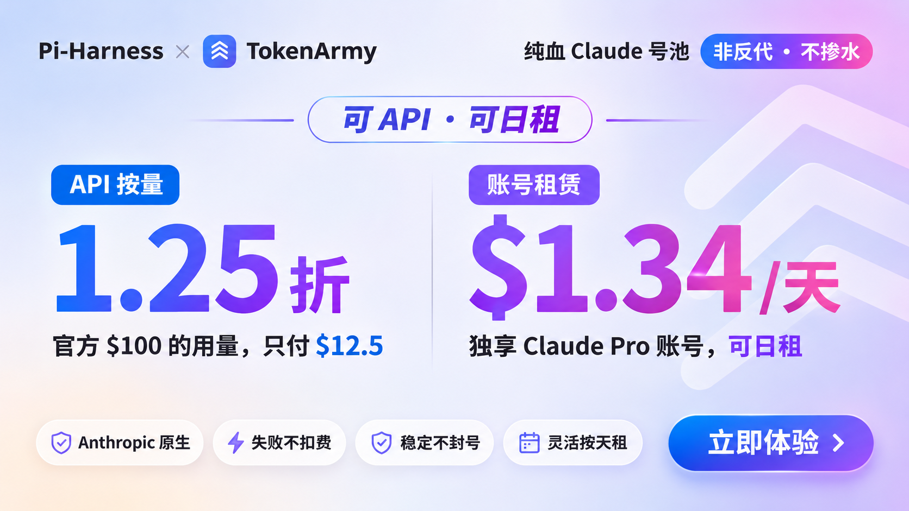
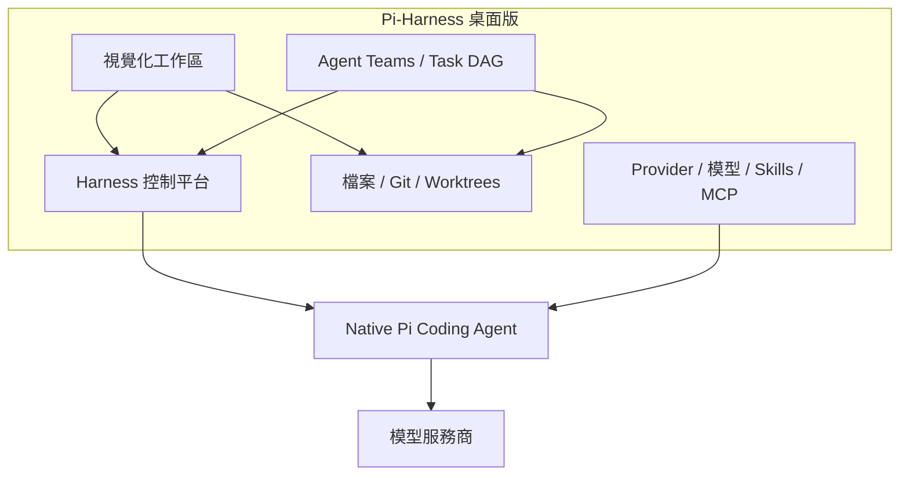

<div align="center">


### Pi Coding Agent 的 Operational Superset

**在一個桌面工作區中觀測、控制並編排 Native Pi 智慧體。**<br>
每個智慧體仍由 Pi 執行。Pi-Harness 在外圍加入工作區、執行記錄、任務復原與智慧體團隊，<br>
你的 Pi 工作階段、設定、Skills 與擴充套件在應用程式內外都能繼續使用。

`Pi Coding Agent ⊂ Pi-Harness`

[](https://github.com/wangmiaozero/pi-harness/releases) [](https://github.com/wangmiaozero/pi-harness/stargazers) [](https://github.com/wangmiaozero/pi-harness/actions/workflows/ci.yml) [](LICENSE)<br>
  

**[下載](https://github.com/wangmiaozero/pi-harness/releases)** &nbsp;·&nbsp; **[實拍](#watch)** &nbsp;·&nbsp; **[功能](#features)** &nbsp;·&nbsp; **[Harness Plugins](#harness-plugins)** &nbsp;·&nbsp; **[文件](#documentation)** &nbsp;·&nbsp; **[更新記錄](CHANGELOG.md)**

[English](README.md) · [简体中文](README.zh-CN.md) · **繁體中文** · [日本語](README.ja-JP.md) · [한국어](README.ko-KR.md) · [Русский](README.ru-RU.md) · [Français](README.fr-FR.md) · [Deutsch](README.de-DE.md)

<br>


</div>

<br>

## 赞助商

<table>
  <tr>
    <td width="580" align="center" valign="middle">
        <a href="https://infistar.cc/register?aff=S26RFM4B&ref_source=link" style="color:transparent;background-color:transparent;text-decoration:none;border:none;"></a>
    </td>
    <td valign="middle">
      Pi-Harness × Infistar.cc 无限星河｜Claude、GPT、Gemini、Grok、DeepSeek 等，一个 Key，只花官方价的零头，省 99%；低至官方 0.1 折，100% 官方纯血，每个模型都能验真；上千线路安全冗余自动切换，200+ 模型、16 个品牌，一个 Key 搞定。<br>
      Pi-Harness 用户通过<a href="https://infistar.cc/register?aff=S26RFM4B&ref_source=link">专属链接</a>注册直接送人民币 5 元：<a href="https://infistar.cc/register?aff=S26RFM4B&ref_source=link">https://infistar.cc/register?aff=S26RFM4B&ref_source=link</a>
    </td>
  </tr>
  <tr>
    <td width="580" align="center" valign="middle">
        <a href="https://tokenarmy.shop/r/TA-7FBJU-NUSUC" style="color:transparent;background-color:transparent;text-decoration:none;border:none;"></a>
    </td>
    <td valign="middle">
      <strong>Pi-Harness × TokenArmy</strong><br>
      <strong>Claude Pro 日租</strong> · 独享账号，低至 $1.34/天，不封号<br>
      <strong>Claude API 按量计费</strong> · 低至官方价格 1.25 折，失败不扣费<br>
      <a href="https://tokenarmy.shop/r/TA-7FBJU-NUSUC">Pi-Harness 用户专属注册链接</a><br>
      <em>价格与服务以 TokenArmy 平台规则为准。</em>
    </td>
  </tr>
  <tr>
    <td width="580" align="center" valign="middle">
        <a href="https://cloud.tencent.com/act/cps/redirect?redirect=6871&amp;cps_key=ece2099a1da90c2f7a4a4c437ad623f8&amp;from=console" style="color:transparent;background-color:transparent;text-decoration:none;border:none;"></a>
    </td>
    <td valign="middle">
      【腾讯云】WorkBuddy 全场景 AI 办公工作台，团队旗舰版低至198元/月<br>
      <a href="https://cloud.tencent.com/act/cps/redirect?redirect=6871&amp;cps_key=ece2099a1da90c2f7a4a4c437ad623f8&amp;from=console">https://cloud.tencent.com/act/cps/redirect?redirect=6871&amp;cps_key=ece2099a1da90c2f7a4a4c437ad623f8&amp;from=console</a>
    </td>
  </tr>
</table>

## Pi-Harness 適合你嗎？

[Pi Coding Agent](https://github.com/earendil-works/pi) 在終端機中就很好用。但在實際專案裡，你很快會需要更多：看清每次執行到底做了什麼、執行出錯時回到正常狀態，以及把較大的工作分給多個智慧體。Pi-Harness 以同一個 Pi 為基礎，把這些都放進一個桌面應用程式：

- **看清每次執行**：Runs、Trace、Replay 與 Evaluation 顯示工具活動、比較執行結果，並依據記錄的證據調查失敗原因。
- **讓工作可以復原**：Policy、Budget、Checkpoints 與 Recovery 設定工具權限與花費上限、保留復原點，並可繼續、分支或重試。
- **協調團隊**：Agent Teams、Task DAG 與 Worktrees 指派有相依關係的任務、在 Pi 智慧體之間傳遞結果，並隔離每個智慧體的修改。
- **保持 Native Pi**：智慧體迴圈、工作階段、上下文、工具、模型與思考都由 Pi 執行。Pi-Harness 以視覺化方式管理它們，你也可以繼續在應用程式之外使用 Pi。

如果你在實際專案中使用 Pi，並希望在一個視窗中查看、引導與協調它的工作，Pi-Harness 就適合你。如果終端機裡的一個對話就足夠，單獨使用 Pi 即可。

支援 macOS、Windows 和 Linux。社群版安裝程式內建 Pi 與 Node.js，不需要事先安裝其他東西。

<a id="watch"></a>

## 實拍

**工作模式。** DeepSeek 進入程式工作區。13 秒。

https://github.com/user-attachments/assets/942b73c9-ece9-485e-ad82-0e51225a73c1

**歡迎回來。** 角色亮起，工作區總覽打開。11 秒。

https://github.com/user-attachments/assets/98708766-f490-4506-a33f-f1376d41770f

<a id="download"></a>
<a id="get-started"></a>

## 快速開始

**1 · 安裝。** 從 **[GitHub Releases](https://github.com/wangmiaozero/pi-harness/releases)** 下載適合你系統的安裝程式：

| | |
| :-- | :-- |
| **macOS** | Apple Silicon（`arm64`）或 Intel（`x64`）的 `.dmg`。開啟後將 Pi-Harness 拖曳到「應用程式」 |
| **Windows** | x64 `.exe` 安裝程式。執行後選擇安裝目錄 |
| **Linux** | x64 `.AppImage`。設定為可執行後開啟 |

```sh
chmod +x "./Pi-Harness-VERSION.AppImage"   # 將 VERSION 換成下載的版本號
./Pi-Harness-VERSION.AppImage
```

<sub>安裝程式內含 Pi、Node.js、npm 與 npx：不需要安裝 Pi 或 Node.js，也不需要複製本儲存庫或安裝 pnpm。發行驗證涵蓋 macOS Apple Silicon、macOS Intel、Windows x64 和 Linux x64，每個版本實際提供哪些平台以該版本的驗證結果為準。Linux 驗證以 Ubuntu 24.04 為目標，其他發行版以及 FUSE 或桌面整合需要自行確認。Windows 與 Linux ARM64 為預覽目標。舊版安裝套件的需求可能不同，請依照所下載版本的說明操作。macOS 組建使用 ad-hoc 簽署，Windows 安裝程式未簽署：請見<a href="#verify-your-download">驗證下載檔案</a>。</sub>

**2 · 檢查環境。** 啟動 Pi-Harness，在總覽頁檢查執行環境。

**3 · 新增 Provider。** 設定 Provider、測試連線並選擇模型。使用模型可能需要憑證，並可能產生服務商費用。

**4 · 開始工作。** 開始獨立對話或開啟專案，再建立或繼續 Pi 工作階段，在同一個視窗中處理對話、檔案與 Git。開啟「**工作區 → 工具 → Harness / 智慧體**」即可檢查執行或協調團隊。

<a id="verify-your-download"></a>

### 驗證下載檔案

社群版免費提供。macOS 安裝套件使用 **ad-hoc 簽署，沒有 Apple Developer ID 簽署或公證**。Windows 安裝程式**未簽署**，可能出現 SmartScreen 警告。允許應用程式開啟前，請確認官方下載來源與校驗值。若 macOS 阻擋首次啟動，請在「**系統設定 → 隱私權與安全性 → 仍要打開**」中為該應用程式放行。請保持系統安全防護開啟。

與安裝程式一起下載 `SHA256SUMS`，計算檔案的雜湊值，並與清單中同名檔案的值比對（將 `VERSION` 與架構換成你下載的檔案）：

```sh
shasum -a 256 "Pi-Harness-VERSION-arm64.dmg"   # macOS
sha256sum "Pi-Harness-VERSION.AppImage"        # Linux
```

```powershell
Get-FileHash ".\Pi-Harness-Setup-VERSION.exe" -Algorithm SHA256   # Windows
```

<sub>SHA256 只能確認檔案與校驗清單一致，無法單獨證明發布者身分。請使用官方 <a href="https://github.com/wangmiaozero/pi-harness/releases">GitHub Releases</a> 頁面，疑似安全漏洞請私下回報至 <a href="mailto:tuziling84@gmail.com">tuziling84@gmail.com</a>。社群版會在應用程式內檢查新版本，並在所有平台開啟 Releases 頁面供手動下載與安裝。在跨版本安裝驗證完成前，自動安裝保持停用，現有安裝維持原本的更新行為。請見<a href="docs/release/community-release.md">社群版發行</a>與<a href="docs/release/update-strategy.md">更新說明</a>。</sub>

<a id="architecture"></a>

## 運作方式

Pi 負責執行與原生工作階段。Harness 觀測每次執行，並在外圍套用策略、預算、檢查點、復原與評估。智慧體團隊使用同一個 Pi 執行引擎。對話歷史與專案架構是工作區工具，主題則用來自訂外觀。下圖表示模組之間的關係，而非類別繼承。



<a id="pi-vs-pi-harness"></a>

<details>
<summary><b>原生 Pi 與 Pi-Harness</b>：逐項能力比較</summary>

<br>

| 能力                     | Native Pi | Pi-Harness        |
| ------------------------ | --------- | ----------------- |
| Agent Runtime            | 支援      | Native Pi         |
| Agent Loop               | 支援      | Native Pi         |
| Sessions                 | 支援      | 支援 + 視覺化管理 |
| Context                  | 支援      | 支援 + 檢查視圖   |
| Compaction               | 支援      | 支援 + 視覺化控制 |
| Steering                 | 支援      | 支援              |
| Follow-up                | 支援      | 支援              |
| Models                   | 支援      | 支援 + 管理器     |
| Thinking                 | 支援      | 支援 + 視覺化控制 |
| Tools                    | 支援      | 支援 + 選擇與策略 |
| Skills                   | 支援      | 支援 + 管理器     |
| Extensions               | 支援      | 支援 + 管理器     |
| Packages                 | 支援      | 支援 + 管理器     |
| MCP / Codemode           | 支援      | 支援 + 選擇與策略 |
| Runs                     | —         | 支援              |
| Trace                    | —         | 支援              |
| Replay                   | —         | 支援              |
| Run Compare              | —         | 支援              |
| Evaluation               | —         | 支援              |
| Policy                   | —         | 支援              |
| Budget                   | —         | 支援              |
| Checkpoints              | —         | 支援              |
| Recovery                 | —         | 支援              |
| Diagnostics              | —         | 支援              |
| Regression               | —         | 支援              |
| Artifacts                | —         | 支援              |
| Multi-Agent              | —         | 支援              |
| Task DAG                 | —         | 支援              |
| Handoff                  | —         | 支援              |
| Review Gates             | —         | 支援              |
| Worktree isolation       | —         | 支援              |
| Project architecture map | —         | 支援              |

</details>

<a id="features"></a>

## 功能介紹

### 工作區、檔案與 Git

可以直接開始獨立對話，也可以開啟專案並繼續 Pi 工作階段。查看串流回覆、思考過程、工具呼叫、圖片與檔案變更；選擇模型、思考等級與工具，或壓縮對話。從工作區「工具」開啟 Harness 或智慧體時，對話與草稿都會保留。

瀏覽與搜尋檔案、預覽媒體和文件，並以語法高亮、行號、尋找、復原/重做、明確儲存和外部變更衝突保護編輯可讀文字。Git 提供差異、提交歷史、活動圖、提交操作、可選的 AI 提交訊息與 worktree。

<table>
<tr>
<td width="50%"><br><sub>輕量檔案編輯</sub></td>
<td width="50%"><br><sub>Git</sub></td>
</tr>
</table>

<a id="harness"></a>

### Harness 控制平台

每次 Pi 執行都會留下可以檢查、比較與復原的記錄。

| | |
| :-- | :-- |
| **觀測** | Runs、Trace、Replay、時間軸與工具活動。比較不同執行，並在 Run Tree 中追蹤分支與重試 |
| **度量** | 每次執行的 Token、費用與耗時，以及產物和專案統計 |
| **控制** | 工具策略與單次執行預算。建立檢查點，再繼續、分支或重試工作 |
| **檢查** | Evaluation、Diagnostics 與回歸基準依據記錄的執行證據檢查結果、調查失敗原因 |

<table>
<tr>
<td width="50%"><br><sub>工作階段狀態與排隊中的指令</sub></td>
<td width="50%"><br><sub>Harness 控制台</sub></td>
</tr>
</table>

<a id="multi-agent"></a>

### 多智慧體編排

開啟「**工作區 → 工具 → 智慧體**」，以可重複使用的團隊與範本協調 Pi 智慧體。為任務指定相依關係與優先順序，以手動、循序或平行方式排程，將結果與產物傳給下一個任務，並加入審核關卡。Worktrees 隔離每個智慧體的修改。預算、衝突提示，以及暫停、繼續、中止、重試、跳過和重新指派等控制項可協助你管理工作。

<table>
<tr>
<td width="50%"><br><sub>執行前的示範團隊：三個智慧體處於閒置狀態，所有任務待處理</sub></td>
<td width="50%"><br><sub>任務相依關係與審核要求</sub></td>
</tr>
</table>

<a id="conversation-history"></a>

### 通用對話歷史

統一瀏覽 Claude Code、Codex（含桌面及封存對話）、Cursor、Cursor Agent、Gemini CLI、OpenCode 和 Pi 的歷史。支援搜尋、依來源、專案或日期範圍篩選，並可新增自訂歷史目錄。

以唯讀方式開啟原始對話、預覽交接內容，並在同一專案下的新 Pi 對話中繼續之前編輯下一步指令。瀏覽、本機預覽與掃描重試不消耗模型 Token；可選的 AI 整理只在你主動要求時使用已設定的模型。

<table>
<tr>
<td width="50%"><br><sub>對話歷史</sub></td>
<td width="50%"><br><sub>對話清理</sub></td>
</tr>
</table>

<a id="project-architecture"></a>

### 專案架構圖

在工作區開啟「專案架構」，瀏覽模組、相依關係、入口檔案與原始碼引用。可依套件篩選、聚焦單一模組、翻頁、縮放或全螢幕。儲存分析快照，在原始碼變更使快照過期時收到提示，並匯出 JSON、離線 HTML 或目前視圖的 PNG。

| | |
| :-- | :-- |
| **本機優先** | 分析在本機執行，不消耗模型 Token；AI 說明為可選功能 |
| **涵蓋範圍** | 在本機分析 JavaScript、TypeScript 和 Vue 的匯入關係；其他支援語言提供檔案層級索引。每次分析都會標示涵蓋範圍與限制 |
| **適用範圍** | 架構圖描述支援的靜態相依關係，並非完整的函式呼叫圖 |


<a id="providers-and-models"></a>
<a id="skills-extensions-packages-and-mcp"></a>

### Provider、模型與 Skills

| | |
| :-- | :-- |
| **Provider** | 透過預設或自訂位址設定 Pi 相容 Provider，管理憑證、在支援時取得模型清單、測試連線並選擇聊天模型 |
| **圖片** | 使用支援的影像模型進行文字生圖或圖片編輯，並下載結果 |
| **Skills** | 瀏覽並編輯內建與本機 Skills。在輸入框鍵入 `@` 即可搜尋並呼叫已安裝的 Skill |
| **套件與擴充套件** | 在能力中心管理 Pi 套件與擴充套件。[Superpowers](https://github.com/obra/superpowers) 等可選增強功能只在你選擇時安裝、更新或解除安裝 |

<table>
<tr>
<td width="50%"><br><sub>Provider 與模型</sub></td>
<td width="50%"><br><sub>能力中心</sub></td>
</tr>
</table>

<a id="mcp-marketplace"></a>

### MCP 伺服器與市場

在「**設定 → MCP**」新增本機命令或 HTTP 伺服器，以「**全部 / 全域 / 專案**」篩選、選擇專案，並在各自的範圍中編輯或啟用每個伺服器。也可以掃描其他工具的設定，審閱後再匯入。

市場提供 **15 個內建伺服器範本**，包括 Memory、Context7、Playwright、Filesystem 與 GitHub，並支援官方 MCP 註冊表的搜尋與分頁。儲存前可預覽設定與目標位置。範本供你安裝使用，並非全部預設啟用。匯入的項目與註冊表項目儲存後為停用狀態，方便你先完成設定。


<a id="agent-settings"></a>

### 智慧體設定

**v2.2.10 及後續版本提供。** 下載的安裝程式是否包含這些功能，請以發行說明為準。

| 頁面 | 可設定的內容 | |
| :-- | :-- | :-- |
| **AI** | 預設思考層級、自動壓縮、重試行為與工作區偏好 | [截圖](docs/%E5%8A%9F%E8%83%BD%E7%95%8C%E9%9D%A2/%E7%BB%8F%E5%85%B8%E4%B8%BB%E9%A2%98/AI.png) |
| **即時語音** | 工作區通話使用的語音服務與帳號 | [截圖](docs/%E5%8A%9F%E8%83%BD%E7%95%8C%E9%9D%A2/%E7%BB%8F%E5%85%B8%E4%B8%BB%E9%A2%98/%E5%AE%9E%E6%97%B6%E8%AF%AD%E9%9F%B3.png) |
| **快捷鍵** | 命令面板、設定、新工作階段與關閉分頁的自訂快捷鍵，或預設值 | [截圖](docs/%E5%8A%9F%E8%83%BD%E7%95%8C%E9%9D%A2/%E7%BB%8F%E5%85%B8%E4%B8%BB%E9%A2%98/%E5%BF%AB%E6%8D%B7%E9%94%AE.png) |
| **指令** | 全域或專案指令 | [截圖](docs/%E5%8A%9F%E8%83%BD%E7%95%8C%E9%9D%A2/%E7%BB%8F%E5%85%B8%E4%B8%BB%E9%A2%98/%E6%8C%87%E4%BB%A4.png) |
| **MCP** | 各範圍的 MCP 伺服器 | [截圖](docs/%E5%8A%9F%E8%83%BD%E7%95%8C%E9%9D%A2/%E7%BB%8F%E5%85%B8%E4%B8%BB%E9%A2%98/MCP%E6%9C%8D%E5%8A%A1%E5%99%A8.png) |
| **子智慧體** | 可重複使用的子智慧體，包含角色、指令、模型、思考層級與工具。選擇共用工作區或獨立 worktree，再啟動任務或在團隊中重複使用範本 | [截圖](docs/%E5%8A%9F%E8%83%BD%E7%95%8C%E9%9D%A2/%E7%BB%8F%E5%85%B8%E4%B8%BB%E9%A2%98/%E5%AD%90%E6%99%BA%E8%83%BD%E4%BD%93.png) |
| **遠端主機** | 執行 pi-host 的主機，以位址與配對權杖配對 | [截圖](docs/%E5%8A%9F%E8%83%BD%E7%95%8C%E9%9D%A2/%E7%BB%8F%E5%85%B8%E4%B8%BB%E9%A2%98/%E8%BF%9C%E7%A8%8B%E4%B8%BB%E6%9C%BA.png) |

<a id="realtime-voice"></a>

### 即時語音

使用 **OpenAI Realtime、Gemini Live 或 Codex Live** 與工作區對話。可使用支援的服務帳號或獨立 API 金鑰；Codex Live 使用你在 Pi 中既有的 Codex 登入帳號。服務可用性與費用取決於你的帳號。

1. 開啟「**設定 → 即時語音**」，啟用語音、選擇服務與帳號並儲存。
2. 在工作區對話中，點選輸入框旁的波形按鈕。
3. 確認目標對話與可選的內容分享，點選「**開始即時語音**」並允許使用麥克風。
4. 透過浮動控制項靜音、查看轉寫或結束通話，切換到其他頁面後仍可操作。

近期內容分享預設關閉。啟用後只包含最近六則純文字訊息，不含附件與工具結果。通話中提出的工作請求須經你確認後才會傳送到工作對話。


<a id="remote-hosts"></a>

### 遠端主機

在「**設定 → 遠端主機**」輸入執行 **pi-host** 的主機位址與配對權杖進行配對。可連線或中斷主機、瀏覽其專案與工作階段、查看對話、傳送提示詞並回應核准請求。遠端主機必須已在執行且可以連線。

<a id="desktop-companion"></a>

### 桌面夥伴

在「**設定 → 桌寵**」啟用已安裝的桌寵，即可在桌面查看思考、工具執行、等待與完成的狀態回饋。桌寵預設關閉，主視窗最小化後仍可顯示。

閒置時，可在支援搜尋的右鍵選單中選擇 193 個動作。任務執行期間會暫停手動互動，拖曳也不會中斷任務動畫。可匯入本機寵物包，並以滑桿調整大小、透明度與氣泡。

<table>
<tr>
<td width="33%"><br><sub>設定與滑桿</sub></td>
<td width="33%"><br><sub>右鍵選單</sub></td>
<td width="33%"><br><sub>可搜尋的動作</sub></td>
</tr>
</table>

<a id="themes-and-custom-skins"></a>
<a id="screenshots"></a>

### 主題與自訂皮膚

選擇經典配色、大明主題、星艦駕駛艙、macOS 27 背景或匯入的自訂皮膚。新安裝預設使用**柔和淺色**。可自訂聊天顯示名稱、應用程式圖示、本機背景圖、視窗與螢幕光暈，以及輸入框火焰效果。啟動動畫會伴隨環境檢查。

人物主題與桌寵是可選的資源包。開啟「**設定 → 資源市場**」，從 GitHub 清單一次安裝一個 `@piharness` 資源包。應用程式不需要網路即可啟動。已經選過的主題或桌寵在檔案尚未安裝時仍會保留，工作區會先使用基礎外觀，直到你安裝該資源包。請見 [docs/market/MARKET.md](docs/market/MARKET.md)。

使用 [Pi-Harness 自訂皮膚範本](https://github.com/wangmiaozero/pi-harness-skin-starter)**製作你自己的皮膚**：

1. 以範本儲存庫建立專案，或直接下載。
2. 以你的編碼智慧體開啟專案，透過內建提示詞描述你想要的風格。
3. 完成後從「**設定 → 主題 → 匯入皮膚**」匯入專案。

多語言範本提供配色、預覽圖、桌布與可選角色圖的製作說明。將皮膚保存在獨立儲存庫中，即可單獨更新與分享。

<table>
<tr>
<td width="50%"><br><sub>大明·雪境朝臣</sub></td>
<td width="50%"><br><sub>大明·雪夜笛姬</sub></td>
</tr>
<tr>
<td width="50%"><br><sub>大明·月城書姬</sub></td>
<td width="50%"><br><sub>星艦駕駛艙</sub></td>
</tr>
<tr>
<td width="50%"><br><sub>大明·一般設定</sub></td>
<td width="50%"><br><sub>大明·主題皮膚庫</sub></td>
</tr>
<tr>
<td colspan="2"><br><sub>macOS 27 · Liquid Ether</sub></td>
</tr>
</table>

<a id="harness-plugins"></a>

### Harness Plugins

**Plugin SDK v1.0.0 · 自 Pi-Harness v2.2.6 起提供。** 外掛擴充的是智慧體外圍的操作，與擴充 Pi 本身的方式並列：

| 擴充方式 | 用途 |
| :-- | :-- |
| **Pi Extensions** | 擴充 Pi 智慧體本身 |
| **Skills** | 為智慧體提供指令與工作流程知識 |
| **MCP** | 將智慧體連接到工具與外部服務 |
| **Harness Plugins** | 擴充 Pi-Harness 在智慧體外圍的操作 |

可提供 **Harness Event Subscribers、Custom Evaluators、Trace Exporters 與 Agent Team Templates**。評估結果僅作補充，匯出使用經授權的 JSON 資料，團隊範本會建立待處理的工作流程，供你檢查後再啟動。可試用維護中的 SDK 範例：[Run Metrics](examples/harness-plugins/run-metrics/plugin.json)、[Quality Evaluator](examples/harness-plugins/quality-evaluator/plugin.json) 與 [Team Template](examples/harness-plugins/team-template/plugin.json)。

在原始碼組建中，開啟「**工作區 → 工具 → Harness → Harness Plugins → 安裝本機外掛**」，選擇外掛資料夾、審閱權限並啟用。安裝過程不會執行任何程式碼。可執行外掛需要明確的原生信任核准：**獨立程序不是安全沙箱；經核准的 Node 程式碼可以存取你的電腦**。不受信任的內容請使用宣告式範本。

[開發與安裝](docs/plugins/getting-started.md) · [架構](docs/plugins/architecture.md) · [SDK API](docs/plugins/api-reference.md) · [安全邊界](docs/plugins/security.md)

### 其他

- **環境檢查**：檢查 Node.js、npm、PATH、Pi Coding Agent 與目前設定；在支援的環境中安裝、更新或修復 Pi，查看診斷並管理設定備份。
- **執行環境**：內建的 Pi 與 Node 執行環境開箱即用，也可在設定中選擇系統或自訂執行環境。
- **應用程式更新**：在應用程式內檢查新版本。
- **八種語言**：English、简体中文、繁體中文、日本語、한국어、Русский、Français 與 Deutsch。

<a id="documentation"></a>

## 文件

| | |
| :-- | :-- |
| **[智慧體設定指南](docs/agent-settings.md)** | AI、即時語音、快捷鍵、指令、MCP、子智慧體與遠端主機 |
| **[資源市場](docs/market/MARKET.md)** | 安裝主題與桌寵資源包 |
| **[Harness Plugins](docs/plugins/getting-started.md)** | 開發與安裝外掛；另請見[架構](docs/plugins/architecture.md)、[SDK API](docs/plugins/api-reference.md) 與[安全邊界](docs/plugins/security.md) |
| **[社群版發行](docs/release/community-release.md)** | 社群版如何簽署、驗證與[更新](docs/release/update-strategy.md) |
| **[疑難排解](docs/release/troubleshooting.md)** | 校驗值、安全警告、啟動與更新問題 |
| **[截圖索引](docs/README.md)** | 依分類列出所有介面與主題 |
| **[更新記錄](CHANGELOG.md)** | 各版本的變更 |

## 開發

安裝 **Node.js 24 LTS (≥ 24.22.1)** 與 **pnpm 9.12.1**，然後執行：

```sh
git clone https://github.com/wangmiaozero/pi-harness.git
cd pi-harness
pnpm install --frozen-lockfile
pnpm dev
```

<sub>若不想另外安裝 Pi 進行開發，可使用 <a href="fixtures/README.md">fixtures</a> 中的範例設定：在「設定」中將手動設定目錄指向 <code>fixtures/mock-pi</code> 的絕對路徑。範例設定不提供實際的模型存取；需要時請設定你自己的 Provider。</sub>

送出變更前請執行檢查。若變更涉及主要桌面流程，也請執行 `pnpm test:e2e`。

```sh
pnpm typecheck
pnpm lint
pnpm test
pnpm compile
```

## 社群

- **[Issues](https://github.com/wangmiaozero/pi-harness/issues)**：回報問題或提出改進建議。請附上應用程式版本、作業系統與重現步驟，並移除憑證與私人對話內容。
- **[Pull requests](https://github.com/wangmiaozero/pi-harness/pulls)**：說明問題、使用者可見的變更與你的驗證結果。歡迎文件、翻譯、主題與聚焦的修正。
- **[自訂皮膚](https://github.com/wangmiaozero/pi-harness-skin-starter)**：製作並分享你的皮膚。
- **QQ 群**：pi-harness · **1109717308**。掃描 QR 碼加入。

<p align="center">
  
</p>

如果 Pi-Harness 讓你使用 Pi 更順手，**給一顆 ⭐ 能幫助更多人找到它。**

<picture>
  <source media="(prefers-color-scheme: dark)" srcset="https://api.star-history.com/svg?repos=wangmiaozero/pi-harness&type=Date&theme=dark">
  
</picture>

## 致謝

Pi-Harness 圍繞官方 [Pi Coding Agent 與 Pi Agent Harness](https://github.com/earendil-works/pi) 建立。由 [wangmiao](https://github.com/wangmiaozero) 建立並維護 · [tuziling84@gmail.com](mailto:tuziling84@gmail.com)。

**PR 貢獻者**

<table>
  <tr>
    <td align="center">
      <br /><a href="https://github.com/HenryArch"><b>HenryArch</b></a><br />
      <a href="https://github.com/wangmiaozero/pi-harness/pull/8">PR #8</a>
    </td>
  </tr>
</table>

歡迎大家提交 PR，一起完善 Pi-Harness。感謝每一位貢獻者讓專案變得更好！

## 授權條款

[GNU Affero General Public License v3.0 only](LICENSE)（`AGPL-3.0-only`）。

Copyright © 2026 [wangmiao](https://github.com/wangmiaozero).
