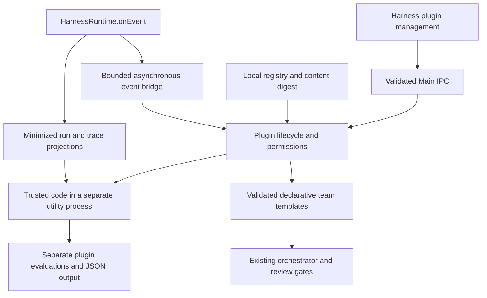

# Harness Plugin architecture

Harness Plugins extend Pi-Harness operations. They are separate from Pi Extensions (native runtime extensions), Skills (instructions/resources), and MCP servers (tools). Native Pi remains the only Agent Runtime. Plugins do not get an Agent Loop, a model client, a Pi configuration writer, or a second scheduler.

The process boundary isolates normal plugin exceptions, hangs, and exits. It is **not a security sandbox**. See [security](security.md) before enabling code.

## Modules

- `packages/harness-plugin-sdk/`: independent, versioned public TypeScript contract and a build-free ESM `definePlugin` identity helper. The exported manifest schema is also the host’s schema. No Pi SDK or Electron imports. No workspace/package-manager migration is needed.
- `src/shared/harness-plugins/`: strict schemas and management DTOs. Supported event literals are checked against the real Harness event union.
- `src/main/harness/plugins/plugin-registry.ts`: discovery/validation, bounded local file reads, duplicate detection, managed copies, content digests, grants and removal.
- `plugin-host.ts`: lifecycle coordination, event bridge, minimized capability inputs, evaluator results and team materialization.
- `process-host.ts`: bounded request/reply protocol, deadlines, termination and failure isolation.
- `plugin-worker.ts`: separate process entry, SDK registration, subscriptions, disposal and callback dispatch. Never imported into Main or Renderer.
- `electron-process.ts`: Electron utility-process transport. No ambient credential environment is forwarded.
- `src/main/ipc/register-harness-plugins.ts`: native pickers and approval dialog behind the existing trusted-main-frame IPC gate.
- `HarnessPluginsPanel.vue`: management inside Harness, using existing theme tokens and eight locale dictionaries. No sidebar redesign or third-party renderer code.

## Data flow

The bridge subscribes to `HarnessRuntime.onEvent()` only while an active plugin declares events. The synchronous listener validates/project scalars and appends bounded queue entries. `setImmediate` starts asynchronous delivery; no plugin callback runs on the Agent execution stack. Each plugin has its own process and queue. An event callback exception, invalid protocol reply, timeout, or exit marks the plugin failed, detaches its registrations, and disables it durably. Manual evaluator/exporter errors fail the requested operation; an otherwise healthy plugin remains active. Other plugins and Pi execution continue.

A custom evaluator is explicitly invoked against a settled run from the management panel. Its score is supplementary: it cannot alter the core run, built-in evaluation, policy decisions or review verdict. Results are stored separately from native Pi and core Harness data, with at most 200 rows and a one-MiB serialized retention cap.

Exporters receive only authorized, minimized trace spans. The host owns the native save picker and JSON file write. Team contributions create a **pending** orchestration through existing services, in dependency order; users inspect/start it in Agents. Applying a template never dispatches a task automatically.

## Lifecycle

1. **Discover**: a user chooses a local directory; only `plugin.json` and its optional single `.mjs` entry are inspected.
2. **Validate**: strict schema, identifiers, SemVer/API compatibility, contribution permissions, graph validity, regular files and content digest.
3. **Install**: make a managed local copy; initial state is disabled. Installation executes no code.
4. **Enable**: check compatibility and unchanged content. Ask for native permission approval and, for code, explicit unrestricted-code trust.
5. **Activate**: launch/register in the separate process; publish contributions only after a valid handshake. Declarative templates require no code process.
6. **Deactivate**: detach the bridge/queue; attempt bounded disposal and then terminate the process.
7. **Disable**: persist disabled state. Existing digest-scoped approvals are retained for the same bytes.
8. **Uninstall**: disable, remove files, grants and supplementary results. A reinstall needs new approval.

Startup restores enabled plugins only if their digest, compatibility and approvals still match. No network discovery, updates, remote store, account login, hot replacement, native add-on loading API, or automatic restart after failures is provided.
